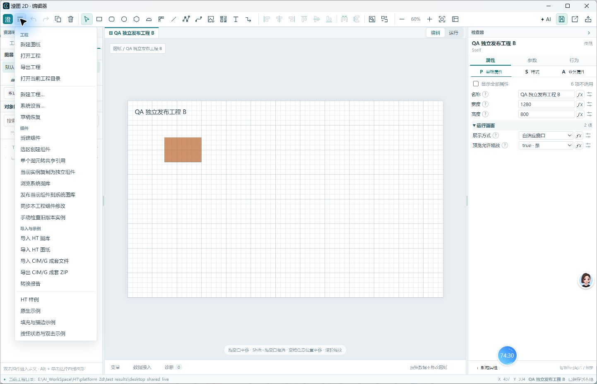
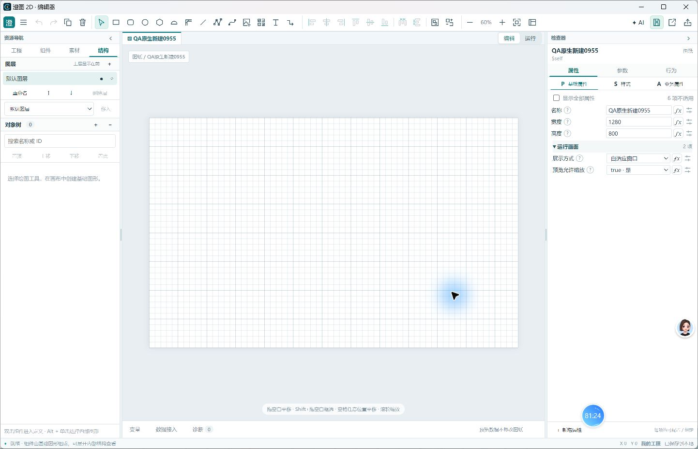

# 01 安装与第一张图纸

[返回总目录](00-阅读指南与总目录.md)

本章使用一个练习工程。完成后，独立运行窗口会显示一块矩形和一行标题，关闭运行窗口后仍可回到编辑器修改。

## 安装并启动编辑器

1. 在 Windows 上打开从下载中心或项目交付方获得的澄图 x64 安装程序。安装程序会申请管理员权限，请按所在单位的安装流程操作。
2. 在安装目录页面保留默认路径 `C:\Program Files\Doenergy\澄图2D`，或选择有安装权限的位置。升级时如果预填了现有安装目录，可沿用该路径。
3. 安装完成后，从桌面或开始菜单启动「澄图 2D 编辑器」。同处的「澄图 2D 运行环境」用于单独打开已保存的工程。

| 安装界面 | 内容和用途 |
| --- | --- |
| 安装目录 | 澄图程序与资源所在文件夹。练习工程的存放位置在下一步单独选择。 |
| 安装进度 | 显示安装过程和结果。等待安装完成后关闭安装程序。 |

## 新建练习工程

点击顶部左侧「主菜单」，在「工程」区选择「新建工程…」。已有工程有修改时，先用顶部的「保存工程」保存。

| 新建工程字段 | 怎么填 |
| --- | --- |
| 工程名称 | 填写便于识别的名称，例如「设备状态练习」。系统会以该名称创建工程文件夹，界面初始填入「新工程」。 |
| 工程存放位置 | 必填。选择一个可以写入的上级文件夹，例如个人文档中的「澄图练习」文件夹。点击「选择…」可浏览目录。系统会在此创建同名工程文件夹，遇到已有同名目录时，改用其他名称或位置。 |

点击「确定」。打开空白图纸后，顶部出现图纸标签。需要查看工程文件时，使用「主菜单 → 打开当前工程目录」。已有工程可用「打开工程」选择 `.ctproj` 文件。

图 01-1。打开左上角主菜单，可新建、打开或保存工程。

图 01-2。新建工程后，中央显示空白画布，右侧显示图纸属性。

## 画一个矩形和一行文字

1. 将鼠标移到顶部图标查看提示，点击「矩形」，在白色画布中拖出一个方框。
2. 切换「选择」，单击矩形。到右侧「属性 → S 样式」查看填充设置，选择一个便于辨认的颜色。
3. 点击顶部「文字」，在矩形上方放置文字对象。在右侧「属性 → P 基础属性」找到文字内容，改为「设备状态」。若属性区未出现，先点击「视图与面板 → 检查器」。
4. 点击顶部软盘图标「保存工程」，确认底部显示已保存。

## 在独立窗口核对

点击顶部靠右的「运行环境预览 ↗」。桌面版会先保存工程，再打开或激活同一安装目录的运行环境。看到自己的矩形和文字后，关闭运行窗口，回到编辑器。若运行窗口显示的是同一工程的另一张图纸，先在运行环境选择练习图纸。希望以后默认打开它时，在编辑器工程树中将它设为默认入口并保存。

图 01-3。独立运行窗口中可查看图纸并操作已配置的交互。

接下来可阅读[认识编辑器](02-认识编辑器.md)，了解对象树、属性区和调试区的位置。
