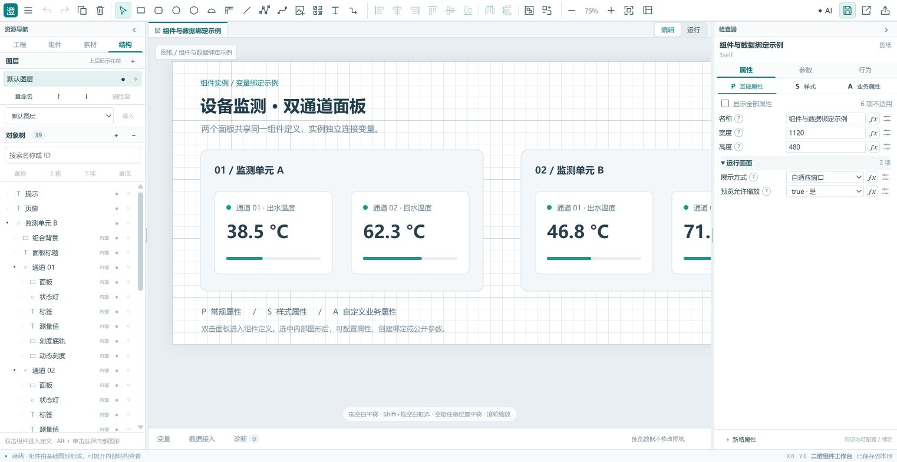
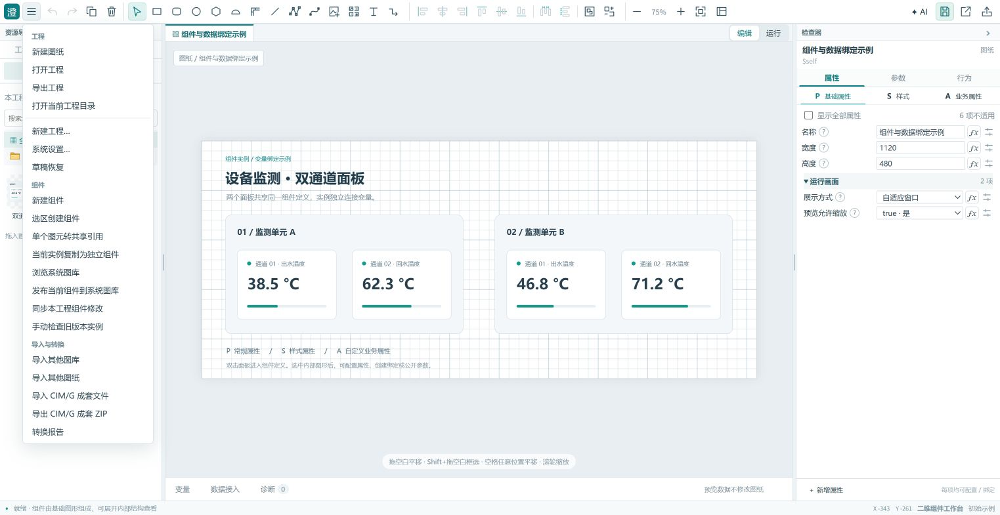

# 02 认识编辑器

[返回总目录](00-阅读指南与总目录.md)

打开图纸后，可从顶部选择操作，在中间画图，通过左侧定位对象，再到右侧修改所选内容。大多数图标可以悬停查看名称。

图 02-1。顶部是工具栏，左侧是资源导航，中间是画布，右侧是检查器，底部是调试区和状态栏。

| 界面位置 | 用途 |
| --- | --- |
| 顶部左侧「主菜单」 | 新建或打开工程、导出、定位工程目录、打开设置、恢复草稿，以及组件和导入相关命令。 |
| 顶部绘图与排版工具 | 选择、绘制、导入图片、插入高级组件、连线和调整排列。窄窗口可在「排版工具」中查找被收起的按钮。 |
| 顶部右侧 | 「AI 助手」「保存工程」「独立预览」「发布与导出」。 |
| 左侧「资源导航」 | 「工程」切换工程内图纸和相关资料，「组件」查找和插入组件，「素材」管理图片等资源，「结构」查看图层和对象树。 |
| 中间画布 | 在图纸标签下绘制或选择对象。上方「编辑 / 运行」切换编辑状态和当前窗口内预览状态。 |
| 右侧「检查器」 | 查看所选对象名称和路径，在「属性」「参数」「行为」之间切换。 |
| 底部「调试」 | 「变量」看当前值与质量并使用模拟数据，「数据接入」配置和查看连接状态，「诊断」定位异常。 |
| 最底部状态栏 | 查看当前状态、工程名称、保存提示和指针坐标。 |

## 在画布上导航

拖动画布空白处可平移，按住空格可从画布任意位置拖动平移。按住 Shift 从空白处拖动可框选，滚轮可缩放。「适应画布」把画面缩放到当前可见区域。缩放数值表示当前视图比例。图纸自身尺寸可在检查器里查看。

「视图与面板」中的「网格」用于显示对照线，「吸附参考线」用于操作时对齐。视图缩放和网格设置不改变图纸宽高。点「专注画布」临时收起面板，按 Esc 或点击「退出专注」恢复。面板缺失时，在「视图与面板」重新打开；布局混乱可用「重置布局」。拖动面板分隔线可调整尺寸，双击恢复默认尺寸。

## 查找对象和编辑属性

左侧切到「结构」，在对象树的「搜索名称或 ID」输入对象名的一部分，或输入对象 ID。搜索框为空时可浏览完整对象树。点树中的对象后，检查器切换到该对象。画布与树中选中的是同一对象；先看右侧标题和路径，再改值。

| 检查器入口 | 常用内容 |
| --- | --- |
| 属性 → P 基础属性 | 名称、位置、宽高、图形内容等。显示项随选中类型变化。 |
| 属性 → S 样式 | 填充、描边、透明度、文字样式等。 |
| 属性 → A 业务属性 | 给对象增加项目自用的字段，例如设备编号。 |
| 参数 | 查看组件公开的参数，或在编辑组件定义时管理哪些属性对外开放。 |
| 行为 | 根据对象类型提供脚本事件、运行日志、控件或图表配置、连接端口、运行交互、宿主跟随和路径编辑等入口。 |

选中单个图元后，从「行为 → 运行交互」统一配置悬停、按下、禁用样式以及单击和双击动作。普通外观仍在「S 样式」修改。状态外观可沿用普通样式，也可直接覆盖颜色、透明度、描边和渐变等设置。已有绑定旁会显示「ƒx」，需要为样式或动作的其它字段新增变量、引用或规则时，可勾选「显示高级绑定」。

在「编辑」状态单击画布空白处，检查器会显示图纸属性。在 P 基础属性中可调整下列设置，改完后可用上一章的独立预览步骤核对。

| 字段 | 用途与填写方法 |
| --- | --- |
| 名称 | 输入一段文字，用于识别图纸，例如「设备状态」。 |
| 宽度、高度 | 输入图纸的设计宽高，单位为像素。图 01-2 中的空白图纸为 1280 × 800。 |
| 展示方式 | 默认为「自适应窗口」，等比缩放以适应可用空间。「原图尺寸」按设计尺寸显示。「拉伸充满窗口」让画面填满窗口，宽高比不同时形状会随之拉伸。 |
| 预览允许缩放 | 默认为「是」，开启后可在预览中用滚轮缩放；非自适应时可拖动空白画布。 |

点击底部「变量」可查看预览值。临时试值用于观察运行效果；需要保留为下次预览的初值时，点击「保存预览初值」，再点击顶部「保存工程」写入工程。

## 导入与转换菜单

「导入其他图库」把独立图标加入系统图库；「导入其他图纸」可把图纸和引用的图标、图片一起转换为本工程资源。两者的文件和路径填写方法见[素材、组件与图库](06-素材组件与图库.md)。需要处理电力成套文件时使用独立的 CIM/G 导入、导出入口。主菜单不再列出四个内置案例入口。
