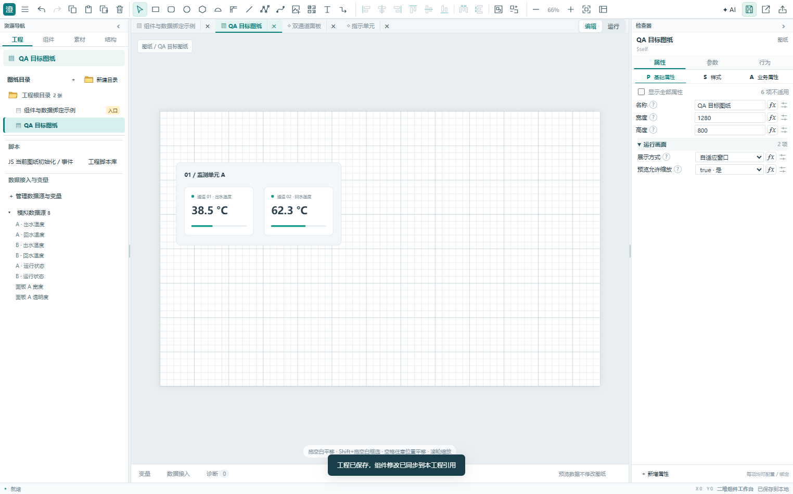
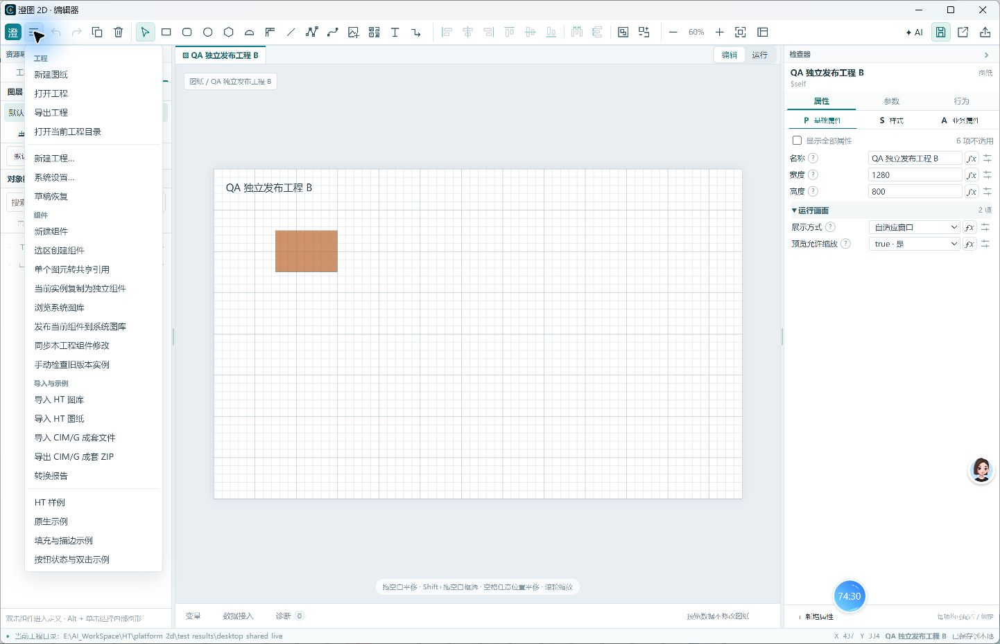

# 03 工程与图纸管理

[返回总目录](00-阅读指南与总目录.md)

工程默认支持多张图纸。只有一张图纸时，也可直接新增图纸。以前保存为单图纸格式的工程，打开后可按同样的方式编辑，点击「保存工程」时才保存为多图纸格式，并保留原格式备份。

图纸各有自己的画布，并共用工程的组件、素材和变量。左侧「工程」中的青色高亮标记当前正在编辑的图纸，黄色「入口」标签标记工程默认打开的图纸。两种标记可以出现在同一行，也可以分开。

## 同时打开图纸和组件

单击左侧图纸目录中的图纸，或双击工程图库中的组件，可将它加入画布上方的标签栏。可以打开多个图纸和组件，点击标签切换当前画布。点标签右侧的「×」关闭该标签，工程中的图纸和组件仍可再次打开。标签列表和每张画布的缩放、平移在本次编辑会话中保留。

## 在画布之间复制图元

1. 在源画布选中一个或多个顶层图元，也可选中整个组。要复制组件内部图元，先进入组件定义。
2. 按 `Ctrl+C` 或点工具栏的「复制到剪贴板」。打开目标图纸或组件的标签，再按 `Ctrl+V` 或点「粘贴」。
3. 图元按原画布坐标粘贴到目标图层，可继续拖动调整。一次撤销可撤回整次粘贴。

同一工程中的组件版本、素材和变量绑定会继续复用。两个端点都在选区内的顶层连线会一并复制。如果粘贴提示依赖原画布对象，请一并复制所需对象，或先解除该引用。要在原画布直接复制一份，可用 `Ctrl+D`。

图 03-1。主菜单上部集中放置工程命令。

| 操作入口 | 字段与结果 |
| --- | --- |
| 主菜单 → 新建图纸 | 「图纸名称」默认「新图纸」，输入读者能辨认的名称。「所在目录」选工程树中的目录，留在根目录时不归入任何子目录。 |
| 工程 → 新建目录 | 「目录名称」默认「新目录」。「上级目录」决定新目录在工程树的位置。 |
| 图纸右键 → 重命名 | 「图纸名称」初始为当前名称，修改后更新标签和目录中的显示。 |
| 图纸右键 → 移动 | 「所在目录」初始为当前位置，选择目标后移动。 |
| 图纸右键 → 复制 | 「新图纸名称」默认为原名加「副本」。「所在目录」默认为原图目录。确认后打开新副本。 |
| 图纸右键 → 删除 | 先查看引用情况。已有其他页面跳转到这张图纸时，先解除相应引用。删除当前默认入口时，需选「替代默认入口」。 |
| 管理图纸目录 | 「操作」选重命名／移动或删除空目录。前者填写「目录名称」和「上级目录」。目录中仍有图纸或子目录时，先整理其内容。 |

在工程树里为一张图纸设置默认入口，可控制平时打开工程时优先显示的画面。编辑完成后点击「保存工程」。要在本机找到当前文件，可选择「打开当前工程目录」。

## 在桌面版使用目录工程

桌面版新建工程时会创建一个工程文件夹。双击文件夹里的同名 `.ctproj` 打开工程。图纸、组件、素材、数据和脚本分别保存在其子目录中。移动、复制或备份工程时，需要带上整个文件夹。

要迁移已打开的旧工程，选择「工程 → 另存为目录工程」。填写「工程名称」并选择「工程存放位置」，确认后会在该位置创建同名文件夹，写入当前编辑内容并打开新工程。旧工程文件会保留。

需要交付一个可供编辑的单文件时，可使用「工程 → 导出便携工程」。部署运行环境则使用发布菜单的导出命令，按目标环境选择桌面运行程序或 Web 工程。连接地址等本机配置在目标电脑上单独设置。

目录工程保存时只写入发生变化的资源，待资源写完后才更新工程入口。若提示工程已被其他窗口修改，先使用「导出便携工程」备份当前编辑内容，再重新打开工程查看最新版本。

## 查看工程组件文件

打开工程目录后，可在 `components` 下找到组件当前版和 `index.json`。索引记录组件名称、分类、目前采用的修订及对应文件。组件有历史版时，历史文件放在该组件同名子目录下。

保存后，编辑器会在后台给当前版和历史版生成同名 PNG，便于在文件管理器中查看。关闭编辑器或切换到运行模式前，如果还没生成完，下次回到编辑模式保存即可补齐。手工放入的同名 PNG 或手工修改过的 PNG 会保留。无法生成预览时仍可正常打开和使用工程。

要修改图纸引用的组件，请从编辑器打开组件定义并保存。目录中可浏览的组件文件是工程保存时生成的副本。若在外部修改了副本，下一次生成时会保留本地文件并提示，工程继续使用已保存的组件定义。

用 0.9.114 保存旧目录工程时，工程入口会升级并保留上一提交。需要把工程交给旧版编辑器时，请使用「导出便携工程」。

## 预览组件历史清理范围

打开已保存的目录工程，选择「工程 → 组件历史清理预览」。窗口会显示当前登记的组件修订数、已核对的恢复点数，以及未被磁盘索引引用且可以核验的文件和大小。即使图纸没有使用某个旧版本，只要它仍在当前组件索引或历史恢复点中，就会保留。

这个窗口只做检查，没有删除操作。编辑器里的未保存草稿、撤销记录和工程目录外的备份不在核对范围内，请不要按预览结果手工删除工程文件。
