# 04 绘图、连线与对象编辑

[返回总目录](00-阅读指南与总目录.md)

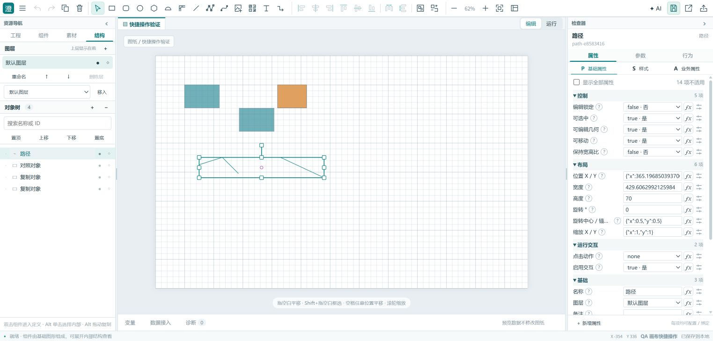

图 04-1。画布中选中了由两段折线组成的路径，左侧对象树只显示一条路径。

| 想绘制的内容 | 怎么操作 |
| --- | --- |
| 矩形、圆角矩形、椭圆 | 选对应工具，在画布中拖出轮廓。返回「选择」后可调整位置与宽高。 |
| 正多边形、圆弧、线段 | 先选工具并在画布中绘制，再在检查器微调几何参数。 |
| 折线 | 用「路径」连续单击各转折点。按 Esc 断开当前段，下次单击开启另一段。双击或 Enter 结束整个路径。 |
| 立体管道、钢笔曲线 | 选择相应工具绘制。路径形状完成后，可以通过「节点 / 曲线」进一步编辑。 |
| 文字、图片 | 用「文字」放置文字对象。用「导入图片」选择文件并插入画布。 |
| 连接两个对象 | 选「连线」，把鼠标移到起点图元上，待端口圆点出现后开始拖线。移到目标图元时显示它的端口，靠近目标端口后松开完成。 |

双击路径进入节点编辑，拖动节点改变轮廓。双击图形外部、按 Enter 或点「完成」提交。按 Esc 可取消这次节点编辑。

切回「选择」后，单击一个对象或按 Shift 拖空白处框选多个对象。按 Ctrl+D 复制，或按住 Alt 拖动以直接确定副本位置。多个对象选中后，顶部排版工具可组合、对齐和分布。对象树可调整同一图层内的前后次序；不同图层的遮挡次序由左侧图层顺序决定。

插入的组件在对象树里显示为一行，左侧缩略图用于快速辨认。单击选中整件组件，可移动、缩放或调整公开参数。双击画布里的组件或对象树中的组件名称，即可在独立标签里编辑定义。返回图纸或保存工程时，组件修改会同步到本工程里的引用。普通组合仍可展开，其中显式跟随组件的图元也可在对象树中查看。

对象树每行右侧的眼睛和锁分别控制显示与锁定。带斜线的眼睛表示图元已隐藏，闭合的锁表示图元已锁定。图层或组合也可能让图元随之隐藏或锁定，可将鼠标移到图标上查看提示。

组合的「P 基础属性 → 控制」提供可选中、可编辑几何和可移动开关。关闭组合的「可选中」后，可直接在画布点击组内可选图元，也可以从对象树选回组合修改开关。鼠标悬停在可选图元上会显示细点虚线，选择宿主时使用同样的线型。

在「选择」工具下，方向键每次微移 1 个图纸单位，按住 Shift 每次微移 10 个单位，可用撤销恢复。锁定、位置绑定和可移动设置仍生效。按 Ctrl+A（macOS 上为 Cmd+A）选择当前图纸或组件中可见、可选且未锁定的内容。全选会切回选择工具并放弃尚未提交的绘图草稿。正在拖动、连接端口或编辑路径节点时，先结束当前操作。在输入框中，Ctrl+A 和 Cmd+A 仍全选文字。

全选和多选后，画布中每个选中的图形都会显示轮廓，即使整个选区超出当前视口。单击已选图形可只保留这一个，按住 Ctrl、Cmd 或 Shift 单击可切换该图形的选中状态。单击空白处可清除选区。拖动选区中的可移动图形会移动选区内所有可移动的图形，位置绑定和不可移动设置继续生效。缩放或旋转整个选区时，每个参与变换的图形都必须允许该操作。

| 快捷键 | 操作 |
| --- | --- |
| Ctrl+A / Cmd+A | 全选当前画布 |
| Ctrl+X、C、V / Cmd+X、C、V | 剪切、复制、粘贴图元 |
| Ctrl+D / Cmd+D | 在当前画布复制一份 |
| Ctrl+G / Cmd+G | 组合选区 |
| Ctrl+Shift+G / Cmd+Shift+G | 取消组合 |
| Ctrl+Z、Ctrl+Shift+Z / Cmd+Z、Cmd+Shift+Z | 撤销、重做，也可用 Ctrl+Y 重做 |
| Ctrl+S / Cmd+S | 保存工程 |
| Delete 或 Backspace | 删除选中图元 |
| F，+ 或 =，− | 适应画布、放大、缩小 |
| V、R、Shift+R、O、L、T、B | 选择、矩形、圆角矩形、椭圆、线段、文字、曲线 |
| P、Shift+P、E | 折线、管道、连线 |

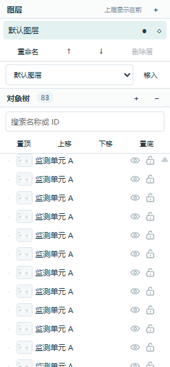

拖动失败时，依次检查图层或对象锁定、位置绑定、布局和宿主跟随配置。完成一组操作后可用顶部撤销、重做检查结果，再保存工程。

配置「宿主跟随」后，拖动宿主会带动附属对象。单独拖动位置可编辑的附属对象，会调整它相对宿主的偏移。宿主和其他附属对象的位置保持原样。如果该对象也是其他对象的宿主，它自己的附属对象会继续跟随。

附属对象也可以参加多选对齐和等距分布。选区同时包含宿主和附属图元时，两者会分别到达各自的排版位置，之后仍可跟随移动。选区中有对象被锁定或坐标由绑定控制时，请先处理锁定或绑定，再排版。

1. 在画布或对象树中选中要跟随的图元。也可以按住 Ctrl 在对象树中加选，给多个图元设置同一个宿主。
2. 在右侧「P 基础属性」找到「宿主对象」。直接按住靶心拖到画布，也可以单击一次靶心后再单击宿主。当前可选宿主会显示名称和虚线外框。松开鼠标确认，按 Esc 取消拾取。
3. 「宿主对象」输入框会显示宿主名称，「对象结构」中附属图元会缩进显示在宿主下方，行首带有 ↳。可展开宿主查看，或直接搜索附属图元名称。
4. 单击「⋯」可从列表选择宿主，或选「不跟随」解除关系。只选一个附属图元时，这里还可以配置水平、垂直与旋转跟随规则。

宿主和附属图元需位于同一级画布或同一组合中，组件内部图元在组件定义中配置。批量设置可一次撤销。对象树的缩进表示跟随关系，图层和绘制顺序沿用工程设置。

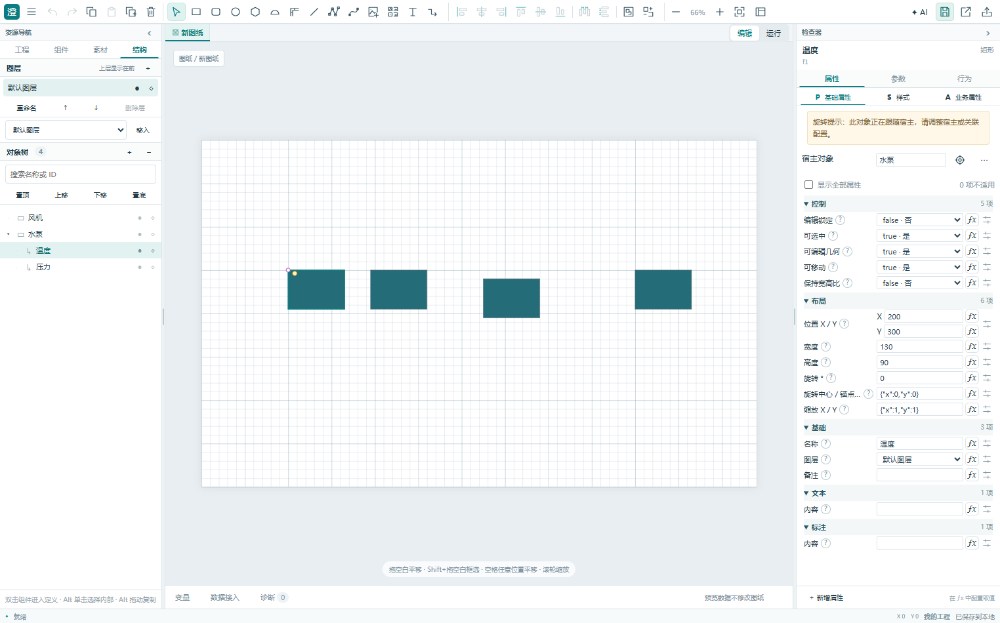

### 坐标与样式

- 选中单个图元，在右侧「P 基础」中分别输入位置 X、Y。点某一轴旁的「ƒx」，可设固定值、绑定数字变量、引用数字属性（包括其它图元的 X、Y），或用规则计算。绑定时填写数据异常时的回退坐标；修改这一轴保留另一轴的设置。已有整组坐标绑定时，通过「ƒx」编辑整组规则。
- 选中文字图元，在「S 样式」展开「文字样式」，设置字体、字号、字重、斜体、对齐和行高。文字内容和文字颜色可分别配置绑定。阴影与描边细节也可通过各自的分组调整。
- 点击「字体」右侧的当前字体名称打开选择对话框。可搜索常用字体、用当前文字预览，再点「确定」。环境支持时可读取系统字体；也可以直接输入已有字体名称或逗号分隔的候选列表。通过变量绑定的字体请用「ƒx」维护。
- 在填充、描边或前景区域打开「图形化配置渐变、方向与色标」，在同一面板调整方向、颜色、渐变坐标和径向半径。需要查看已有的细项绑定时，勾选「显示全部属性」并展开「高级字段及兼容绑定」。

## 母线吸附与连接点滑动（0.9.69 起）

1. 在图纸中画一个细长矩形，按需要调整为水平或垂直长条。右键单击它，选择「设为水平母线」或「设为垂直母线」。标记不会改变矩形尺寸，也不会自动确认电气接线。
2. 切换到「连线」工具，从设备端口拖向母线中间的任意位置，也可以从母线拖向设备端口。接近母线中心线后松开，落点会成为有稳定 ID 的连接端口，与连线一起保存。
3. 回到「选择」工具，选中连线，拖动母线一端的端点手柄，在母线中心线附近松开。只有这条线使用的连接点会沿母线滑动，连线 ID、端口 ID 和数据绑定保持；本工具生成的正交折点会同步调整。
4. 若这个端口还被其他连线共享，本次只给当前连线建立新落点，其他支路保持。不要用一次端点拖动来批量移动所有支路。
5. 用撤销、重做核对，再保存并重新打开工程。要恢复普通图形，可右键选择「取消母线标记（保留连接点）」，现有连线不会因此断开。

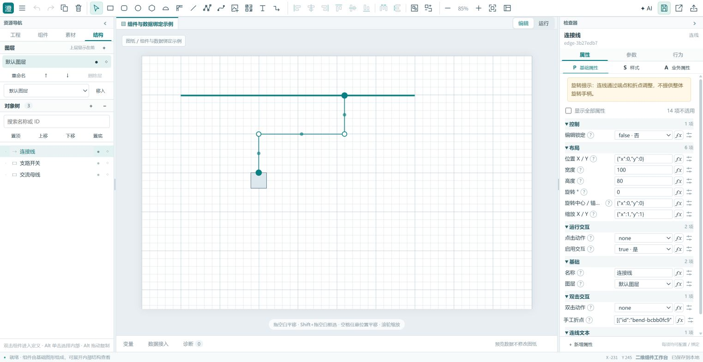

吸附范围为屏幕上的 8 像素，不随画布放大而扩大。已有可见端口优先吸附；没有命中端口时才沿已标记母线查找落点。按 Esc 取消未完成的绘制，不会留下临时端口或半条连线。

0.9.83 起，旋转或缩放后的矩形母线也能沿中心线吸附。设置水平或垂直时，以矩形自身的长边为准；例如先画水平长条再旋转，仍选择「设为水平母线」。斜向母线的支线沿最接近母线垂线的水平或竖直方向出线，后续线段仍保持横平竖直。若自动折线路径不合适，可在连线设置中手动调整。

要在组件中使用母线，先进入组件定义，再右键其中的矩形设置母线并连接组件内部设备。需要更新已放置的实例时，请发布组件新版本，并将目标实例切换到新版本。锁定和端口坐标绑定仍受保护；已有端口时请先整理连接，再改变母线方向。

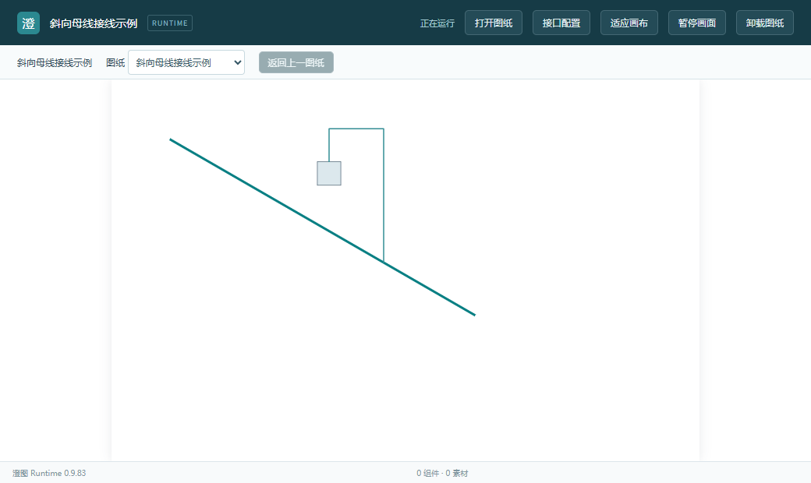

连线折点被手工改过或绑定后，工具不会擅自重写。请先核对并在连线设置中清空不再需要的手工折点，再尝试滑动。每条母线最多保留 64 个自定义连接点，可在端口管理中整理不再使用的点。

新生成的一次图母线已带标记，旧工程不会自动改写，可按上述方法手动标记。本功能处理绘图连接，不计算潮流或带电范围。双端设备插入拆线与移出合线见下一节，顶层连线的跨越弧适用范围见本章「交叉跨越弧」。

## 双端设备插入拆线与移出合线（0.9.70 起）

将开关等双端设备加入已有接线时，可以把原线拆成接到设备两端的两段线；需要移出设备时，可以恢复原线。

0.9.71 起可优先使用本章末尾的直接拖放和“＋”引线；下面保留手动选择两个端口的方法，适合需要明确指定端口的对象。

1. 在图纸中放置一个尚未接线的设备。设备可以是基础图形或组件实例，须有两个不同的可见端口。
2. 将设备的端口方向调整为与目标线段一致。例如竖向接线使用上、下端口，横向接线使用左、右端口。工具只移动设备，不自动旋转设备。
3. 在对象树中选中设备，按住 Shift 再选中一条连线。右键单击其中一个已选对象，选择「插入设备并拆线…」。
4. 在「设备端口一」「设备端口二」中选择两端端口。下拉列表显示端口名称和稳定 ID；不表示电力方向或带电判断。确认后，设备对齐到最近的平行线段；线段长度须足以容纳两端口，并在两侧留有间距。
5. 原线 ID 留在靠近原起点的一段，另一段显示为「原线名称 · 续线」。颜色等样式绑定保留，原线外端的标记保留，设备接入口不额外增加箭头。插入、移动设备及拆线是一次可撤销操作。

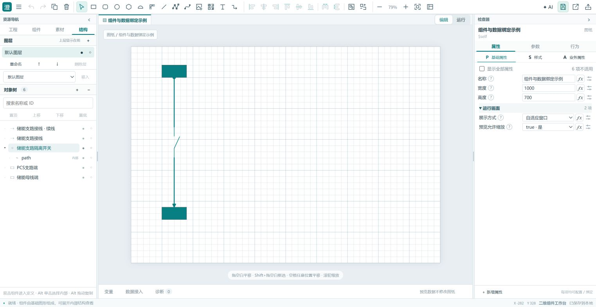

只选中已插入的设备后，右键提供两种操作：

| 操作 | 结果 |
| --- | --- |
| 移出设备并合线… | 恢复插入前的原线，将设备移至线路侧面，保留设备、组件及数据绑定 |
| 删除设备并合线… | 恢复原线，删除此设备及内部图元、移除新增续线；可一次撤销 |

合线使用保存在工程中的插入记录，保存重开后仍可使用。若两段线的端点、折点、名称、样式等已被修改，或者设备增加了第三条支路，工具会保留当前工程并提示核对。续线或待删除设备被属性、事件、回路等配置引用时，也不能自动移除。普通「删除」按钮不执行合线，请使用明确的「删除设备并合线…」命令。

首批支持当前图纸顶层的直线或正交连线，以及画面中水平、竖直的目标线段。位置绑定、布局、跟随、对象或图层锁定仍受保护；折点或方向标记绑定、连线上已有事件/脚本/动画、端口方向不一致、线段过短或等距线段有歧义时，须先调整配置再操作。

一次图的设备与连接模型不会因此自动确认。修改生成的一次图后，应重新检查连接清单：原模型对应的连线发生拆接时会显示连接变化；设备、测点和电气业务对应关系仍需核对。跨越弧的使用范围见本章「交叉跨越弧」。

## 直接拖放接线与端口拖线（0.9.72）

### 拖到线上自动插入

从工程组件库或系统组件库拖一个图标到连线上，也可以拖动图纸中尚未接线的单个图形、图片或组件。独立文字和未闭合自由路径不参与自动插入。靠近兼容线段时会高亮原线，并显示「松开插入接线」。松开后，对象移动到线上，原线分成连接设备两端的两段线；不需要右键菜单。插入和移动一起撤销。

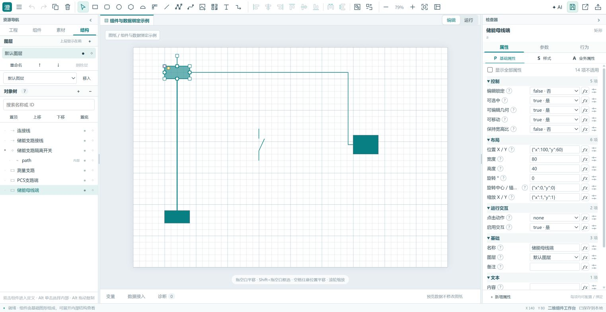

自动吸附范围为屏幕上的 8 像素。设备两端口须与线段平行，线段须能容纳设备并留出两侧间距。普通图形使用上/下或左/右端口，只有两个可见端口的组件使用其两端口；多自定义端口、两条线重叠等含义不明确时不猜测，仍可用上一节的手动端口选择。

### 从线上拖出自动合线

由插入功能接入的设备，拖离原线超过 20 屏幕像素后会显示「松开移出并恢复原线」。松开后恢复原线，设备停在鼠标释放的位置，不额外跳到其他地方。若沿原线附近移动，则保留接线。

设备新增了支路，或两段线的端点、折点、名称、样式等已经修改时，拖动会保留现有连接，不自动丢弃这些修改。锁定、位置绑定、布局及跟随保护保持。拖动过程中按住 Alt 可暂时停用自动拆合；从一开始就按住 Alt 拖动仍是原来的复制操作，复制不自动接线。按 Esc、窗口失焦或取消指针可丢弃本次预览。

窗口或画布尺寸在拖动中改变时，本次拖动会取消，请在布局稳定后重新拖动。

### 图纸图标再次接入与拖动跟随（0.9.73）

图标可以先放到图纸空白处，之后再拖到连线上；满足上面的双端口、未接线和可编辑条件时，同样显示插入预览，松开后接入线路。

拖动图元时，旋转中心、圆角调整点和连接到图元的连线端点会实时跟随，另一端保持与原对象连接。松开保存新位置；按 Esc 取消会恢复图元、手柄及连线位置。

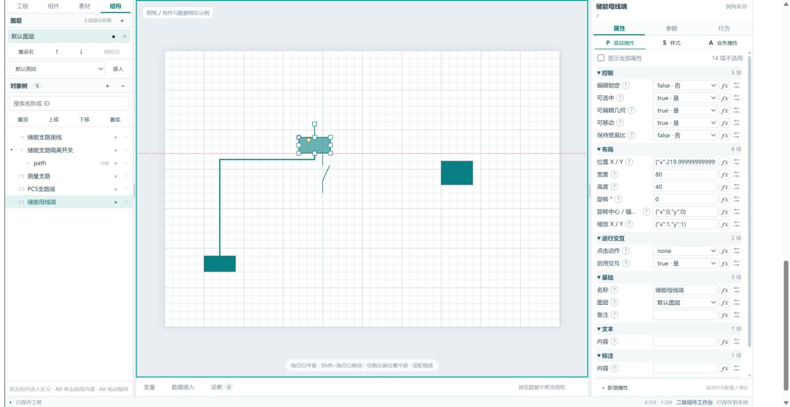

### 悬停端口直接拖线

1. 使用「选择」或「连线」工具，将鼠标移到图形上，不必先单击选择。当前图形边缘显示可用端口圆点；只有中心端口的图形则显示中心点。移到其他图形时，圆点随悬停对象切换，移到空白处后隐藏。
2. 从起点端口按住鼠标左键，拖到目标端口。目标端口附近会吸附，松开后生成连线。也可以接到已标记母线的吸附位置。
3. 点击起点后松开，也可以移动鼠标预览，再点击目标端口完成。按 Esc 取消；拖到空白处松开会取消，不留下半条线。

在「选择」工具下，已有选区的缩放和旋转手柄优先。与手柄重叠的端口圆点会暂时隐藏，拖动该位置可直接调整图形。要从这个端口拉线，可切换到「连线」工具，或先取消选中，再悬停图形。开始拉线后，目标图形的端口也可正常吸附。端口原坐标和已有连线保持。
4. 连线完成后，可以一次撤销和重做。单选图形时，其发出的连线会短暂显示流动虚线和方向箭头，便于确认连接方向；这是编辑提示，不代表设备实际电流或运行状态。

0.9.72 已移除图形四周的「＋」，端口圆点位于图形边缘，旋转手柄位于上方。双端组件按已配置端口显示，不额外创建新设备。运行模式不显示这些编辑提示。

### 自动计算正交折点

新拖绘的正交连线根据两端位置及端口朝向计算折点，可以是直线、单折、双折或更多折。移动对象或其位置变量更新后，自动连线会重新计算，删除多余的共线点；水平、竖直图形的边界端口按法线方向出入，不沿边平行接入。

手动拖动折点后，该线使用手工路径，不再自动改变这些折点。需要恢复时，打开「连线设置」，选择「正交折线」，点击「清空 / 自动路由」并保存。旧版本中已保存为固定折点的连线，也用这一操作恢复自动路由，避免误删原先的人工布线。

自动路由以两端图形的外框为参考，遇到其他设备时，请核对路径并按需添加折点。

### 指定设备端子的出线侧

从 0.9.81 起，选中图形，在检查器中打开「连接端口」，找到自定义端口并点击「定义」。在「正交出线侧」选择「自动、上、右、下、左」，然后保存。组件实例的端口在所属组件定义中维护。

「自动」根据端口的位置选择出线方向。选择「上」等方向后，位于设备内部的端子会先沿指定侧穿过外框，再开始转弯。方向以设备自身的上、下、左、右为准。设备旋转后，正交连线取最接近的水平或竖直方向。直线和手工折点仍按各自的路径配置显示。

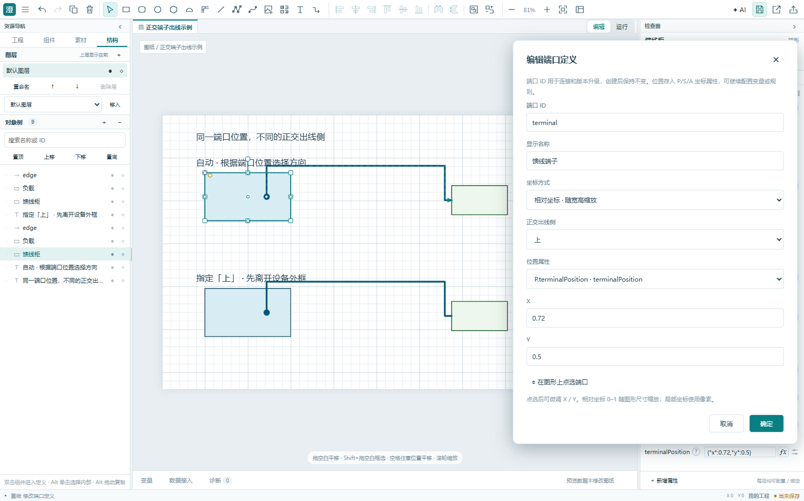

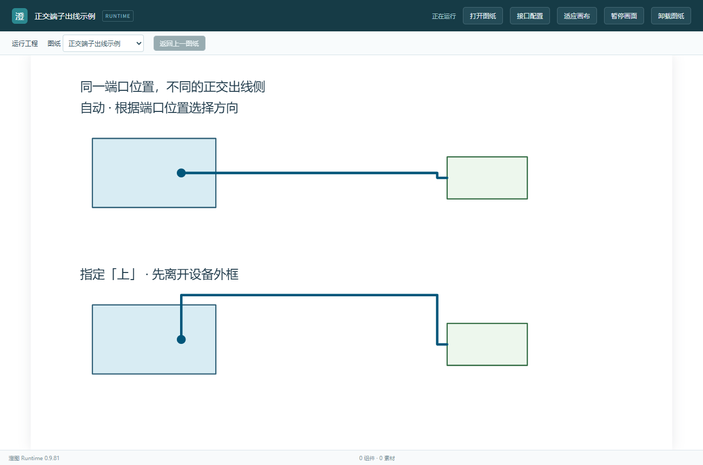

### 正交连线避让图形（0.9.84 起）

1. 选中连线，在右侧打开「行为 → 连线端点 / 折点」。
2. 将「自动路由」设为「正交折线」，勾选「正交避让图形」，点击「确定」。
3. 拖动线路附近的图形，观察连线是否腾出空间。避让沿可见矩形、椭圆、图片或组件的外框计算，通常在外框外留出 8 个图纸单位。连线始终使用原来的端口。

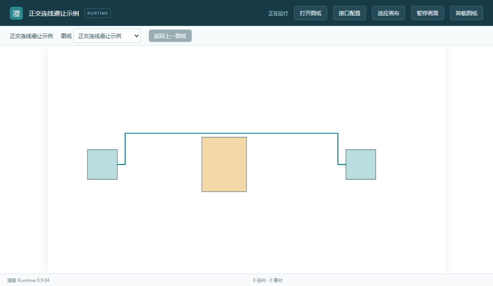

从 0.9.85 起，设备交错摆放时，自动连线可沿可用空隙连续转弯。移动其中一个设备腾出空间后，线路会重新计算，原有端口仍用于连接。

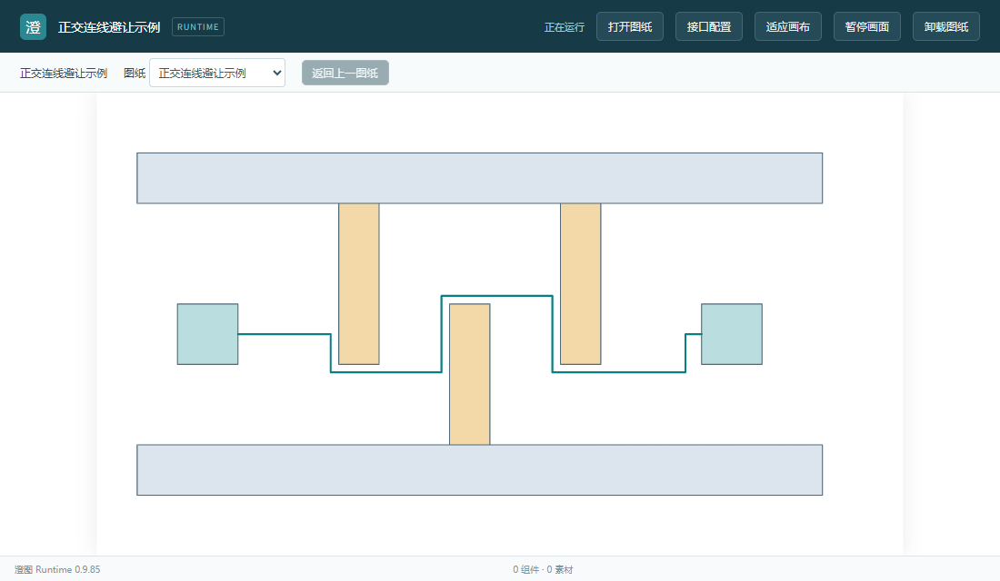

手工折点优先。要重新自动绕行，可用「清空 / 自动路由」清除手工折点。设备堵住出线口、附近障碍过密或有限范围内无可行通道时，仍可能显示普通正交路径，可移动设备或补设手工折点。每条线分别计算，线路交叉时可按需启用下方的跨越弧。

### 交叉跨越弧

选中需要跨过另一条线的连线，打开「行为 → 连线端点 / 折点」，勾选「交叉跨越弧（只改变显示）」。该选项默认关闭；已有图纸的连线外观保持原样。也可以在样式中查找「交叉跨越弧」。

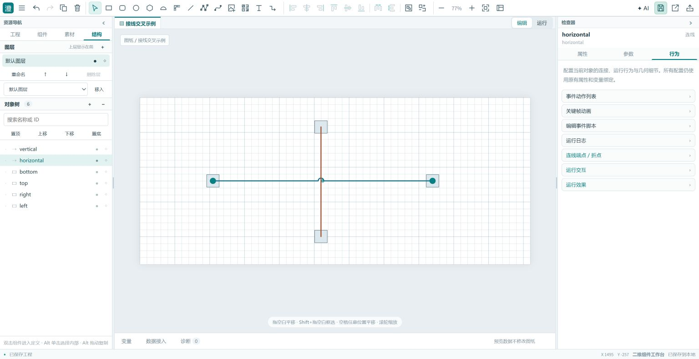

跨越弧表示两条线在画面上相交，电气连接仍由各自的起点、终点和端口确定。需要表示已接入的端点时，先连到正确端口，再按需把线头样式设置为「圆点」。两条线都开启时，较接近水平的线优先显示弧。实际没有内部交叉、交叉靠近端点或折点、交叉过密时，会保持原线。

从 0.9.86 起，可见斜线以及同一组件实例内的连线也能生成跨越弧，组件旋转后仍可显示。跨组件实例、组件内外之间、裁剪中的连线、重叠线段和 T 形接触不生成弧。编辑拖动和变换动画期间暂时显示原线，稳定后按新位置重算。

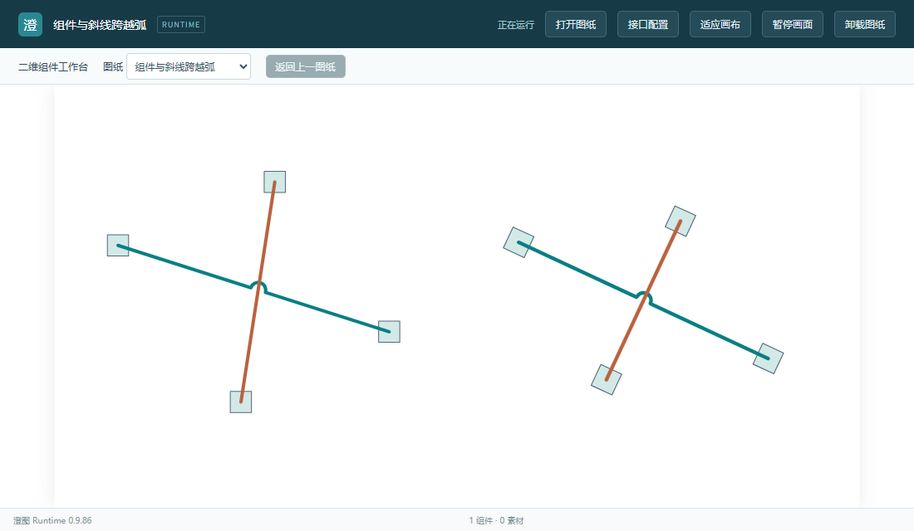
