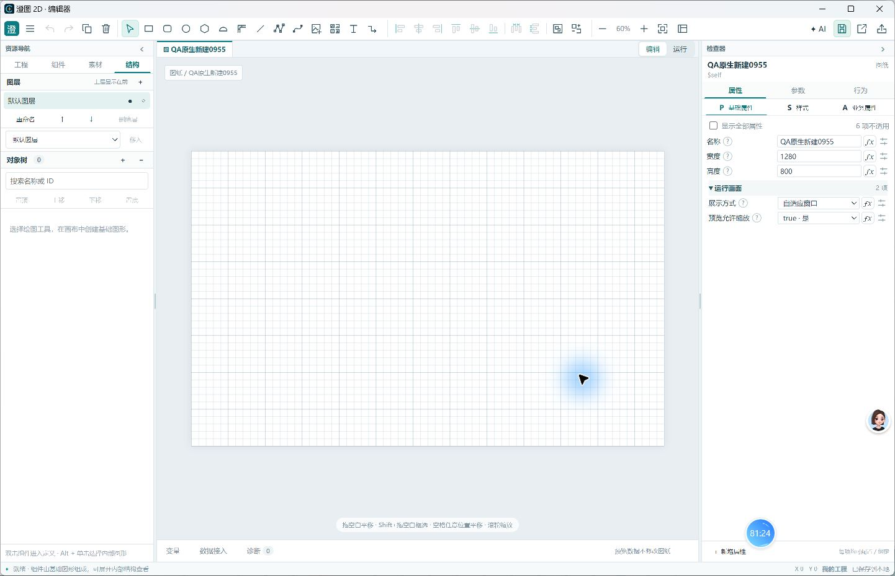
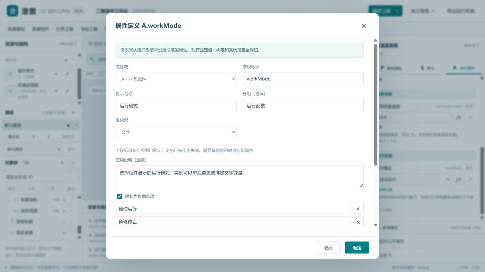
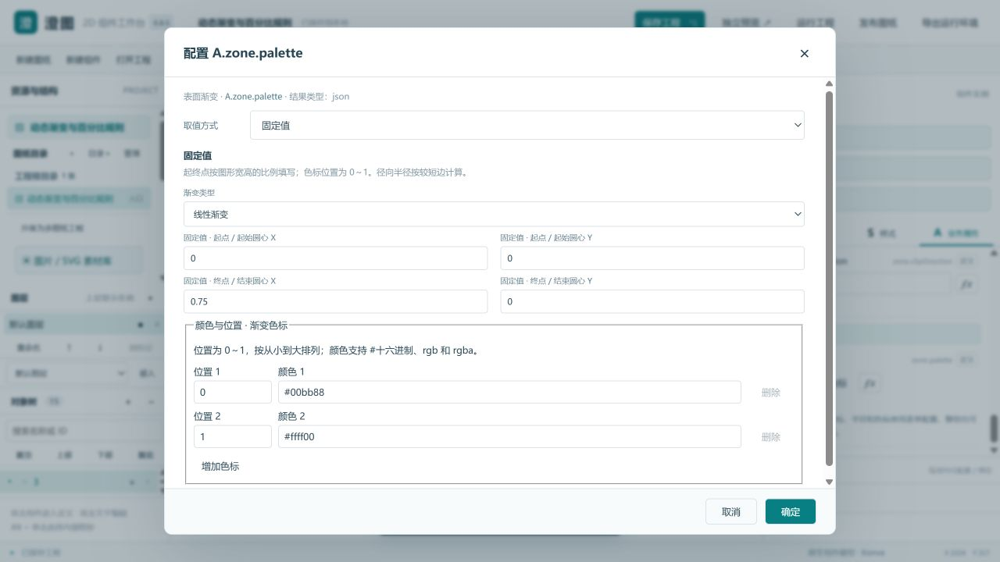

# 05 属性、外观与公开参数

[返回总目录](00-阅读指南与总目录.md)

选中对象后，右侧「属性」分为 P 基础属性、S 样式和 A 业务属性。先在检查器顶部确认当前对象；选中图纸空白区时，右侧显示的是图纸属性。

图 05-1。右侧「属性」标签按 P、S、A 分组。

P 常用于名称、位置、宽高和文字内容；S 用于填充、描边、透明度和文字样式；A 可放设备编号等业务数据。固定值可在属性行编辑，点属性行的规则图标可设置变量或表达式。不同图形可见的字段不同。

在属性区底部点「新增属性」。例如给设备图形增加 A 域的「设备编号」字符串字段。

图 05-2。新增运行模式属性时，填写显示名称、说明和枚举选项。

| 属性定义字段 | 用途 |
| --- | --- |
| 属性域 | 决定属性放在哪个分组。业务字段可选择 A。 |
| 字段标识 | 必填。用于规则和脚本引用，例如 `equipmentId`。编辑既有定义时标识与值类型固定。 |
| 显示名称、分组 | 显示名称必填，出现在属性行中；分组可留空，也可填写「设备信息」以便查找。 |
| 值类型 | 决定可填的值与输入方式。例中选择字符串；数值、颜色或布尔值请选择对应类型。 |
| 使用说明 | 选填，向配置者说明用途和填写方式。 |
| 最小值、最大值 | 数值限制，可留空。设置后用于校验输入。 |
| 限制为枚举选项 | 开启后可逐行添加允许值，属性编辑器用下拉框展示。 |
| 允许空值、默认值为空 | 根据业务是否允许缺省选择。需要在属性未配置时返回空值，可启用对应选项。 |
| 默认值 | 按值类型填写，例如字符串 `PUMP-01`。数组、对象和路径使用高级 JSON。 |

外观编辑先从「S 样式」的填充和描边开始。颜色输入可通过拾色器选择；使用渐变时再配置方向和色标，并查看预览。要让使用组件的人在实例上修改某项属性，可进入组件定义，在「参数 → 管理公开参数」公开该属性，再回到实例的「参数」页设置值或绑定变量。

要复用屏幕上的颜色，打开拾色器并点击「屏幕取色」，再单击屏幕上的目标颜色。颜色会填入弹窗，可继续调整不透明度，最后点「确定」应用。按 Esc 可退出本次取色。填充、描边、渐变色标、图表配色和表格配色均可从各自的拾色器进入。按钮不可用时，可用色板或输入颜色值。

在渐变编辑窗口中选择渐变方式，调整色标后查看效果。
