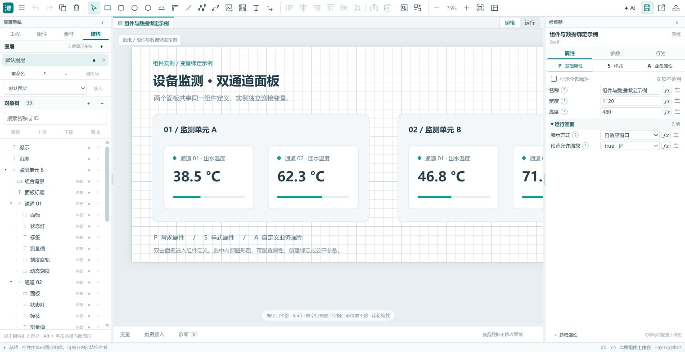
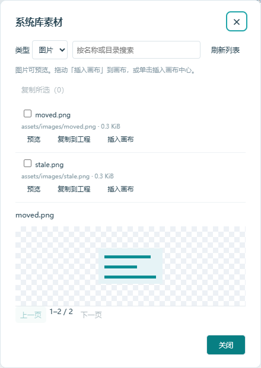
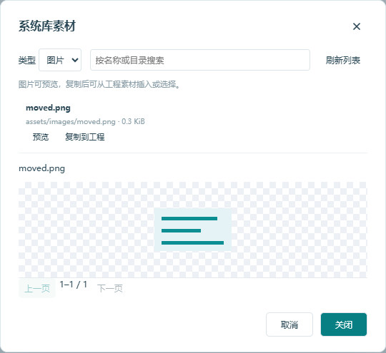
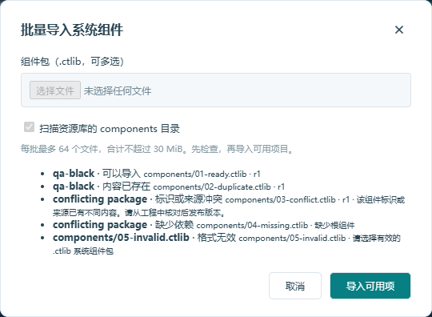
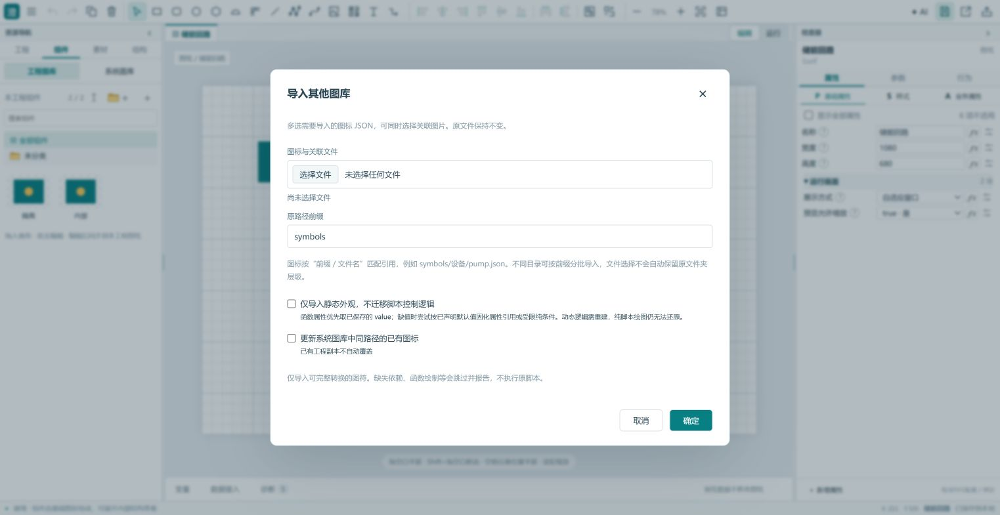
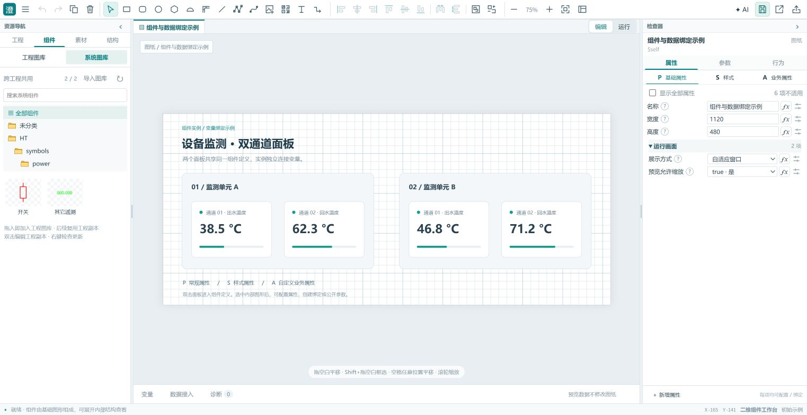
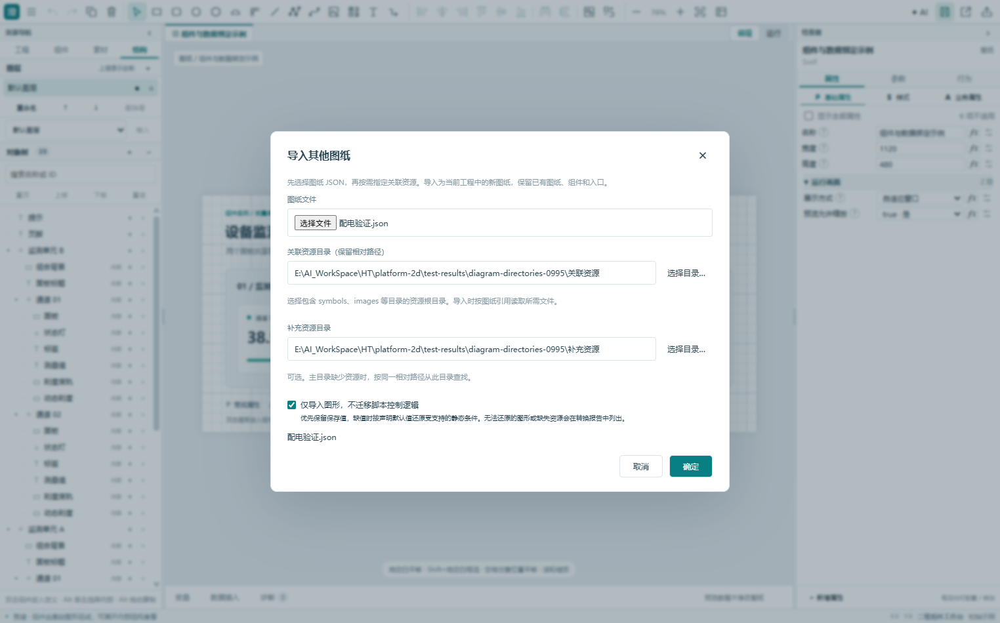
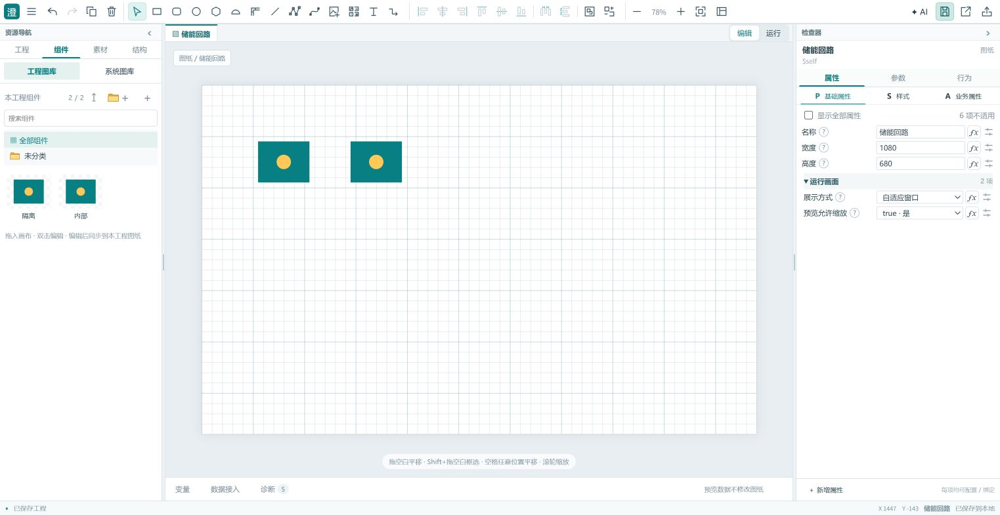

# 06 素材、组件与图库

[返回总目录](00-阅读指南与总目录.md)

图标和照片可作为图片素材；需要复用一组图形、参数和交互时，可把它们组织成组件。放在图纸中的组件称为实例，同一组件可在图纸中放置多次。

图 06-1。通过左侧的「组件」和「素材」切换资源列表。

左侧「素材」使用加号导入图片，支持 PNG、JPEG、WebP、SVG 和 GIF。导入后可按名称搜索并拖入画布，使用「管理素材」查看素材引用与运行备用项。左侧「组件」可切换工程与系统资源。「搜索组件」输入名称中的关键词，「组件分类」收窄显示范围，选择「全部分类」清除分类限制。找到组件后拖入画布；双击已有实例可进入定义。

### 导入可编辑的 SVG 或 CAD 图纸

1. 选择「导入与转换 → 导入 SVG / CAD（可编辑）」，选择 SVG 或二维文本 DXF 文件。DWG 请先在 CAD 软件中另存为文本 DXF。
2. 查看可导入数量及转换提示，确认后在当前工程里新增一张图纸。选中单个图元可修改样式和绑定。双击路径可以编辑控制点，双击文字可以修改内容。
3. 从「导入与转换 → 转换报告」核对差异，再保存工程。SVG 的渐变、蒙版和复杂排版，以及 DXF 的标注、外部参照和三维实体需逐项核对。原图中的线条导入为可编辑路径，电气连接端子和设备测点可在澄图中配置。

编辑组件定义后，可在「参数」点击「立即同步到工程图纸」，或使用「同步本工程组件修改」。状态栏会显示「正在后台同步组件」，完成后提示更新了多少个组件和实例。同步期间继续修改工程时，旧结果会放弃，请重新发起同步。保存工程后同步结果才会写入文件。发布到系统图库用于跨工程复用，图库更新后，已有工程副本按自身版本安排更新。

## 管理系统资源库

打开「工程 → 系统设置 → 系统资源库」。在「根目录」中选择一个已有的专用文件夹，再点「保存资源库目录」，即可切换本机使用的库。留空并保存可切回默认库。切换目录后，老库仍可通过选择原路径继续使用。

在「组件 → 浏览系统图库」中点击「重建资源索引」，可以重新登记库内组件，以及 `assets/images`、`assets/audio`、`assets/models` 中的文件。库的身份记录在 `library.json`，索引记录在 `index.json`。素材按文件内容生成标识，改名或移动到同类型的子目录后，再次重建会更新路径。

### 浏览并复制系统素材

在系统图库中打开「系统库素材」，按图片、音频或模型筛选，也可按文件名或目录搜索。图片可先点「预览」。检查后点击「复制到工程」，再保存工程。

要直接插图，按住图片行的「插入画布」拖到画布，松开即可。也可单击该按钮插入画布中心。插入会同时复制素材和创建图元，可一次撤销。编辑前景图或背景图时，在属性的选图对话框中点击「从系统库选择图片」，选中的图片会随属性一起保存到工程。

勾选多个文件后点击「复制所选」。切换类型、搜索或翻页时，已勾选文件仍保留。每批最多 40 项、合计 32 MiB，并受工程各类素材容量限制。某项读取或校验失败时，整批停在预检阶段，调整选择后再试。

- 图片进入工程「素材」，可从素材面板拖入画布或在属性中选择。
- MP3 或 WAV 进入「声音素材」，可在事件动作中选用。
- 自包含的 GLB、glTF、OBJ 或 STL 作为原文件保存。打开「素材 → 模型」可以下载原文件，或移除工程副本。引用外部配套文件的模型请先转换为自包含 GLB。当前模型用于工程归档，画布和运行环境暂不支持渲染。打开含模型的目录工程请使用 0.9.117 或更新版本。

每个文件不超过 5 MiB。内容相同的素材可复用已有工程副本。如果库中文件在上次索引后改变，请先重建资源索引。

## 批量导入系统组件

1. 点击系统图库中的「批量导入组件」。选中一个或多个 `.ctlib` 文件，或者把组件包放入资源库的 `components` 目录，并勾选「扫描资源库的 components 目录」。
2. 点击「检查并预览」，核对分类、修订和状态。内容已存在的条目会跳过。同一组件标识或来源有不同内容时，请在工程中核对后再发布。缺少嵌套组件、图片、声音或变量的包，需要从原工程重新打包。
3. 点击「导入可用项」，再从系统图库打开或拖入需要使用的组件。已有工程副本可继续使用原版本，升级时从组件右键菜单发起。

每批最多 64 个文件，合计不超过 30 MiB。可直接使用旧系统图库 `items` 下保存的 `.ctlib` 文件。批量导入会保留选择的源文件。

在系统图库中右键组件，选择「导出组件包」，即可下载当前系统版本的 `.ctlib`。在工程图库中，右键选择「导出已同步组件包」可导出本工程版本。最近编辑过的组件请先完成同步。组件包包含必要的嵌套组件、图片、声音和变量，可交给其他工程批量导入。

支持背景、前景的图元，在「S 样式」点击「背景图片」或「前景图片」打开选择框。可选工程中的图片、组件、图纸，也可浏览本机图片。还可以把左侧资源或本机图片直接拖到字段上。组件和图纸按当前工程预览值生成静态 PNG，原资源的动画、变量绑定和交互仍保存在原组件或图纸中。背景和前景只显示选取时的画面，原资源更新后可重新选择。需要动态显示组件时，把它作为组件实例放到画布上，按需配置公开参数和变量绑定。选择前景图时，固定值的前景开关会自动启用；已有绑定的开关仍按原规则取值。

从主菜单选择「导入其他图库」，按下面填写。

图 06-2。导入其他图库时，先选择资源，再设置导入选项。

| 输入项 | 用途 |
| --- | --- |
| 图标与关联文件 | 可多选图标 JSON 与它们引用的图片。把同一批依赖一起选入。 |
| 原路径前缀 | 默认为 `symbols`，用于按原路径匹配引用。例中原引用为 `symbols/设备/pump.json`，填 `symbols/设备`，并选 `pump.json`。不同目录的同名文件分批操作。 |
| 仅导入静态外观 | 需要沿用旧函数属性已保存的值时选中；缺值时可按图标已声明的默认值固化属性引用和受限纯条件。导入后在澄图重新配置控制逻辑，纯脚本绘制的图标仍可能无法还原。 |
| 更新系统图库中同路径的已有图标 | 要替换图库中已有同路径条目时选中。已有工程副本仍需在各工程中检查更新。 |

完成后查看导入结果并按需下载详细报告。遇到缺失依赖，先补齐文件或修正前缀，再导入一份到练习图纸中检查外观。

## 电力图标的静态导入

例如导入开关、遥测显示图标时，选中「仅导入静态外观」，前缀填原引用所在目录，如 `symbols/power`。函数字段优先保留文件已经保存的值；没有保存值时，属性引用或受支持的简单布尔、数值条件会按图标声明的默认值固定下来。系统不会执行旧脚本，也不会把函数文本作为颜色、文字或尺寸。

图 06-3。开关和其它遥测已进入系统图库并生成缩略图。示例中的遥测保留文件内的 `000.000` 文字；默认关闭的单位和标签保持隐藏。拖入练习图纸检查外观后，再配置自己的数据绑定。

静态导入后，更改业务参数不会恢复原函数逻辑。需要状态切换、数值格式化或单位显隐时，请在澄图中重新配置绑定、规则或事件。报告中的「脚本/动态属性未迁移」是处理说明；「不支持」或「失败」才表示该项未导入。没有静态结构、没有可靠默认值或函数包含额外操作的图标仍会跳过，不会猜测外观。

## 图纸与图标一起导入

如果要导入的是整张图纸，请在主菜单选择「导入其他图纸」，不用先把每个图标分别导入系统图库。目前该入口读取兼容的图纸 JSON，不会因菜单改名而支持任意 CAD 或图片格式。

| 输入项 | 用途与填写方法 |
| --- | --- |
| 图纸文件 | 选择要转换的图纸 JSON。已把图标嵌入其中的文件可直接导入。 |
| 关联资源目录（保留相对路径） | 点击「选择目录…」并确认文件夹，也可直接粘贴完整路径。请选择包含 `symbols`、`images` 等子目录的资源根目录。 |
| 补充资源目录 | 可留空。主目录找不到某项资源时，按同一相对路径在补充目录查找。 |
| 仅导入图形，不迁移脚本控制逻辑 | 默认选中。保留已有静态结构、保存值及受支持的默认条件；原事件脚本不运行，需在澄图中重新配置。取消后按原转换能力处理，无法转换的脚本仍会在报告中列为待处理。 |

1. 选择图纸，再选择关联资源目录；资源已嵌入或在系统图库中存在时，可省略目录。
2. 保持「仅导入图形」选中，点击「确定」。
3. 查看「图纸转换报告」：图标、嵌套图标及图片会作为工程组件与素材带入，同一图标的多个实例共享定义。
4. 在左侧「工程 → 图纸目录」核对新图纸与原有图纸。导入会打开新图纸，原有图纸、工程组件、图片素材、数据绑定和入口图纸都保留。同名图纸会添加「导入2」等后缀。
5. 核对画面、位置、颜色及默认状态，再保存工程。需要撤回时，先关闭转换报告，再按一次 `Ctrl+Z`，同时撤回新图纸及本次带入的资源。图标已成为本工程资源，后续打开和独立运行不再依赖原文件夹。

示例中，两处图标实例共享包含内部图形和图片的组件。菜单中的内置案例入口已移除，可用自己的练习工程检查导入效果。

遇到「资源包未包含」时，按报告中的完整相对路径核对目录层级。原图纸和实际引用的资源合计不超过 25 MB，最多 1000 个引用。没有保存值的复杂绘图函数可能需要手动重建。

## 资源按需读取与大型图纸

目录选择窗口只返回路径。点击「确定」后，澄图才从本机读取图纸引用的文件，无需确认上传文件夹。导入过程如下。

1. 从图纸对象的图标、图片引用取得相对路径，例如 `symbols/power/开关.json`。
2. 在所选资源根目录中按完整路径查找。图标内部再引用图标或图片时，继续查找这些依赖。
3. 同一路径只读取和转换一次，多处实例复用同一组件。没有引用的文件不读取内容；已嵌入资源包中的未引用图标也不会被转换或保存进新工程。
4. 找不到的路径列入转换报告，不用同名文件猜测替代。需要数据接入时，保留保存值并重新配置映射；原数据转换脚本不会执行。

大型图纸里的普通坐标、颜色和文字不再累计成“结构节点”误触发限制。图纸按对象分别检查结构，单个异常图标或过深结构会报告具体来源路径和原因；文件大小、依赖数量和深度保护继续有效。画布背景、填充规则和受支持的虚线偏移会保留为原生样式。

## 组件缩略图背景

组件设置了画布背景后，工程图库会将该颜色与图形一同生成缩略图。发布到系统图库的组件也会使用该背景。白线图标可在组件编辑页将「画布背景」设为黑色，返回图纸后查看缩略图。图符导入时，原文件中的固定画布背景会保留在组件设置中。

组件放入图纸后，左侧对象树也显示对应的缩略图。缩略图背景仅用于辨认组件，画布上仍按图元的填充和透明样式绘制。双击对象树中的组件可打开组件定义，修改后返回图纸或保存工程即可同步本工程的组件引用。
