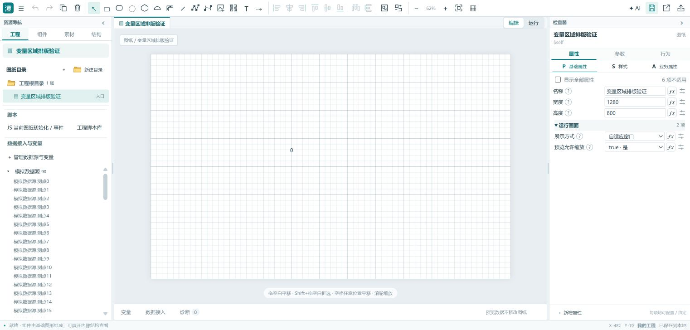
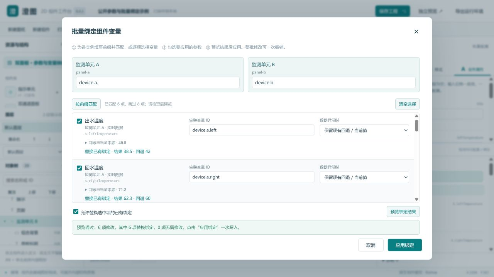

# 07 变量、表达式、绑定与条件

[返回总目录](00-阅读指南与总目录.md)

变量存放画面需要使用的数据。把某项属性绑定到变量后，变量值更新时，画面上的对应值也会更新。本章先用工程内变量练习，数据接口在下一章配置。

图 07-1。工程树按数据源分组显示测点，底部「变量」可打开调试面板。

打开「调试 → 变量 → 添加变量」，填写以下字段。

| 字段 | 填写方法 |
| --- | --- |
| 变量 ID | 工程内唯一，供绑定和规则引用，例如 `device.temperature`。默认示例是 `device.value`。 |
| 显示名称 | 配置列表里供人阅读的名称，例如「设备温度」。 |
| 变量类型 | 默认为 `number`。也可选 `boolean`、`string`、`color`、`point`、`array` 或 `json`。按实际用途选择。 |
| 默认值 | 与类型一致，数值可填 `40`，布尔值可填 `true`，字符串可填文字，颜色可填 `#278080`，点可填 `{"x":10,"y":20}`，数组和对象按 JSON 填写。默认示例是数值 `0`。 |

选中一个对象，在属性行打开规则配置，先选「取值方式」。

| 取值方式 | 需要配置的内容 |
| --- | --- |
| 固定值 | 填一个与属性类型一致的值。 |
| 直接绑定变量 | 选择工程变量。要练习显示数值，可将数值变量绑定到图形宽度，再观察变化。 |
| 直接引用属性 | 选择作为来源的对象和属性。例如引用另一对象的样式值。 |
| 规则计算（可视化） | 在「常用配置」选模板并填写参与运算的数据；用「组合规则」组合多个步骤。高级 JSON 可编辑规则结构，其中 `op` 表示运算，`args` 表示参与运算的值。 |
| 移除覆盖 / 恢复默认 | 清除当前配置覆盖，恢复继承值或默认值。 |

在「工程」的变量列表点击变量，可查看数据来源、默认值、当前质量和绑定对象。可在调试区修改预览值来观察结果。若需要把调试值保留为下次预览的初值，点击「保存预览初值」再保存工程。

条件配置常用于决定何时执行动作。例如配置温度大于 80 时执行提示，先选来源变量，再选比较运算，最后填数字 80。用阈值上下两个预览值核对触发结果。

在「批量绑定组件变量」中，按前缀匹配或逐行填写完整变量 ID，预览结果后再应用。
