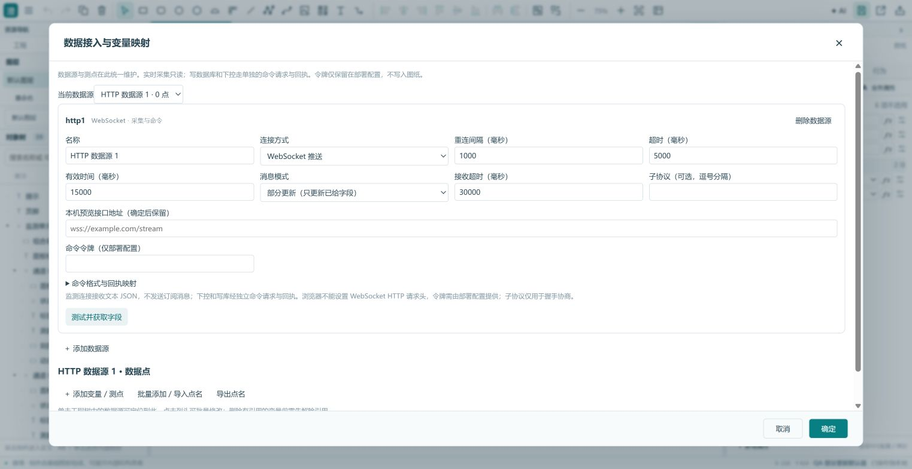
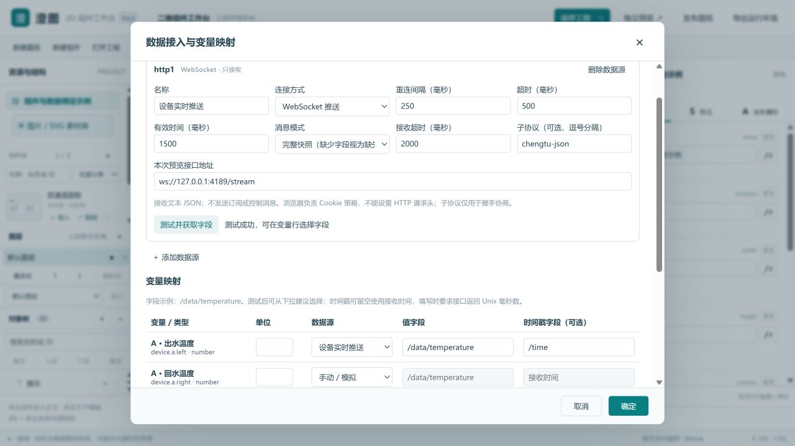
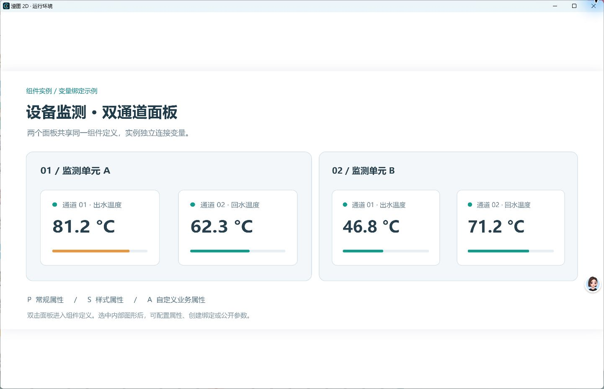

# 08 数据源与设备操作

[返回总目录](00-阅读指南与总目录.md)

在工程树单击数据源，打开「数据接入与变量映射」。先建数据源并测试响应，再配置变量，最后在运行环境核对变量值和质量。

在「消息模式」中选择 WebSocket 消息如何更新变量。

| 字段 | 如何填写 |
| --- | --- |
| 当前数据源 | 选中要编辑的数据源。「模拟数据源」管理本地变量，无需网络。 |
| 名称 / 连接方式 | 填写便于识别的名称，选择 HTTP 查询或 WebSocket 推送。 |
| 调用方式 / 轮询间隔 | HTTP 选择定时轮询或事件触发。轮询间隔填毫秒，事件方式不使用此值，需配置「请求HTTP数据源」动作。 |
| 超时 / 有效时间 | 都以毫秒填写。超时限制等待响应，超过有效时间的旧值标记过期。 |
| 重连间隔 / 接收超时 | WebSocket 专用，单位毫秒。分别控制断线后等待时长和多久未收消息算空闲超时。 |
| 消息模式 | 「部分更新」只更新出现的字段，其他字段按自己的有效时间保留。「完整快照」把本帧没出现的字段视为缺失。 |
| 子协议 | 可留空。服务器有握手要求时填写子协议，多项用逗号分隔。 |
| 本机预览接口地址 | 填现场提供的 HTTP(S) 或 WS(S) 地址。确定后保留在本机配置，部署时需在目标环境配置。 |
| 测试并获取字段 | 连接并读取示例响应。成功后可在变量行选取字段。 |

先选数据源，再填写测点的字段路径和类型。

「添加变量 / 测点」中选择数据源，填写唯一且稳定的变量 ID。显示名称可留空自动生成。类型选 number、boolean、string、color、point、array 或 json，默认值按所选类型填写。采集字段使用响应路径，例如响应为 `{"data":{"P1":23.5}}` 时用 `/data/P1`，路径留空表示整个响应。时间戳字段可留空采用接收时刻，填写时指向 Unix 毫秒数。单位用于显示，例如 ℃，不参与数值换算。

「批量添加 / 导入点名」接受每行一个点名，或由点名、变量 ID、显示名称、类型、采集字段和单位组成的制表符表格，可选择 TXT 或 TSV。列头的批量按钮可取相同值、粘贴每行一值、复制整列，支持序列的字段还可填固定前缀、起始数字和间隔。应用前核对作用范围和顺序。

WebSocket 可配置命令。测点行分别设置「命令点位」「下控」「写库」，点位按对端协议填写。展开「命令格式与回执映射」后填写以下项目。

| 字段 | 说明 |
| --- | --- |
| 命令地址 / 命令子协议 | 命令连接地址留空使用监测地址，子协议按命令服务要求填。 |
| 命令令牌 | 服务需要时填写，保存在部署配置中。 |
| 控制命令 JSON / 写库命令 JSON | 各自按服务约定填写 JSON，可使用 requestId、token、point、value 的双花括号占位符。命令须包含请求 ID，完整的 value 占位符保留 JSON 类型。 |
| 回执字段映射 JSON | 按服务响应结构填写，让运行端识别请求 ID 和处理结果。 |

配置好命令后还需单独配置「下控 / 写数据库」动作或给脚本授权。先用测试环境检查回执，再核对设备状态。修改播放器本地变量和向设备发送命令是两种独立操作。收到回执后仍要核对设备状态。

新数据源默认值如下，均以毫秒计。HTTP 默认定时轮询，每 3000 毫秒一次。两种连接的超时设置默认 5000，有效时间默认 15000。WebSocket 默认部分更新，重连间隔 1000，空闲接收超时 30000。

接通数据源后，在运行画面核对各设备的测量值。
