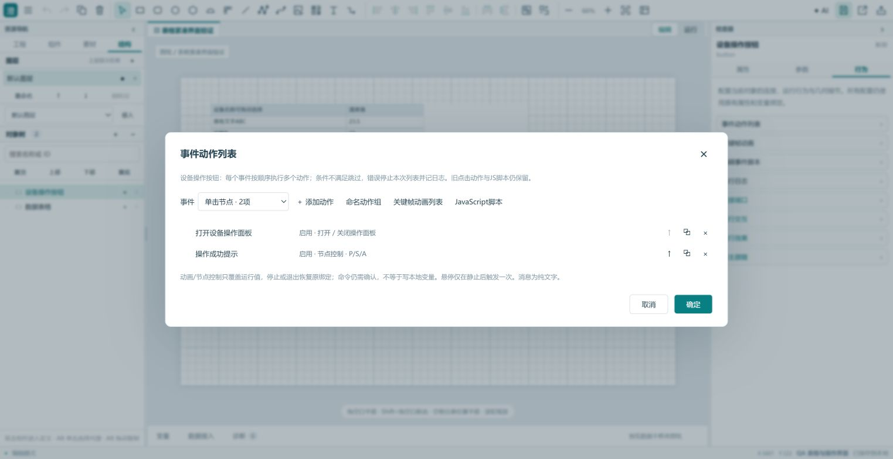
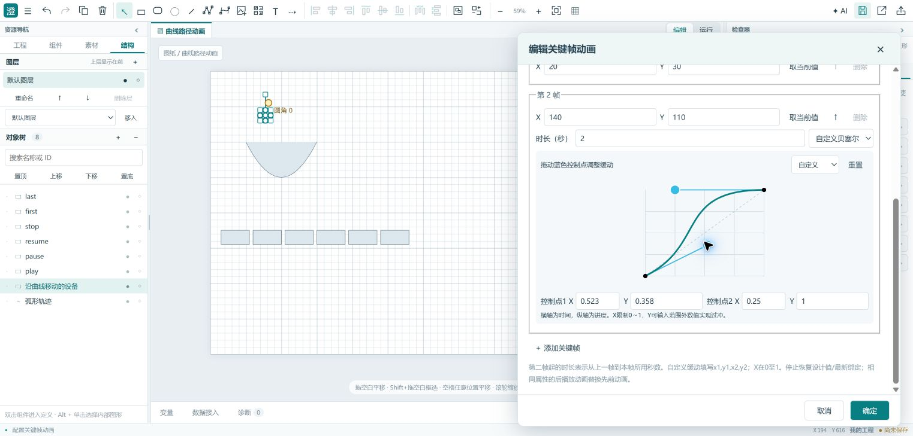
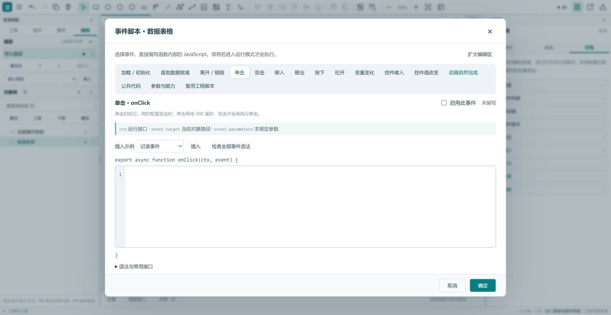

# 09 事件、动作、动画与脚本

[返回总目录](00-阅读指南与总目录.md)

选中对象后打开「行为」中的「事件动作列表」，也可为当前图纸或组件配置事件。在事件下拉框选择触发时机，例如单击或属性变化。列表从上到下执行，条件不满足跳过，错误会停止本次列表并写入日志。

先选择触发事件，再在下方添加和排列动作。

| 通用配置 | 用途 |
| --- | --- |
| 事件 | 选择何时触发。属性变化还需指定监听属性，动画自然完成可选任意或指定动画。 |
| 别名 / 启用 | 别名用于识别动作，停用后保留配置。 |
| 动作类型 | 决定下面出现哪些配置。 |
| 执行条件 | 选比较对象、运算及比较值，满足时才执行；无条件时直接执行。 |
| 上移 / 复制 / 删除 | 调整次序、复用配置或移除当前动作。 |

| 动作类型 | 分支字段 |
| --- | --- |
| 节点控制 · P/S/A | 目标节点和属性决定写入位置。操作选设置运行值、布尔反转或清除本列表覆盖。设置值使用 JSON，例如 `true`、`100`、`"#0099ff"`。 |
| 设置本地变量 | 选择变量，值填同类型 JSON。 |
| 下控 / 写数据库 | 选择变量和命令类型，值填 JSON。依赖该变量的命令点位、授权和回执。 |
| 动画控制 | 选目标和动画，操作可从头播放、暂停、继续、停止或定位首末帧。播放和继续可设置立即执行后续或等自然完成。无限循环不可等待。 |
| 打开 / 关闭操作面板 | 见[操作面板](10-操作面板.md)。 |
| 切换图纸 | 目标图纸选择工程内已存在图纸。 |
| 切换容器图纸 | 选择当前画面的图纸容器，再选择已加入该容器的候选图纸。外层画面继续运行。 |
| 显示消息 / 打开链接 | 输入纯文字或 HTTP(S) 链接。 |
| 请求HTTP数据源 | 选择已配置的 HTTP 源。 |
| 调用命名动作组 | 选目标和动作组。用「命名动作组」新增或重命名，再在组内排列动作。 |
| 派发事件 | 指定目标节点和事件。 |
| 终止当前动作列表 | 无附加字段，执行到此结束当前列表。 |

在「关键帧动画列表」新增动画。名称用于查找，动作可选移动、缩放、旋转、路径移动、透明度或指定属性。动画对象选被控制的节点，属性动画另选目标属性，路径移动另选独立的折线或曲线。开始进度、开始延迟、循环间隔均为秒。循环可选一次、重复、往返，次数为 0 时无限，往返每个方向算一次。自动播放可选进入运行后播放，也可由事件启动。

关键帧填写与动画类型匹配的目标值，第二帧起填写从前一帧到本帧的秒数和缓动。自定义缓动可输入控制点坐标，X 在 0 到 1 之间。先用列表预览，保存后进运行环境验证。停止可恢复设计值或最新绑定，自然完成事件只在有限动画自然结束时触发。

在缓动曲线窗口拖动控制点，调整动画前后段的速度变化。

图中打开的是「动画自然完成」事件。打开「JavaScript脚本」，按事件标签写函数体，勾选「启用此事件」。可以插入示例或检查全部事件语法。公共代码可供同一绑定内的事件调用。

| 脚本配置 | 用途 |
| --- | --- |
| 事件超时 | 100–5000 毫秒，超出限制结束本次执行。 |
| 事件参数 | JSON 对象，例如 `{"threshold":80}`，通过 `event.parameters` 读取。 |
| 允许的能力 | 分别允许运行时 P/S/A 覆盖或跳转工程内图纸。 |
| HTTP事件请求 | 允许触发已配置的 HTTP 数据源。 |
| 变量读 / 写 / 下控 / 写库 | 各选需要授权的变量。写播放器变量与设备命令单独授权。 |
| 首批数据就绪的来源 | 启用该事件时，至少选一个需要等待的来源。 |
| 复用工程脚本 | 管理共享绑定与源码。修改共享源码会影响各引用对象。 |

脚本保存后进入运行模式才执行。可用 `ctx.log()` 将调试信息写入「行为 → 运行日志」，用 `event.target` 取得当前对象路径。先以最少权限验证行为。
