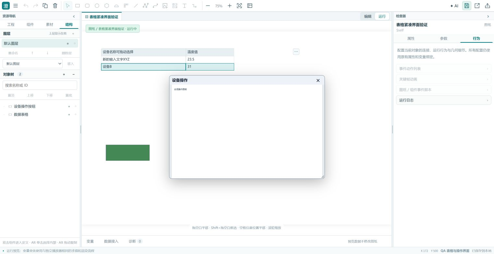
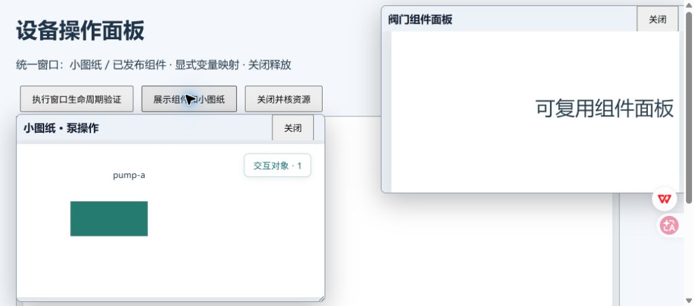
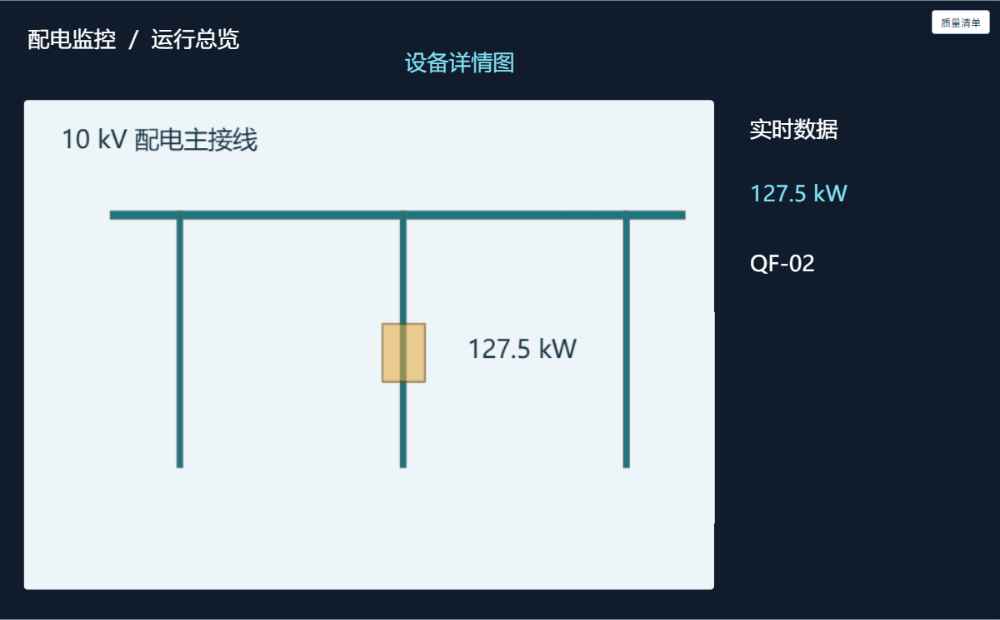

# 10 操作面板

[返回总目录](00-阅读指南与总目录.md)

准备一张面板图纸，或发布一个可用于面板的组件版本。选中主图的设备图元，在「事件动作列表」选「单击」，添加「打开 / 关闭操作面板」动作。

点击设备打开操作面板，在窗口标题栏关闭面板。

| 字段 | 用途和填写示例 |
| --- | --- |
| 操作 | 选择「打开面板」或「关闭面板」。 |
| 窗口标识 | 用稳定标识例如 `pump-detail`，打开和关闭填同一个值。面板内关闭当前窗口可填 `$self`。 |
| 内容 | 从工程图纸或已经发布的组件版本中选择。 |
| 标题 | 窗口顶部显示的文字，初始为「操作面板」。 |
| 显示方式 | 模态对话框用于集中操作，可拖动悬浮窗便于看主图，右侧抽屉适合详情，对象旁气泡贴近触发对象。 |
| 宽度 / 高度 | 输入像素，初始 480 × 320，运行时按可用窗口空间约束。 |
| 本地初始变量 | JSON 对象，空配置填 `{}`。例如 `{"tab":1}` 设置面板自己的 tab 变量。 |
| 共享变量映射 | JSON 对象，键是面板变量 ID，值是当前画面的变量 ID。例如 `{"temperature":"pump_temp"}`。类型需匹配，同一变量不再设置本地初值。 |
| 重复打开 | 「配置相同则激活；变化则重开」适合重复点击同一设备，「销毁旧窗口后重开」用于每次重新初始化。 |
| 关闭状态 | 可选重置，或保留本地变量和悬浮位置。关闭仍释放运行资源。 |

操作面板可显示图纸或组件。打开后检查标题与内容是否对应。

关闭动作只使用窗口标识。配置后在独立运行中检查标题、位置、变量和关闭行为。共享变量双向同步，适合把同一设备状态显示在主图和面板。设备下控仍由宿主确认。最多同时 8 个窗口，最多 3 层嵌套。

## 在画布中嵌入图纸

图纸容器适合把主接线图放在固定菜单和数据显示栏之间。子图在容器中运行，可以播放动画、处理事件和显示绑定的数据。

1. 在同一工程内建立外层画面和要嵌入的子图。在外层画面打开「高级组件 → 布局」，插入「图纸容器」。用基础属性调整位置和尺寸。将容器置底，可在它上方放置菜单、图例等图元。
2. 双击容器，在「候选图纸」中勾选子图，再选「初始图纸」。选「启动时留空」后，第一次切换动作执行时才加载。
3. 选择「允许独立缩放与平移」后，容器内滚轮缩放，拖动子图空白处平移。选「固定适应容器」时，子图按容器大小自动适配。固定外层画面时，在外层图纸的基础属性中关闭「预览允许缩放」。
4. 「共享变量映射」左边选择子图变量，右边选择外层变量。例如把子图的 childLoad 映射到外层的 load 显示负荷，把子图的 childSelected 映射到外层 selected，让点击开关的动作更新右侧设备栏。两侧变量类型须一致。未映射的变量保留各自会话的值，子图复用外层的数据连接。
5. 选中外层的菜单图元，在「事件动作」添加「切换容器图纸」，选择容器以及它的一张候选图纸。切换会重新初始化子图，外层画面及其变量继续运行。

容器需保持水平，内容按容器边界裁切。每个容器最多选 8 张候选图纸，每个运行窗口最多同时运行 8 个容器，最多嵌套 3 层。图纸之间的包含关系不能成环。容器内的整页图纸导航应由外层菜单的「切换容器图纸」完成。第三方地图和 3D 场景使用独立集成方式。
