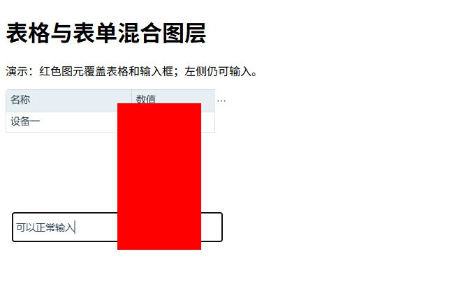
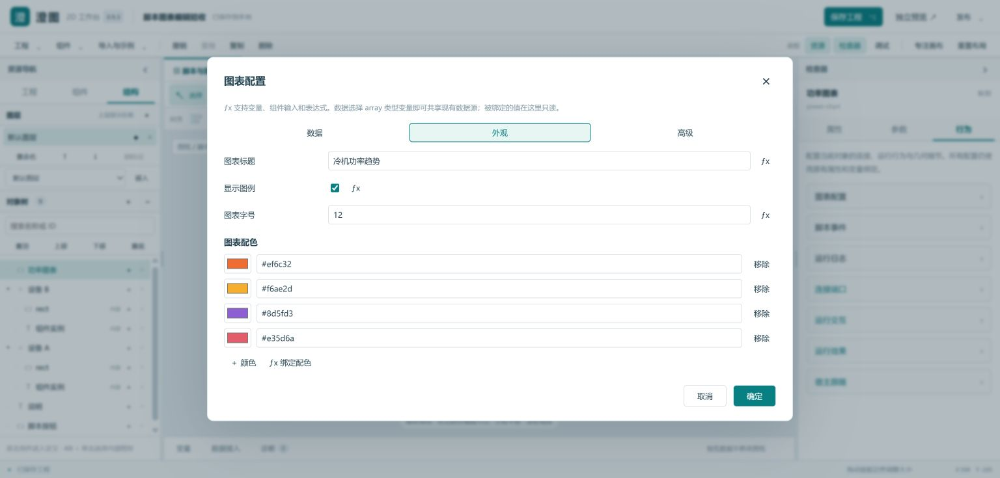

# 11 表单、控件与图表

[返回总目录](00-阅读指南与总目录.md)

从控件区将对象加入画布。双击控件或用右键菜单打开「高级配置」，常用设置也可在右侧 P 属性中维护。编辑态查看初始外观，运行态检查输入和提交。

在同一张画面上可以组合输入控件、按钮与其他图元。

| 控件字段 | 用途 |
| --- | --- |
| 标签 / 输入提示 | 标签用于标明用途，输入提示在空值时帮助用户填写。按控件类型显示。 |
| 初始值 | 未绑定时的起始状态，文本填字符串，数字填数值，开关勾选表示开。 |
| 绑定 / 写回播放器变量 | 选匹配类型的变量取得初始值并写回；留空时只保留本次会话输入。若已使用复杂表达式或覆盖，请从属性绑定面板修改。 |
| 禁用 / 只读 / 必填 | 禁用用于禁止交互，只读保留展示，必填要求提交前提供值。 |
| 最大字符数 | 文本、密码、多行和富文本类控件的输入长度限制。 |
| 写回时机 | 可在值确认或失焦时写回，或在每次有效输入时写回。 |
| 下拉选项 | 为每个可选项填写显示文字及对应的实际值。 |
| GIF 素材 / 导入 GIF / 播放动画 | 选择已导入资源或导入 5 MB 以内的 GIF。暂停显示静帧，恢复后从头播放，循环次数由 GIF 决定。 |

操作示例是把数字输入框绑定到本地数字变量，再把文本图元绑定到同一变量。运行中输入并确认，检查显示是否同步。需要操作设备时按第 08、09 章配置命令。

在图表配置窗口设置标题、颜色与图例，并核对数据字段。

配置图表时，先按展示目的选择图表类型，再设数据和样式。折线适合观察趋势，柱状适合比较类别。数据可使用示例初值检查显示，也可绑定数组变量实时更新。请按图表当前的字段约定提供类别或时间和值，例如时间字段为 `time`、数值字段为 `value` 时，每行提供这两项。类型改变后重新核对字段和数据。标题用于说明指标，图例用于识别系列，坐标轴和单位用于读数。需要联动时可在事件中配置图表点击、图例切换或数据缩放。

数字、滑块、圆弧和范围控件可填「最小值」「最大值」「步长」。范围控件初值由起点和终点组成，按从小到大填写，两个值均应落在允许区间。日期、日历和日期时间使用相应的日期输入；选择和单选的初值应从配置的选项中选取。已绑定字段在高级配置中只读。

| 图表配置页 | 字段与填写示例 |
| --- | --- |
| 数据 | 「类型」选择图表形式。「数据集」填写由对象组成的 JSON 数组，或用 ƒx 绑定 array 变量。「分类 / 时间字段」默认 time，「数值字段」默认 value，均填对象键名。「分组字段」默认空，填设备名等字段可拆成不同系列。 |
| 外观 | 标题填图表显示的文字，图例开关控制系列说明是否显示，图表字号默认 12，可填 8–72。颜色配置用于区分系列。 |
| 高级 | 扩展选项填写 JSON，支持 title、legend、grid、dataZoom、textStyle、axisPointer。配置函数、远程图片和链接不属于这一区域。 |

例如把数据集填为 `[{"time":"08:00","value":23},{"time":"09:00","value":25}]`，选择折线图，保持默认字段，确认预览出现两个数据点后再接入动态数据。
