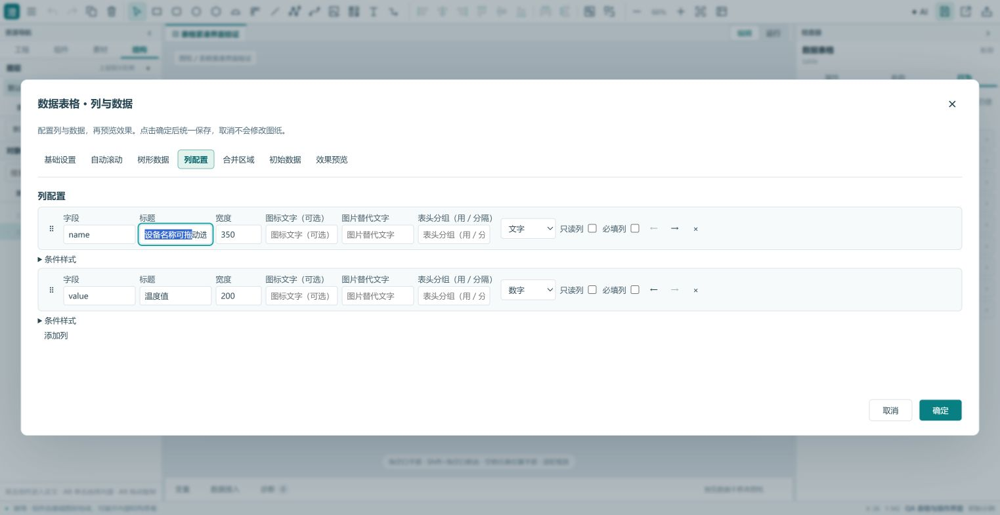
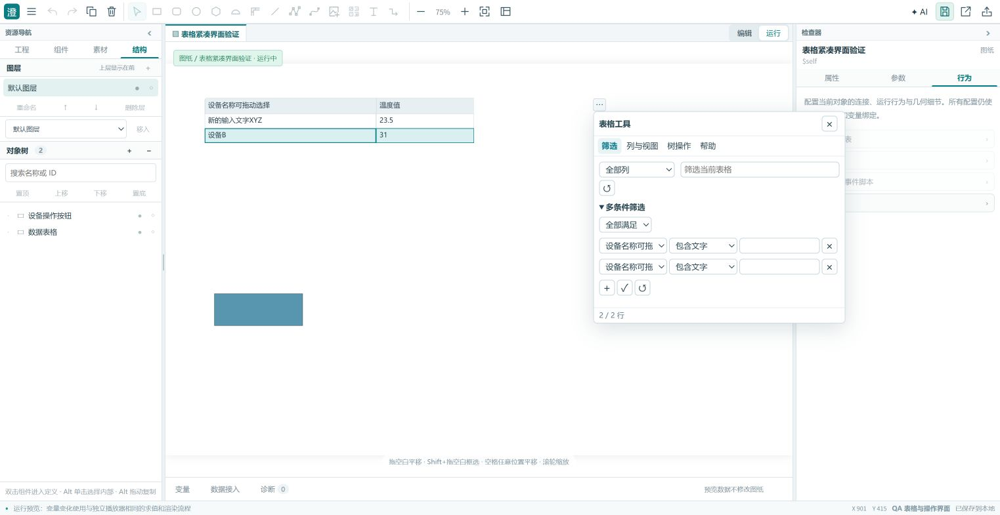

# 12 表格

[返回总目录](00-阅读指南与总目录.md)

在画布添加数据表格。双击表格或从右键打开「数据表格 · 列与数据」，依次配置数据来源、列、初始数据和运行操作。

在列配置中设置字段、标题和显示方式。

| 通用字段 | 用途 |
| --- | --- |
| 数据变量 | 选择数组变量供表格显示。选「不绑定」时编辑初始数据；已有复杂绑定时从属性面板处理。 |
| 冻结前几列 / 行高 | 冻结列从最左列开始计数，填 0 不冻结；行高填像素。 |
| 只读 / 禁用 | 只读用于展示，禁用限制运行交互。 |
| 自动循环滚动 | 仅运行时生效，内容超高才滚动。速度 1–500 像素/秒，首尾停留 0–60000 毫秒，可选择鼠标悬停暂停。编辑单元格或打开工具时暂停滚动。 |
| 指定行配色 | 可填原始行号，或填写配色匹配字段（如 `id`）后按字段值选背景和文字颜色。字段值配色随记录跨接口刷新、排序和分页移动；条件单元格颜色优先。 |

列配置用于定义每列的字段标识、显示名称、类型和宽度。字段标识与数组对象的键对应，宽度用像素。按内容选文字、数字、图片等列类型，图片或 SVG 选择工程素材。多级表头在分组中用 `/` 分隔层级。用列卡左侧手柄或左右移动按钮调整顺序，文字输入框中可正常拖选文字。结构变化后检查公式和映射。

在初始数据区添加、插入、复制、移动或删除行。数字列可输入 `=` 开头的公式，A1 代表原始数据第一行第一列，表头不计。批量粘贴用制表符分列、换行分行，粘贴起始行列从 1 开始；先准备足够行列，拆开涉及的合并区，校验失败时修正后重试。

启用树形表格后，指定节点标识和父级字段。节点标识须唯一，父级留空表示根节点，填写其他节点标识表示挂在其下，不允许循环引用。筛选保留匹配行的祖先，排序只改变同级顺序。移动分支时选择目标父节点，会一起移动后代。

合并区域填写起始行、行数、起始列和列数，位置从 1 开始。被覆盖单元格保留原值，拆分后恢复。排序或筛选打散区域时按普通单元格显示。

运行中选择列、运算符和比较值添加条件，可清除条件恢复全部数据。通过列和视图页切换显示或冻结，通过树操作展开折叠。可编辑单元格双击进入，Enter 提交；方向键选择，Shift 扩选，Ctrl+C/V 复制粘贴，Ctrl+Z/Y 撤销重做。确认后检查是否需要通过配置的数据服务保存，运行输入不会直接改写设计初值。

Excel 文件适合批量交换表格数据，导入前核对工作表、表头和列类型，导入后检查公式、空值和行数。数据服务模式依赖发布环境中的接口配置，服务端分页应返回当前页的行数据及总记录数；排序与筛选按服务所支持的字段执行。配置了版本化写入服务时可提交远端单格；发布前分别验证第一页、末页、筛选无结果、编辑成功与版本冲突后的刷新。接口契约和公式支持范围见下文链接。

| 列卡字段 | 填写方法 |
| --- | --- |
| 字段 / 标题 | 字段填写唯一键名，例如 temperature。标题是运行时表头，例如温度。 |
| 宽度 | 填像素，新列为 120。 |
| 图标文字 | 可留空，用于列的图标文字。 |
| 图片替代文字 | 说明图片内容，可在图片无法显示时帮助识别。 |
| 表头分组 | 可留空。填写如 `设备/读数` 可组织多层表头。 |
| 列类型 | 文字、数字、布尔、下拉、图片素材或 SVG 素材。选择下拉时，用逗号分隔选项。 |
| 只读列 / 必填列 | 控制该列是否允许修改和是否允许提交空值。 |

列卡的左右移动按钮按相邻位置移动。绑定列配置后，列编辑和移动按绑定保护限制。新增列默认文字类型，字段自动生成，最多 100 列。初始数据每页显示 100 行，最多 10000 行。

详见[表格的样式、Excel 与接口数据](12.1-表格样式Excel与接口数据.md)。
