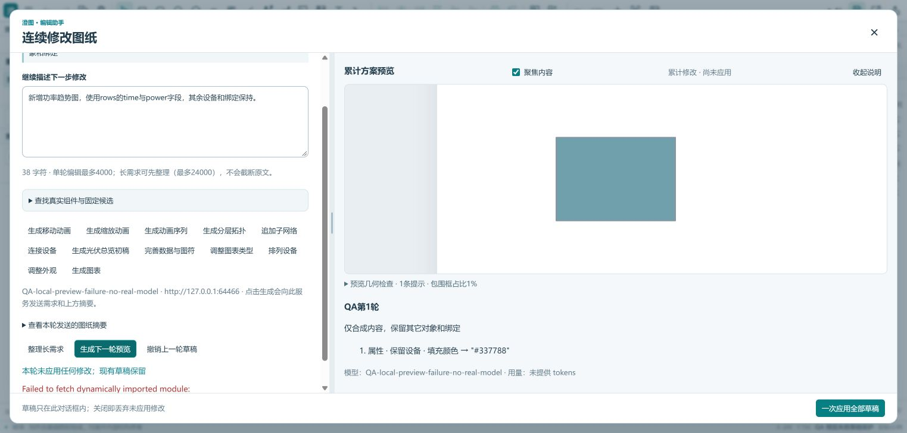
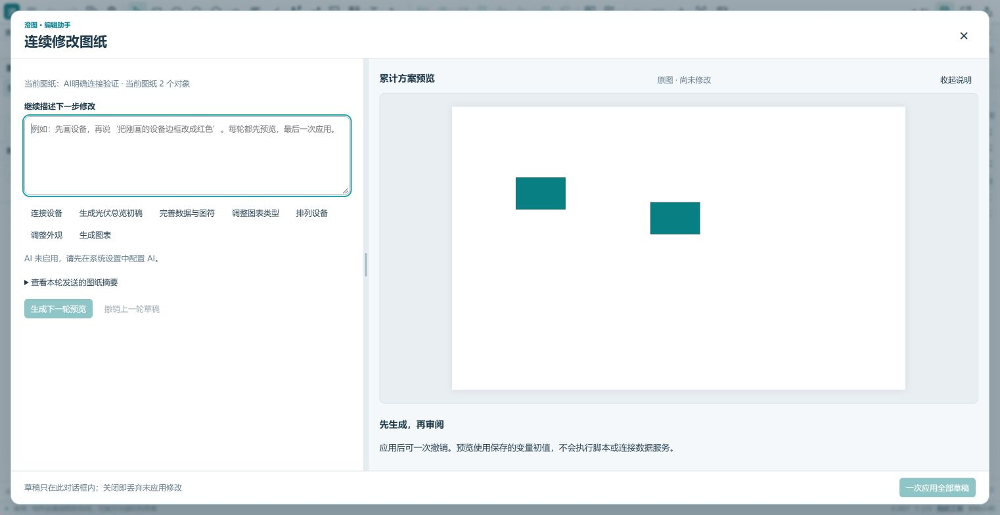

# 13 AI 绘图

第一次使用外部AI，可直接跟做[储能一次接线图逐步实操](13.3-跟着AI绘制储能一次接线图.md)：导出并安装Skills，复制提示词，逐轮看图、修改与核对。

[返回总目录](00-阅读指南与总目录.md)

在编辑器打开图纸，点击顶部「AI 助手」。初次使用先按[系统设置](16-系统设置与故障排查.md)配置模型接口。需要修改特定图元时，打开助手前先在画布选中它们，并核对对话框显示的作用范围。

图 13-1。对照左侧的修改记录和右侧的草稿预览，确认后再应用。

| 界面项目 | 用途与填写方式 |
| --- | --- |
| 继续描述下一步修改 | 用自然语言写明对象、目标和需要保留的内容。例如「把选中的矩形填充改为蓝色，保留尺寸和绑定」。具体动画要提供起止值、时长和触发事件。 |
| 示例按钮 | 将示例需求填入输入框，可按自己的图纸修改后再发送。 |
| 查看本轮发送的图纸摘要 | 查看将发送给模型的对象、属性、变量名称和类型等信息。变量实时值、图片和脚本源码不在摘要中。 |
| 整理长需求 | 把较长需求整理为分步方案。检查各步所需的变量、组件和条件，再逐步生成。 |
| 生成下一轮预览 | 基于当前累计草稿生成本轮修改。生成中可点击「取消生成」。 |
| 撤销上一轮草稿 | 撤销最近一轮成功生成的草稿，回到前一轮预览。 |
| 聚焦内容 | 调整预览视口，图纸大小仍以图纸属性为准。 |
| 预览几何检查 | 查看重叠、出界、标签和可能的文字溢出等提示。业务连线关系和现场含义需人工核对。 |
| 一次应用全部草稿 | 将累计修改写入当前编辑图纸，应用后可通过编辑器一次撤销。仍需保存工程。 |

左侧填写需求，右侧先显示原图，生成后可在同一区域核对草稿。

若出现待确认问题，在输入框补充对象、端口、变量或字段信息，再生成下一轮。若生成或渲染失败，阅读错误信息并检查上一次有效草稿。关掉对话框会丢弃未应用修改。预览用于审阅图形与变更说明，应用后在运行环境测试脚本、动画和数据连接。

### 让新增图元带有层次结构

生成整页监控总览后，应用草稿并打开左侧「结构」。标题与说明、实时指标、设备概览、趋势与图表以及运行状态会形成可展开的组合。展开组合可以编辑其中的图元。后续只想修改某个成员时，先在结构树中选中该成员，再打开 AI 助手。

局部新增也可以在需求里写明分区。例如「新增两张告警指标卡，放在『告警概览』组合内；已有图形和连线保持原层次」。生成后可在变更列表中核对组合名和成员数。AI 可以组合本轮新增图元，已有对象的重新归组请在编辑器里操作。电力一次图保持原连线结构，回路分组按相应的一次图编辑流程处理。

外部模型可通过 CLI 读取工程、提交绘图方案和数据契约，再输出可编辑图纸。[外部 AI 绘图与数据绑定](13.1-外部AI绘图与数据绑定.md)提供操作步骤、泵站和储能站示例。
