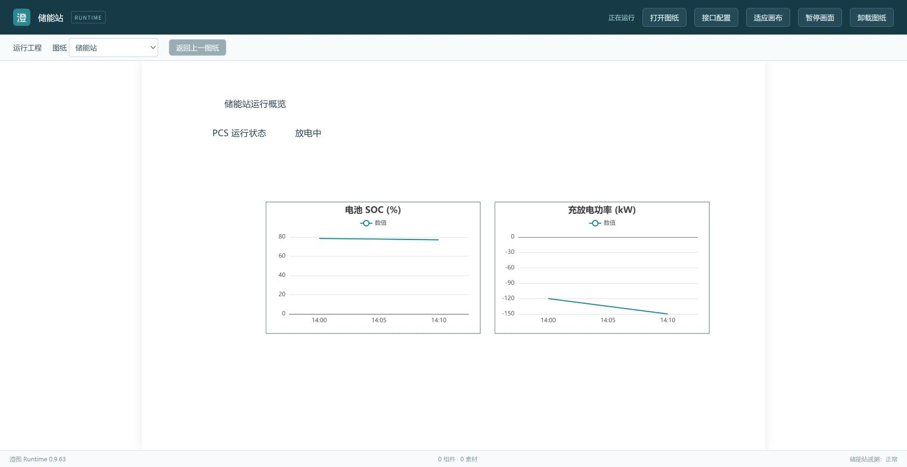

# 13.1 外部 AI 绘图与数据绑定

[返回 AI 绘图](13-AI绘图.md)

绘图命令行工具用于让外部 AI 读取澄图工程、预览绘图方案并另存修改结果。向项目交付方获取 Windows x64 版 `chengtu-cli.exe`，将它放在工程所在目录，在该目录打开 PowerShell 后执行下列命令。

```powershell
.\chengtu-cli.exe schema
.\chengtu-cli.exe inspect .\泵站.ctproj --query 阀门
.\chengtu-cli.exe preview .\泵站.ctproj --plan .\方案.json --query 阀门
.\chengtu-cli.exe apply .\泵站.ctproj --plan .\方案.json --query 阀门 --expect-base <预览返回的SHA256> --out .\泵站-修订.ctproj
```

使用时把示例里的 `<预览返回的SHA256>` 替换成实际值。文件编码为 UTF-8。默认选择工程入口图纸，可用 `--diagram` 指定其他图纸。重复 `--select` 可限制到指定的顶层对象。三步应使用相同的图纸、对象范围和组件关键词。每次继续编辑时，以刚保存的工程作为下一轮输入，重新读取上下文。

`schema` 返回 JSON Schema、限制和生成提示。`inspect` 返回图纸目录、对象和端口、属性契约、变量定义及组件候选。`preview` 返回变更、创建与删除对象和画面质量提示，适合智能体检查方案。`apply` 从输入工程重新校验方案后另存。输出目录须已存在且支持硬链接，输出文件已存在时会拒绝覆盖。可选的 `--expect-base` 将应用绑定到预览时读取的工程文件。

例如，工程已存在 `pump` 和 `tank` 两个对象，且上下文列出了以下端口时，方案可写为：

```json
{
  "version": 1,
  "title": "连接泵和水箱",
  "summary": "新增一条主水路，保留原对象",
  "questions": [],
  "operations": [
    { "op": "connect", "alias": "main", "name": "主水路", "source": "pump", "sourcePort": "east", "target": "tank", "targetPort": "west" }
  ]
}
```

机器调用成功退出码为 `0`，JSON 写到 stdout。方案有待确认项时返回 `needs_input` 和退出码 `2`。校验失败退出码为 `1`，诊断写到 stderr。两种失败都不生成工程。输出 `.ctproj` 可在编辑器里继续修改和检查视觉效果。

先查看命令输出中的变更。需要核对实际画面时，添加 `--web-preview` 生成浏览器预览。

## 将业务接口和画面设计交给 AI

给 AI 三份输入。第一份是 `schema` 的输出，包含绘图方案及数据契约的 JSON Schema。第二份是 `inspect` 返回的工程能力和图纸上下文。第三份是业务需求与脱敏响应样例，写明画面区域、数据字段、单位及交互要求。先让 AI 列出每项需求对应的对象、变量和字段，再输出文件。字段含义或关系不明确时，先让 AI 返回待确认问题。

如果工程还没有变量，可让 AI 提交一份 `--data-contract` 文件。数据契约版本为 `1`，包含 `dataSources` 和 `variables` 两个数组。数据源提供唯一 `id`、名称和 `http` 或 `websocket` 类型。HTTP 可配置 `poll` 或 `event`，WebSocket 可配置 `patch` 或 `snapshot`。变量提供唯一 `id`、类型和同类型 `defaultValue`，可附名称、单位及 `source`。`source` 用 `sourceId` 指定来源，`path` 用 JSON Pointer 指向字段。可选 `timestampPath` 指向 Unix 毫秒时间戳。空路径表示整份响应。所有 ID 按工程中的真实标识填写。

契约只新增配置，重复 ID 会被拒绝。新变量关闭下控和写库。接口地址、请求头及凭据由部署配置提供。`inspect` 输出变量类型、样例字段名和映射路径，默认值与实时值不会作为数据契约字段返回。数组变量可通过 `rowFields` 显式声明接口行字段，`defaultValue` 可以是 `[]`。每项填写 `name` 和 `type`，类型支持 `string`、`number`、`boolean`，最多 20 项。图表用这些字段确认映射，首次取数前可显示空图。字段声明会随工程保存，CLI 重开可继续读取。它用于设计阶段识别字段，运行时仍按数据源和图表规则处理响应。已有数组变量缺少声明时，CLI 仍可识别预览样例里的字段。

### 泵站状态与趋势图示例

接口响应形状为 `{"data":{"status":"运行中","trend":[{"time":"12:00","flow":37}]}}`。数据契约将 `/data/status` 映射成字符串，将 `/data/trend` 映射成数组。绘图方案放置标题、状态文字和折线图，状态文字用 `bind`，图表在 `chart` 操作里指定时间与流量字段。

- [泵站数据契约](examples/draw/pump-data.json)
- [泵站画面方案](examples/draw/pump-screen.json)

先在澄图新建并保存一张空白图为 `泵站.ctproj`，下载示例 JSON 到工程所在目录，再在该目录运行以下命令。

```powershell
$contract = '.\pump-data.json'
$plan = '.\pump-screen.json'
.\chengtu-cli.exe inspect .\泵站.ctproj --data-contract $contract
$preview = .\chengtu-cli.exe preview .\泵站.ctproj --data-contract $contract --plan $plan | ConvertFrom-Json
$preview
# 核对 dataChanges、changes 和 quality 后执行
.\chengtu-cli.exe apply .\泵站.ctproj --data-contract $contract --plan $plan --expect-base $preview.baseSha256 --out .\泵站监控.ctproj
```

应用时使用与预览一致的数据契约和方案文件。`--expect-base` 校验输入工程文件。输出工程同时保存数据契约和绑定。示例数据源使用 HTTP 事件触发，在运行环境填入本机接口配置后，可通过「请求 HTTP 数据源」动作触发。接入示例形状的 HTTP 响应后，状态文字可更新为「运行中」，趋势图收到流量 `37`。

能力仍受方案 Schema 及现有校验约束。复杂画面可以先按区域设计，再分轮执行，每轮读取上一轮输出工程。表单、操作面板及复杂布局的完整外部编辑覆盖仍待扩展。

### 在浏览器看方案画面

给 `preview` 增加 `--web-preview`，将当前草稿导出到一个新目录。它使用澄图独立运行引擎，可查看原生图元和图表。命令成功时，JSON 结果中的 `webPreview` 给出目录、页面和本机服务入口。

```powershell
.\chengtu-cli.exe preview .\泵站.ctproj --data-contract $contract --plan $plan --web-preview .\泵站预览
.\chengtu-cli.exe serve .\泵站预览
```

打开终端显示的本机地址下的 `project.html`，默认是 `http://127.0.0.1:4181/project.html`。要并行看两份方案，可以用 `--port 4182` 指定不同端口。预览目录包含本轮图纸和匹配的运行资源，输入工程不变。待确认方案不会生成目录。预览使用工程中的预览初值，接口地址和凭据请在运行环境另行配置。含图纸脚本的工程仅在可信环境打开。

如果生成过程报错，使用新的目录名重试。画面核对后，仍用 `apply` 另存可编辑的 `.ctproj`。浏览器预览目录也包含自包含的 `project/project.ctrun`，可用独立播放器打开。

## 能源示例｜储能站运行概览

这张画面显示 PCS 运行状态、电池 SOC 趋势和充放电功率趋势。样例约定功率为负表示放电，正表示充电，单位为 kW。SOC 使用百分数，例如 `77.1` 表示 `77.1%`。接入现场前按实际接口确认符号和单位。

| 画面内容 | 接口字段 | 绑定方式 |
| --- | --- | --- |
| PCS 运行状态 | `/data/mode` | 字符串变量 `storageMode` 绑定到文字对象 |
| 电池 SOC | `/data/trend` 中的 `time` 和 `soc` | 数组变量 `storageSoc` 作为折线图数据 |
| 充放电功率 | `/data/trend` 中的 `time` 和 `power` | 数组变量 `storagePower` 作为折线图数据 |

把以下四个文件下载到同一目录，并在澄图中创建一张空白图，保存为 `储能站.ctproj`。

- [储能站数据契约](examples/draw/storage-data.json)
- [储能站画面方案](examples/draw/storage-screen.json)
- [储能站模拟响应](examples/draw/storage-telemetry.json)
- [储能站预览接口配置](examples/draw/storage-config.json)

```powershell
$contract = '.\storage-data.json'
$plan = '.\storage-screen.json'
.\chengtu-cli.exe inspect .\储能站.ctproj --data-contract $contract
$preview = .\chengtu-cli.exe preview .\储能站.ctproj --data-contract $contract --plan $plan --web-preview .\储能站预览 | ConvertFrom-Json
$preview
Copy-Item .\storage-telemetry.json, .\storage-config.json .\储能站预览
.\chengtu-cli.exe serve .\储能站预览
```

访问 `http://127.0.0.1:4181/project.html?config=./storage-config.json`。播放器每 3 秒从本机预览服务读取模拟响应，画面显示「放电中」及两条趋势，最后一笔分别为 `77.1%` 和 `-150 kW`。可编辑预览目录中的模拟响应，观察下一次轮询更新。这个步骤只读取本机样例，适合在接入现场前核对绑定。



确认后按 Ctrl+C 停止本机服务，在同一终端执行另存。

```powershell
.\chengtu-cli.exe apply .\储能站.ctproj --data-contract $contract --plan $plan --expect-base $preview.baseSha256 --out .\储能站监控.ctproj
```

## 电力一次图与 AI 技能

用 skills --out 新目录导出配套指南及储能示例。一次图模型可通过 --plan 生成原生图元，设备测点目录通过 --device-catalog 校对绑定。[电力一次图操作指南](13.2-AI电力一次图与设备测点.md)。

## 明确指定设备插入接线与移出合线

先用 `inspect` 核对设备ID、连线ID和实际端口。一次只处理一个顶层设备。插入方案：

```json
{"format":"chengtu.electrical.splice","version":1,"operation":"insert","deviceId":"switch","edgeId":"wire","portIds":["north","south"]}
```

将 `switch`、`wire`、端口名替换为工程里的实际标识。先 `preview`，确认变更后用同一方案 `apply --out` 另存。插入后保留原线ID，增加续线并记录恢复信息。下一轮以另存工程重新 `inspect`；新增续线ID以实际结果为准。

移出设备并恢复原接线：

```json
{"format":"chengtu.electrical.splice","version":1,"operation":"remove","deviceId":"switch","position":{"x":300,"y":240}}
```

`position` 是图纸坐标，可省略，此时移到线路侧面。设备不会被删除。已修改拆分后的连线或增加分支时拒绝自动合线。锁定、绑定位置、端口不明确或图纸出界也会拒绝。使用 `--select` 时必须覆盖设备及所有受影响的现有连线；创建的续线会在 `created` 中列出。完整Schema由 `schema.spliceSchema` 返回。

一次图原模型与核验记录不会被自动改写；拆线改变模型连接时，结果 `electrical.changedConnections` 会列出待重新核对项。几何接线成功不代表业务拓扑已确认。

## 批量设置连线跨越弧

从 0.9.87 起，绘图 CLI 可为当前图纸已有连线启用或关闭跨越弧。用 `inspect` 确认连线 ID，并通过 `schema` 查看 `wireBridgeSchema`。将下面的示例保存为 `跨越弧.json`，把两个示例 ID 换成实际 ID。

```json
{
  "format": "chengtu.electrical.wire-bridges",
  "version": 1,
  "wires": [
    { "edgeId": "incoming", "enabled": true },
    { "edgeId": "outgoing", "enabled": false }
  ]
}
```

```powershell
$preview = .\chengtu-cli.exe preview .\一次图.ctproj --plan .\跨越弧.json --web-preview .\跨越弧预览 | ConvertFrom-Json
$preview.wireBridges
.\chengtu-cli.exe apply .\一次图.ctproj --plan .\跨越弧.json --expect-base $preview.baseSha256 --out .\一次图-跨越弧.ctproj
```

预览结果列出每条线的原值、新值和是否有变化。一个方案可配置 1 至 32 条线。多图纸工程可用 `--diagram` 指定图纸，两条命令应使用相同的图纸 ID。使用 `--select` 时，所有目标都须在选区内。重复 ID、非连线、锁定对象和已绑定的跨越弧会使整个方案被拒绝。此操作只修改跨越弧显示开关，原有端口、手工折点和测点绑定保持原状。组件定义中的连线可在编辑器里配置。

## 编辑整条电力回路

`schema` 返回 `circuitEditSchema`，`inspect` 返回一次图的回路、设备及连线。使用 `chengtu.electrical.circuit-edit` 方案新增、删除或替换一条接入已有母线的回路。预览的 `circuitImpact` 包括变更前后的回路和测点、删除的图元、新增及删除的接线、母线端口变化。应用要求 `--expect-base`，输出到新工程。操作步骤和方案下载见[替换整条回路示例](13.2-AI电力一次图与设备测点.md#新增、删除或替换整条回路)。

## 编辑跨回路联络线

`circuitLinkSchema` 描述跨回路线的新增与删除。新增方案指定两个不同回路的设备端子和接线依据。删除方案使用 `inspect` 返回的连接 ID。预览列出实际端口、两端回路和其他图连接路径，应用时带上 `--expect-base` 并另存。见[跨回路联络线示例](13.2-AI电力一次图与设备测点.md#新增和删除跨回路联络线)。

## 柜组与间隔归属

`cabinetPlanSchema` 定义已有一次图的柜组方案。先用 `inspect` 读取柜组、间隔及未归属回路，再提交完整的 `cabinets` 清单。预览会报告新增、移除、重命名和归属调整，应用时需要 `--expect-base`。见[柜组与间隔示例](13.2-AI电力一次图与设备测点.md#按柜组和间隔组织回路)。

只切换画布边界时，方案可省略 `cabinets`，填写布尔值 `showCabinetBoundaries`。在 `cabinetImpact.visibility` 中核对变更，在 `inspect` 的 `electrical.showCabinetBoundaries` 中核对保存状态。见[画布边界示例](13.2-AI电力一次图与设备测点.md#显示柜组和间隔边界)。

`cabinetReflowSchema` 用于按已保存的柜组顺序重排现有单列回路。预览列出回路位移、母线连接点及受影响连线，应用要求匹配的 `--expect-base`。见[已有一次图重排示例](13.2-AI电力一次图与设备测点.md#重排已有一次图的柜组回路)。

## 将实际预览保存为 PNG

0.9.80 起，可以直接从已保存的工程生成预览目录。多图纸工程可加 `--diagram` 指定图纸 ID。

```powershell
.\chengtu-cli.exe preview .\储能一次图.ctproj --web-preview .\预览
.\chengtu-cli.exe capture .\预览 --out .\预览.png --width 1440 --height 900
```

如果要检查尚未保存的修改，在 `preview` 中加 `--plan .\方案.json`。看完修改并另存后，再对另存的工程运行一次无方案预览，核对最终交付文件。

`capture` 使用机器上已有的 Chrome、Edge 或 Chromium。未自动找到时，可用 `--browser` 指定浏览器程序。命令会等图纸和字体加载完成，截取指定尺寸的运行页面；加载失败或超时不会生成 PNG，已有文件不会覆盖。宽度为 320–2560，高度为 240–1440。

截图使用独立浏览器会话和工程内的预览值，不加载部署地址，也不接入实时数据。把 PNG、预览诊断和目标要求一起交给 AI，调整方案后生成新目录和新截图再核对。PNG 只用于看图与审阅，不能证明电气连接已核验或现场数据在线。

在 0.9.81 及之后的版本中，`inspect` 返回的端口记录可以包含 `exitSide`。值 `north`、`east`、`south`、`west` 分别对应设备自身的上、右、下、左。连接方案继续用对象 ID 和端口 ID。自动正交线会按保存的出线侧计算路径。

## 搜索系统图库与固定电力图符版本

```powershell
.\chengtu-cli.exe symbols --root $library --query 开关
.\chengtu-cli.exe symbols --root $library --id $symbolId --revision $revision
```

`--root` 指向包含 `items` 的 `system-library` 目录。搜索返回最多 32 项并报告命中数。第二条命令提供某个固定版本的端口、公开输入、类型及可绑定标记。一次图方案的设备可填写 `symbol`。系统图库引用使用 `source: "system"`，预览和另存都传 `--system-library $library`。工程已有组件使用 `source: "project"`，ID 和版本从工程 `inspect` 取得。版本和输入字段说明及状态示例见[一次图与设备测点](13.2-AI电力一次图与设备测点.md)。
