# 13.2 AI 制作电力一次图


想按完整流程练习，请先阅读[跟着AI绘制储能一次接线图](13.3-跟着AI绘制储能一次接线图.md)，其中包含Skills安装、连续提示词、每轮画面和结果检查。

[返回 AI 绘图](13-AI绘图.md) · [外部 AI 绘图与数据绑定](13.1-外部AI绘图与数据绑定.md)

把设备清单、回路连接和测点资料交给 AI，可以生成一张可编辑的一次图草稿。设备、文字和连线各自保留身份，生成后可继续在编辑器里调整位置和样式。

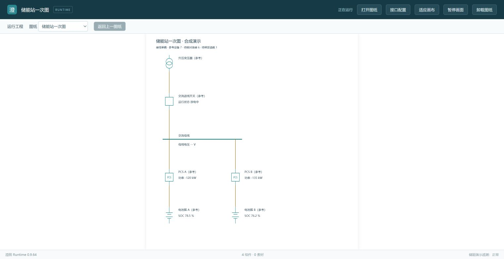

上图为本章合成示例的独立运行画面。棕色连接表示尚待核对，未绑定的母线电压显示 `--`；功率和 SOC 按设备分别取数。

## 把操作指南交给 AI

在澄图安装目录打开 PowerShell，将技能包导出到一个新目录。

```powershell
.\chengtu-cli.exe skills --out .\chengtu-draw
```

把导出的整个文件夹放入所用 AI 工具支持的技能目录，或让 AI 读取其中的 SKILL.md。文件夹包含操作指南、设备目录说明和储能演示文件。不同 AI 工具的技能目录位置由该工具决定。

可以这样描述任务。

> 用澄图生成储能站一次图。先读取 schema 和目标工程，按我给出的设备和连接表安排母线、开关、PCS 与电池簇。按设备 ID 和字段绑定功率与 SOC，单位按测点清单填写。没有依据的连接标为待核对，没有测点的读数显示 --。先给预览和映射清单。

CLI 的 schema 返回当前支持的全部字段。一次图模型填在 --plan 文件中，format 为 chengtu.electrical、version 为 1。已有图纸的局部修改使用普通绘图方案，详见 13.1 章。

## 按连接自动排布多支路

放射式一次图可以使用 `chengtu.electrical.topology` 格式。设备只填写 `id`、`name`、`kind`、`referenceOnly`，不填行、列和母线跨度。连接与读数字段沿用下表，程序按端口连接分层、分开各支路，并计算母线覆盖范围。

例如“总开关→母线→各支路断路器→PCS→电池簇”，只需列出真实连接。设备的 `south` 端放在 `north` 端上方，母线 `tap` 按相接设备端口安排；交换连接记录的 from/to 顺序不改变布局。这是画面上下位置的规则，不表示实际潮流方向。

技能包的 `assets/storage-topology-plan.json` 提供三支路储能示例。把本章预览、另存命令中的方案文件改为这个文件即可。A、B 支路沿用已提供测点，C 支路没有测点，功率和 SOC 显示 `--`。

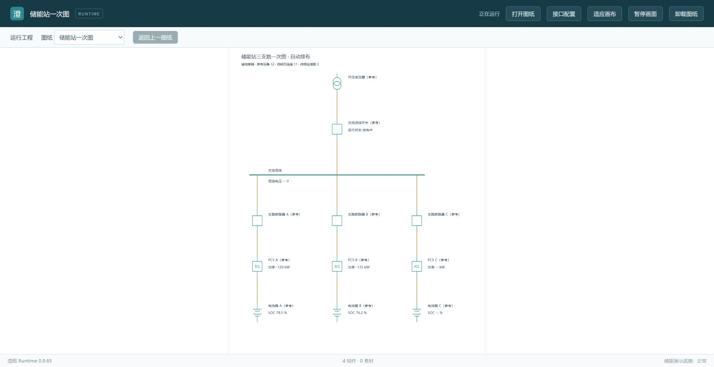

[下载三支路自动排布方案](examples/draw/storage-topology-plan.json)

预览返回 `electrical.layout.roots`（独立回路起点）和 `placements`（各设备的行、列、跨度），可结合实际画面核对。自动排布最多 16 行、16 列。环路、多路汇合、同向端口或规模超限会提示改用手动行列或拆分图纸；不要删除真实连接来规避提示。生成初稿后仍使用普通绘图方案或编辑器调整，保留已有绑定。

## 填写一次图模型

设备名称较长时，生成器保留完整文字并自动换行，按标签高度增加层间距，避免挤占下方读数。名称仍可在编辑器中修改。自动换行按估算字宽计算，更换字体后请核对实际显示；过多长名称会增加图纸高度，可缩短显示名称或拆分详情图纸。

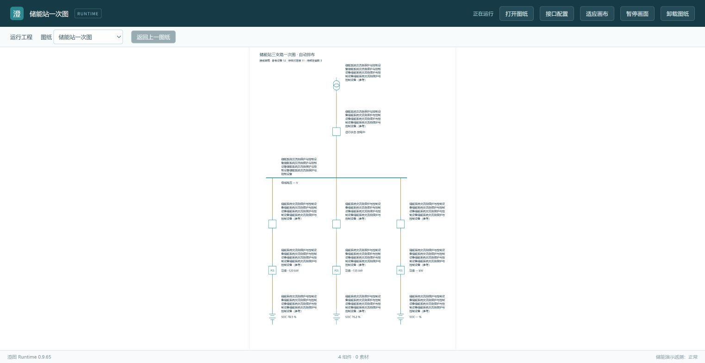

| 区域 | 字段 | 用途 |
| --- | --- | --- |
| 整图 | title | 页面顶部的标题 |
| devices | id、name | 设备稳定标识和显示名称 |
| devices | kind | bus 母线、breaker 断路器、disconnect 隔离开关、transformer 变压器、pcs、battery 电池、meter 仪表、load 负荷 |
| devices | column、row | 设备所在的列、行，从 0 开始。相邻布局格由程序留出标签和读数空间 |
| devices | span | 母线横向覆盖的列数，其他设备填 1 |
| devices | referenceOnly | 图示或设备配置是否仅供参考 |
| connections | id、from、to | 连线标识及两端设备 ID |
| connections | fromPort、toPort | 设备选 north 上端或 south 下端；母线选 tap，连接点按对端设备列放置 |
| connections | verified、evidence | 连接是否已确认，以及所依据的图纸、表格或说明 |
| readings | id、ownerId、label | 读数标识、所属设备 ID 和显示名称 |
| readings | catalogDeviceId、measurementId | 实际设备及测点 ID，两项同时填写；尚未匹配时同时留空 |
| readings | unit | 单位，须与测点及变量一致，例如 kW、% |

生成初稿时选择空白图纸。每张图最多 40 个设备、64 个连接、80 个读数，每个设备旁最多放置 5 个读数。母线可横向覆盖多列，同一行的布局格不能重叠。规模较大时按区域或母线段拆图。

图符为简化草稿表达。根据项目采用的图形规范核对图符、设备角色和状态。模型中的确认标记只记录制图依据，带电区域、保护计算和现场接线仍按项目业务规则核定。

## 填写设备测点目录

设备目录通过 --device-catalog 传入。每台设备填写 id、name 和 measurements。每个测点填写 id、variableId、type 和 unit。variableId 指向工程已有变量；需要新增变量时，先用 --data-contract 声明。

例如 meterA 的 power 测点对应 storage.A.power，类型 number，单位 kW。meterB 的 power 对应另一变量 storage.B.power。名称相同的测点仍按设备 ID 分别核对。

目录整理自项目实际接口或设备表。CLI 读取目录文件，运行画面通过部署配置连接 HTTP 或 WebSocket 数据。接口地址与凭据在运行环境填写。

## 运行储能示例

技能包 assets 中提供空白工程、一次图模型、设备目录、数据契约和模拟响应。在导出技能包的同一目录执行。

```powershell
$assets = '.\chengtu-draw\assets'
$inputFile = "$assets\storage-electrical.ctproj"
$plan = "$assets\storage-electrical-plan.json"
$catalog = "$assets\storage-device-catalog.json"
$data = "$assets\storage-electrical-data.json"

.\chengtu-cli.exe inspect $inputFile --data-contract $data --device-catalog $catalog
$preview = .\chengtu-cli.exe preview $inputFile --plan $plan --data-contract $data --device-catalog $catalog --web-preview .\储能一次图预览 | ConvertFrom-Json
$preview.electrical
Copy-Item "$assets\storage-electrical-config.json", "$assets\storage-electrical-response.json" .\储能一次图预览
.\chengtu-cli.exe serve .\储能一次图预览
```

访问终端显示的地址并加上 ?config=./storage-electrical-config.json。示例有两套 PCS 和电池簇，功率负数表示放电。数据来自本机模拟响应，母线电压保留待绑定。修改预览目录中的模拟响应，观察对应设备的读数更新。

核对完成后按 Ctrl+C 停止服务，并另存工程。

```powershell
.\chengtu-cli.exe apply $inputFile --plan $plan --data-contract $data --device-catalog $catalog --expect-base $preview.baseSha256 --out .\储能一次图.ctproj
.\chengtu-cli.exe inspect .\储能一次图.ctproj
```

## 阅读映射核对结果

### 查看逐回路运行数据质量

完整运行环境加载图纸后，单击画布右上角的「质量清单」。面板按回路列出设备、测点、变量、质量状态、数据时刻和数据年龄。未归属回路的读数单独列出；没有回路声明的图纸仍可采集变量质量。

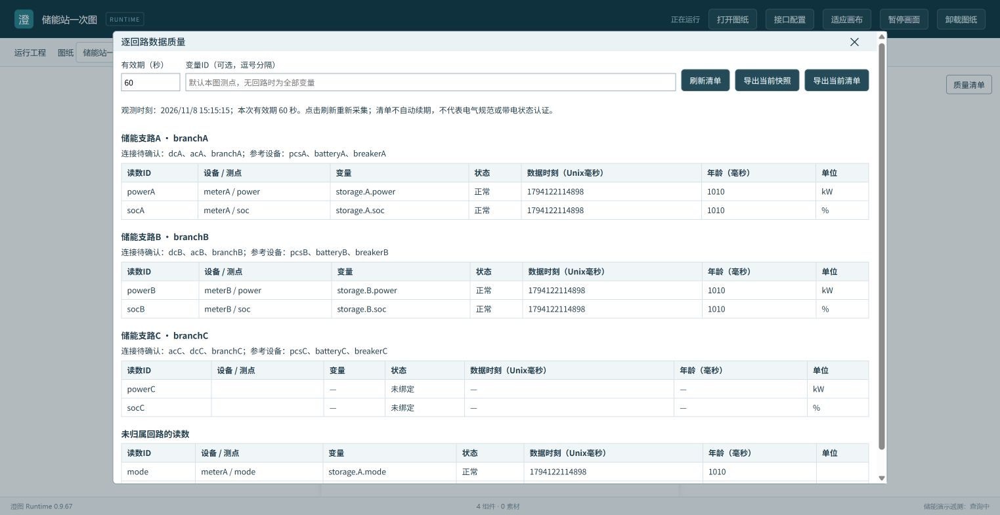

| 输入或操作 | 用途 |
| --- | --- |
| 有效期（秒） | 用本次观测时刻减去数据时刻判断过期，填写 1–86400 的整数，默认 60 秒。不会修改变量的数据接收时间或原有过期配置 |
| 变量 ID | 可选，用逗号分隔。留空采集本图电力读数绑定的变量；没有电力声明时采集全部变量。最多 500 项，未知 ID 会提示错误 |
| 刷新清单 | 从当前运行会话重新采集，不另建数据连接。面板固定显示本次结果，需要再次单击才更新 |
| 导出当前快照 | 下载本次变量 ID、质量、时间及有效期 JSON，可交给 CLI 核对 |
| 导出当前清单 | 下载当前逐回路报告，包含映射状态和待确认项 |
| × / Esc | 关闭清单。切换或卸载图纸时也会关闭旧清单 |

修改有效期或变量 ID 后，请先刷新再导出。导出内容不含业务数值、接口地址或凭据。独立的精简嵌入引擎不提供该面板，需使用完整运行环境。

「正常」表示该快照内质量正常且未超过本次有效期，不表示当前仍在线。其他状态包括未绑定、无样本、等待数据、字段缺失、错误、连接中断、过期、时间未知及未来时间。暂停画面不等于停止数据接收。

连接待确认、连接已变化、参考设备与数据质量分别核对。例如 A 回路读数正常，仍可能有尚未确认的接线。此清单不执行电气规范、潮流或带电拓扑认证。

将导出的快照与同一版本工程一起交给外部 AI，可执行只读核对：

```powershell
.\chengtu-cli.exe inspect .\储能一次图.ctproj --data-snapshot .\chengtu-quality-snapshot.json
```

结果位于 `circuitQuality`。快照对应采集时的工程，后续变更映射或测点后应重新采集；不要将旧快照当成实时连接检测。

### 按回路定位与移动

在一次图方案中增加可选 `circuits` 数组，每个回路填写 `id`、`name`、`deviceIds`（设备 ID 列表）。同一设备只能属于一个回路，共享母线不能列为回路成员。三支路储能示例已声明 branchA、branchB、branchC。

生成并保存后执行 inspect，在 `electrical.circuits` 中核对该回路的设备、读数、内部连接及边界连接。把下面内容保存为 move-circuit.json，使用普通 preview/apply 命令对已生成工程操作：

```json
{"format":"chengtu.electrical.circuit-move","version":1,"circuitId":"branchA","dx":20,"dy":0}
```

dx、dy 是画布坐标位移，正数表示向右、向下，范围各为 -5000 到 5000。设备、名称标签和读数一起移动，变量绑定和连接端子保持，母线及其他回路保持。相关连线含手工折点、端点已改变，或成员缺失、锁定、位置绑定、选区不完整时，会拒绝操作；请先核对工程，不要删除保护信息强行移动。仍需查看预览中的几何提示，移动不会自动证明接线或布局正确。

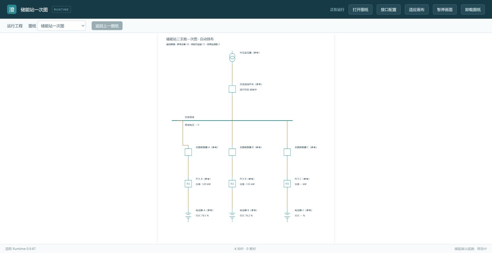

| 输出字段 | 如何使用 |
| --- | --- |
| mappings | 逐项查看设备、测点、变量、单位和来源路径 |
| unboundReadings | 尚未指定设备测点的读数 |
| unverifiedConnections | 生成时尚未确认的连接 |
| referenceDevices | 仅供参考的设备 |
| changedReadings | 另存后重新 inspect 时，表达式、变量来源、类型或单位已改变的读数 |
| changedConnections | 重新 inspect 时，端点已改变或连线已移除的项目 |

quality 提供出界、文字及连线相交等几何提示。结合实际预览检查，必要时用普通方案或编辑器调整。位置或样式修改保留对象身份；映射或连接变化会提示复核。

[一次图模型示例](examples/draw/storage-electrical-plan.json) · [设备目录](examples/draw/storage-device-catalog.json) · [数据契约](examples/draw/storage-electrical-data.json) · <a href="examples/draw/storage-electrical.ctproj" download>空白示例工程</a>

### 用截图核对修改后的运行画面

先用 `preview --web-preview` 生成一个预览目录，再把该目录交给 `capture`。例如，修改 B 支路标签后执行：

```powershell
.\chengtu-cli.exe capture .\储能预览 --out .\储能预览-第二轮.png --width 1200 --height 800
```

把 PNG 和 `inspect` 输出交给 AI，分别核对画面与工程：图中 B 支路显示「PCS B 已核对」，再用 `inspect` 检查其设备身份、端子和测点绑定是否保持。每轮使用新的输出文件名。截图为离线预览，未接入数据时读数显示 `--`，接口提示会如实保留；逐回路的运行质量应另外用运行环境导出的快照检查。

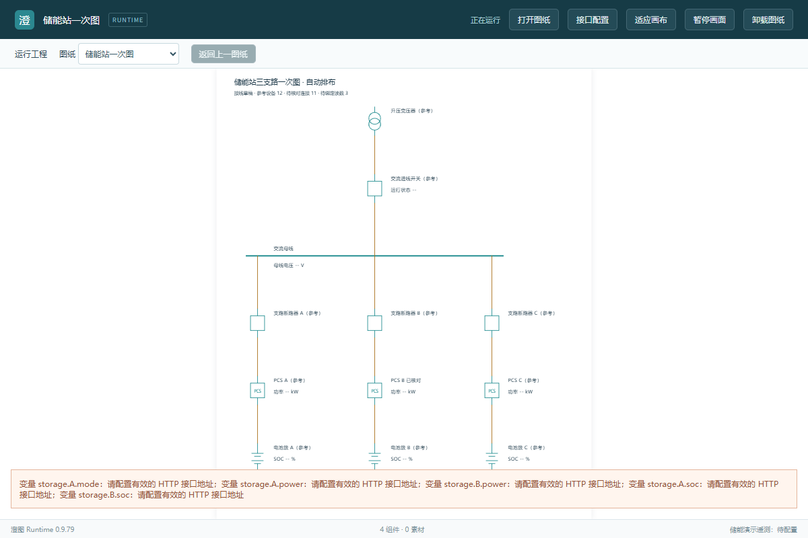

### 长读数与交付文件复核

在 0.9.80 生成新图时，较长的读数名称会分行，数值和单位有单独的显示空间。如果是在修改现有图纸，可先让 AI 根据截图定位问题，再调整读数的文本框或字号。遇到已绑定读数，保留文字表达式和变量绑定。另存后用下面的命令对最终工程截图。

```powershell
.\chengtu-cli.exe preview .\储能一次图-交付.ctproj --web-preview .\交付预览
.\chengtu-cli.exe capture .\交付预览 --out .\交付核对.png
.\chengtu-cli.exe inspect .\储能一次图-交付.ctproj
```

对照修改前后的 `electrical.mappings` 和 `electrical.connections`，核对测点、端口和连接。下图中 B 支路显示了完整功率名称与单位。

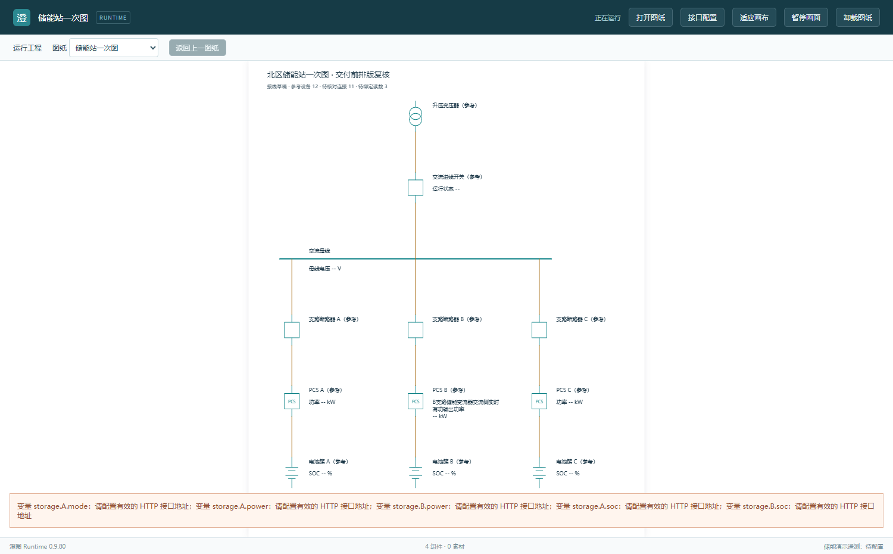

## 让 AI 选用系统图库电力符号

从 0.9.82 起，外部 AI 可以先查图库，再用选中的版本生成一次图。把系统图库目录交给 AI，路径应是包含 `items` 子目录的 `system-library` 目录。桌面版通常把它放在该安装实例的数据目录下，与默认 `workspace` 同级。

```powershell
.\chengtu-cli.exe symbols --root $library --query 开关
.\chengtu-cli.exe symbols --root $library --id $symbolId --revision $revision
```

第一条列出匹配的名称、分类、ID 和版本，第二条列出真实的端口 ID、公开输入、类型和可绑定标记。把结果和设备测点目录交给 AI，明确哪台设备用哪个图符、哪一路遥信控制哪个输入。已经加入工程图库的组件可用 `inspect --query 开关` 查询，再用 `source: "project"` 引用。

下面是某个设备的 `symbol` 字段示意。请把 ID、版本、端口和测点替换成实际查询结果。

```json
{
  "source": "system",
  "id": "<图库返回的 ID>",
  "revision": "<图库返回的版本>",
  "ports": { "north": "north", "south": "south" },
  "bindings": [
    { "inputId": "expose-state", "catalogDeviceId": "switchA", "measurementId": "closed" }
  ],
  "stateTint": {
    "catalogDeviceId": "switchA",
    "measurementId": "closed",
    "trueColor": "#FFFFFF",
    "falseColor": "#505050"
  }
}
```

- `ports` 把一次图布局中的上、下接线角色映射到图符的真实端口。组件提供自定义接线端子时，按端口含义填写。默认上、下端口是边界位置，画完后应核对是否落到正确的接线点。
- `bindings` 把某台设备的测点绑定到该实例的公开输入。图符内部配置了状态规则时，输入会驱动对应外观。两个开关可以复用同一个图符，分别使用各自的测点。
- `stateTint` 可选。布尔测点选择两种整体染色，颜色与原图颜色相乘。白色保持原色，示例的深灰色将原色压暗。实际项目先确认布尔值和配色约定。需要显示不同的分合闸形状时，在组件定义中配置输入到图形的规则。

`preview` 和 `apply` 使用相同的方案和 `--system-library $library`。另存后，用 `inspect` 的 `electrical.symbols` 核对图符版本与测点绑定，再用独立运行环境验证。运行所需的组件及其依赖已随工程保存。

下图使用同一个图库开关的两个实例。模拟遥信交换后，A、B 的颜色各自随自己的测点变化。

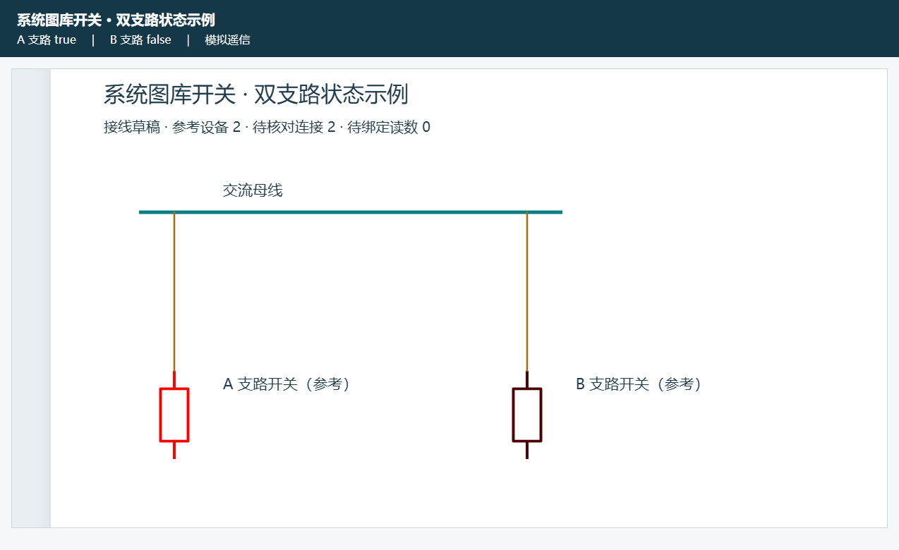

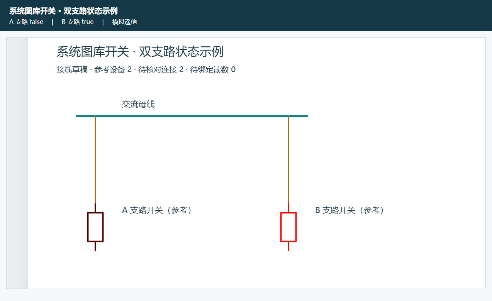

## 批量设置连线跨越弧

从 0.9.87 起，绘图 CLI 可为当前图纸已有连线启用或关闭跨越弧。用 `inspect` 确认连线 ID，并通过 `schema` 查看 `wireBridgeSchema`。将下面的示例保存为 `跨越弧.json`，把两个示例 ID 换成实际 ID。

```json
{
  "format": "chengtu.electrical.wire-bridges",
  "version": 1,
  "wires": [
    { "edgeId": "incoming", "enabled": true },
    { "edgeId": "outgoing", "enabled": false }
  ]
}
```

```powershell
$preview = .\chengtu-cli.exe preview .\一次图.ctproj --plan .\跨越弧.json --web-preview .\跨越弧预览 | ConvertFrom-Json
$preview.wireBridges
.\chengtu-cli.exe apply .\一次图.ctproj --plan .\跨越弧.json --expect-base $preview.baseSha256 --out .\一次图-跨越弧.ctproj
```

预览结果列出每条线的原值、新值和是否有变化。一个方案可配置 1 至 32 条线。多图纸工程可用 `--diagram` 指定图纸，两条命令应使用相同的图纸 ID。使用 `--select` 时，所有目标都须在选区内。重复 ID、非连线、锁定对象和已绑定的跨越弧会使整个方案被拒绝。此操作只修改跨越弧显示开关，原有端口、手工折点和测点绑定保持原状。组件定义中的连线可在编辑器里配置。

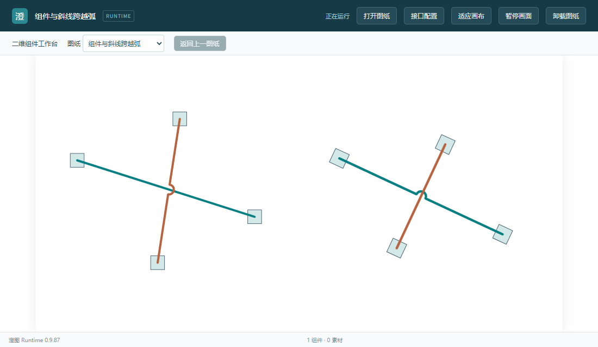

## 新增、删除或替换整条回路

从 0.9.88 起，可在已有一次图中一次处理一条回路。先用 `inspect` 查看 `electrical.circuits`、`electrical.devices` 和 `electrical.connections`，并用 `schema` 查阅 `circuitEditSchema`。

| 字段 | 如何填写 |
| --- | --- |
| `operation` | `add` 新增，`remove` 删除，`replace` 替换 |
| `circuitId` | 新增时用新的回路 ID，删除和替换时用检查结果中的回路 ID |
| `name`、`devices` | 新增或替换的回路名称和设备清单。设备使用新的 ID，`column` 和 `row` 用于记录并核对布局格 |
| `positions` | 每台新设备的画布坐标，`x` 向右、`y` 向下。可参考 `inspect` 中已有设备的坐标 |
| `connections` | 为新线分配 ID，明确两个端口、连接依据和确认状态。回路接入已有母线，母线侧用 `tap` |
| `readings` | 每项用新 ID，填写所属设备、显示名称、设备目录 ID、测点 ID 和单位。没有可核实的测点时两个目录 ID 均留空，界面显示 `--` |

删除方案只填写 `format`、`version`、`operation`、`circuitId`。新增或替换时填写表中所有字段。绑定真实测点时，在预览和另存命令中传入同一份 `--device-catalog`。工程图符或系统图符应指定固定版本，系统图符还需提供 `--system-library`。

1. 用本章的三支路储能示例生成并保存 `三支路储能.ctproj`。
2. 下载[替换 C 回路示例方案](examples/draw/storage-circuit-replace.json)。它将 C 回路替换成站用负荷支路，保留 A、B 两条储能回路。
3. 运行以下命令生成预览。打开预览图纸核对版面，同时检查 `circuitImpact` 中的前后成员、测点、连线和母线端口。未确认连接保持待核对状态。

```powershell
$preview = .\chengtu-cli.exe preview .\三支路储能.ctproj --plan .\storage-circuit-replace.json --web-preview .\替换预览 | ConvertFrom-Json
$preview.circuitImpact | ConvertTo-Json -Depth 15
```

4. 确认后沿用原方案和参数，带上预览返回的工程基线另存。

```powershell
.\chengtu-cli.exe apply .\三支路储能.ctproj --plan .\storage-circuit-replace.json --expect-base $preview.baseSha256 --out .\三支路储能-已替换.ctproj
.\chengtu-cli.exe inspect .\三支路储能-已替换.ctproj
```

原工程保留。回路内存在锁定对象、额外接线、引用冲突或测点映射被改动时，工具会拒绝整次操作。跨回路接线请先在编辑器核对。删除回路保留工程中的变量和组件库。删除母线端口时保留原坐标属性，以免破坏已有引用，后续新增连接使用新 ID。

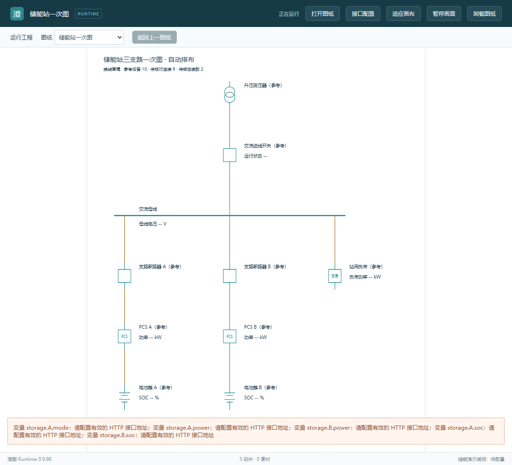

此图来自离线预览，已有支路因未配置数据接口而显示 "待配置"。在运行环境接入工程的数据接口后，可检查已绑定的 A、B 支路读数。示例中的站用负荷功率仍待绑定。

## 新增和删除跨回路联络线

从 0.9.89 起，CLI 可在同一张一次图中连接两条已登记回路的设备端子。用 `inspect` 查看设备和回路 ID，以及 `electrical.circuitLinks` 中已登记的跨回路线。用 `schema` 查看 `circuitLinkSchema`。

1. 用本章三支路储能示例保存 `三支路储能.ctproj`，下载[跨回路联络线示例](examples/draw/storage-circuit-link.json)。示例把 A、B 回路的断路器下端连接起来，使用待核对标记。
2. 预览并检查 `circuitLinkImpact`。其中 `fromCircuit`、`toCircuit` 是两端回路，`source`、`target` 给出实际图符端口 ID，`otherModeledPath` 表示去掉本线后，设备之间是否仍有模型连接路径。该检查包含待核对接线，只反映图纸结构。现场接线、带电状态与保护配置须另行核验。

```powershell
$preview = .\chengtu-cli.exe preview .\三支路储能.ctproj --plan .\storage-circuit-link.json --web-preview .\联络线预览 | ConvertFrom-Json
$preview.circuitLinkImpact | ConvertTo-Json -Depth 10
.\chengtu-cli.exe apply .\三支路储能.ctproj --plan .\storage-circuit-link.json --expect-base $preview.baseSha256 --out .\三支路储能-已接线.ctproj
```

3. 删除时，将下面的内容保存为 `删除联络线.json`，以另存后的工程为输入重新预览，再用新基线另存。关联整条回路的删除或替换，应先逐条核对并处理跨回路线。

```json
{
  "format": "chengtu.electrical.circuit-link",
  "version": 1,
  "operation": "remove",
  "connectionId": "tieAB"
}
```

如果启用了选区，请把两端设备加入选区，删除时还要包含联络线本身。若预览提示接线说明会更新，也须将说明对象加入选区。重复接线、被手工改过端点的连线、锁定对象和引用冲突会被拒绝。

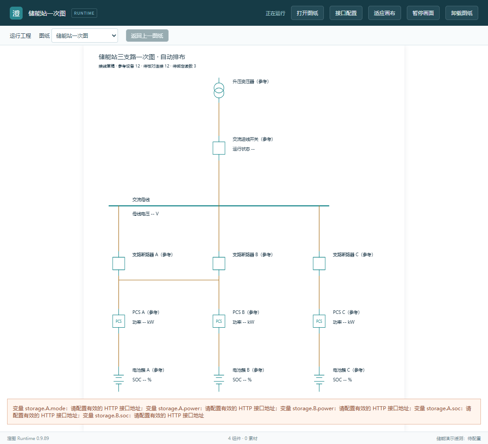

截图为离线示例，测点接口待配置。

## 按柜组和间隔组织回路

从 0.9.90 起，一次图可记录「柜组 → 间隔 → 回路」归属。可在初次生成时填写 `cabinets`，也可用 CLI 为已有一次图补填或修改归属。此操作保存工程中的电气归属，画面位置和测点绑定保持原样。

| 字段 | 如何填写 |
| --- | --- |
| `cabinets` | 整张图纸的柜组清单。每项包含稳定的 `id`、显示名称 `name` 和 `bays` |
| `bays` | 该柜组的间隔清单。每项填写 `id`、`name` 和 `circuitIds`。间隔 ID 在图纸内唯一 |
| `circuitIds` | 此间隔包含的回路 ID，用 `inspect` 核实。每条回路最多归属一个间隔，可以暂未归属 |

1. 打开已保存的三支路储能示例，下载[柜组与间隔示例方案](examples/draw/storage-cabinets.json)。示例将 A、B 支路分别放入两个间隔，C 支路暂未归属。
2. 用以下命令预览。核对 `cabinetImpact` 的柜组、间隔和回路变更，以及 `unassignedCircuitIds` 中暂未归属的回路。

```powershell
$preview = .\chengtu-cli.exe preview .\三支路储能.ctproj --plan .\storage-cabinets.json | ConvertFrom-Json
$preview.cabinetImpact | ConvertTo-Json -Depth 10
.\chengtu-cli.exe apply .\三支路储能.ctproj --plan .\storage-cabinets.json --expect-base $preview.baseSha256 --out .\三支路储能-已分间隔.ctproj
$saved = .\chengtu-cli.exe inspect .\三支路储能-已分间隔.ctproj | ConvertFrom-Json
$saved.electrical.cabinets | ConvertTo-Json -Depth 10
```

3. 检查间隔下的 `circuitIds`、`deviceIds`、`readingIds`。例如 A 支路间隔应含 `branchA` 和 `powerA`、`socA` 两项读数，C 支路应列在 `unassignedCircuitIds`。

修改时先读取已有归属，再按表中字段提交完整柜组清单。`deviceIds` 和 `readingIds` 由查询生成，填写方案时只需提供 `circuitIds`。清单中的某个间隔留空时，原有回路会变为未归属。提交空的 `cabinets` 会清除整张图纸的归属。替换整条回路沿用原回路 ID 和所属间隔，删除回路时会从间隔移除该回路。柜组方案作用于整张图纸，使用前取消选区。

### 显示柜组和间隔边界

从 0.9.91 起，编辑器和运行播放器会根据可见的回路设备、名称和读数绘制边界。柜组用实线，间隔用虚线。空的间隔没有边界，共享母线与未归属回路仍按原样显示。移动回路图元时，边界会跟随更新。边界位于画布背景，单击和拖动仍可操作图元。

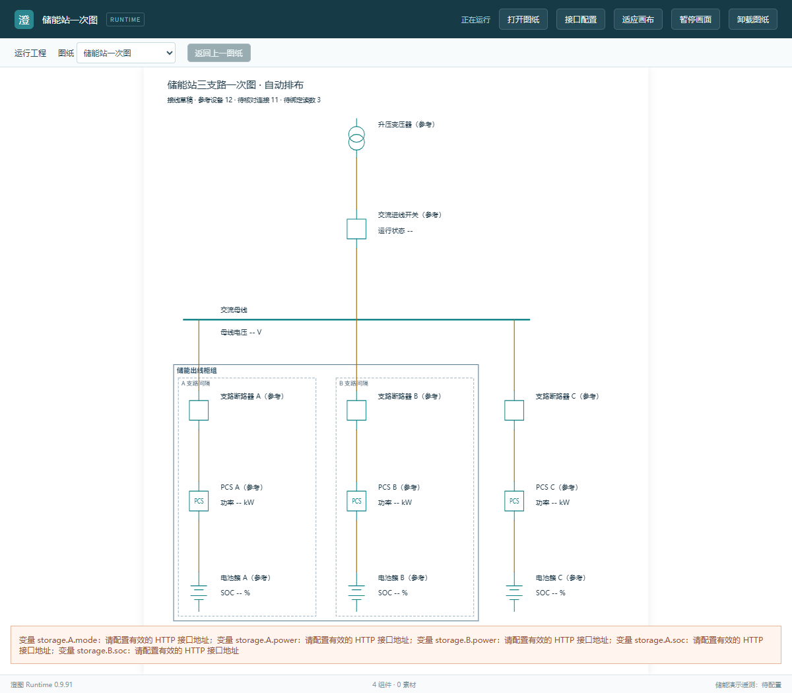

截图为离线示例，测点接口待配置。若需要只隐藏边界，可将以下方案另存应用。将 `false` 改成 `true` 可重新显示。

```json
{
  "format": "chengtu.electrical.cabinets",
  "version": 1,
  "showCabinetBoundaries": false
}
```

沿用本节的 `preview` 和 `apply --expect-base` 命令。预览的 `cabinetImpact.visibility` 给出切换前后的状态，柜组与间隔归属继续保留。

### 在编辑器内管理柜组和间隔

从 0.9.92 起，打开包含已登记回路的一次图，在编辑模式选择「工程 → 柜组与间隔」。可以添加、重命名、排序和删除柜组与间隔。在「回路归属」中用下拉框选择间隔，选择「未归属」可解除关联。「显示画布边界」控制当前图纸的边界。确认后可一次撤销或重做，点击「保存工程」后写入文件。

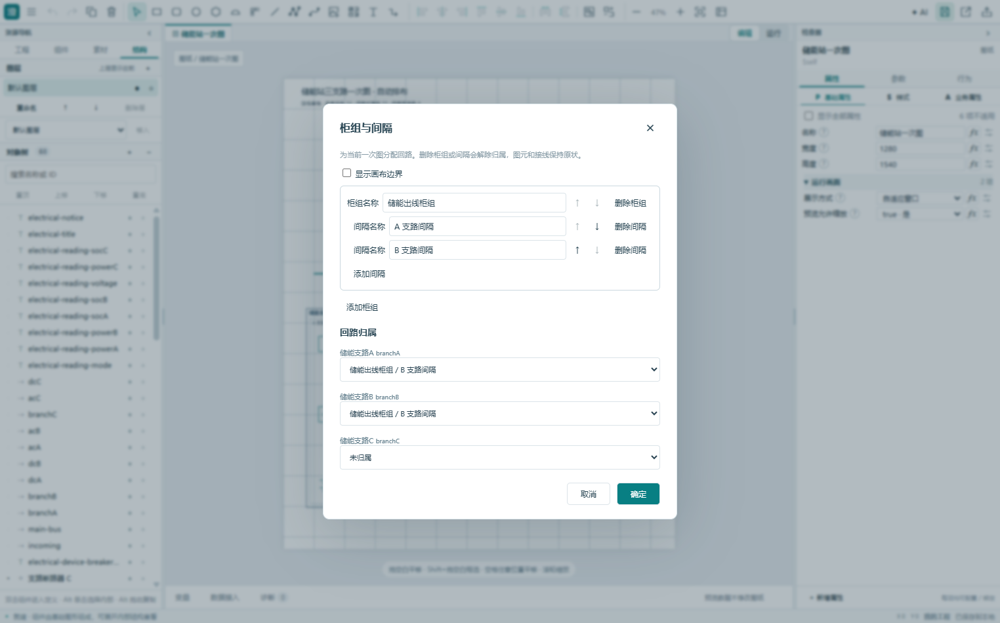

### 生成一次图时按柜组排布

下载[按柜组排布的储能示例](examples/draw/storage-cabinet-layout.json)，用它替换本章生成三支路一次图时的方案文件。方案设置 `layoutByCabinet: true`。程序按柜组、间隔、回路清单中的顺序，从左到右安排列，并继续按端口关系确定设备上下层。示例结果为 C、A、B 三列，其中 C、A 属于同一间隔。用 `electrical.layout.placements` 和运行预览核对。

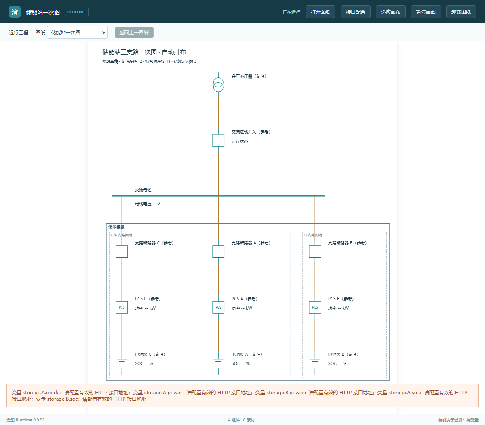

上述生成方式适用于空白图纸的放射式一次图初稿。已有图纸中的管理窗口调整归属与显示，保存后继续使用原位置。需要按新归属顺序调整已有画面时，使用下节的重排方案。

### 重排已有一次图的柜组回路

从 0.9.93 起，可按保存的柜组、间隔和回路顺序，交换已归属单列回路的位置。至少需要两条分别占用不同列的回路。以已保存的三支路储能图为例，在「工程 → 柜组与间隔」中让 B 间隔排在 A 间隔前面，保存工程。将以下内容保存为 `柜组重排.json`。

```json
{
  "format": "chengtu.electrical.cabinet-reflow",
  "version": 1
}
```

```powershell
$preview = .\chengtu-cli.exe preview .\三支路储能.ctproj --plan .\柜组重排.json --web-preview .\重排预览 | ConvertFrom-Json
$preview.cabinetReflow | ConvertTo-Json -Depth 10
.\chengtu-cli.exe apply .\三支路储能.ctproj --plan .\柜组重排.json --expect-base $preview.baseSha256 --out .\三支路储能-已重排.ctproj
```

检查 `cabinetReflow.circuits` 的原列、新列和位移，以及 `taps` 中母线连接点的坐标变化。打开运行预览，确认 B 回路在左，A 回路在中，未归属的 C 回路留在原处。

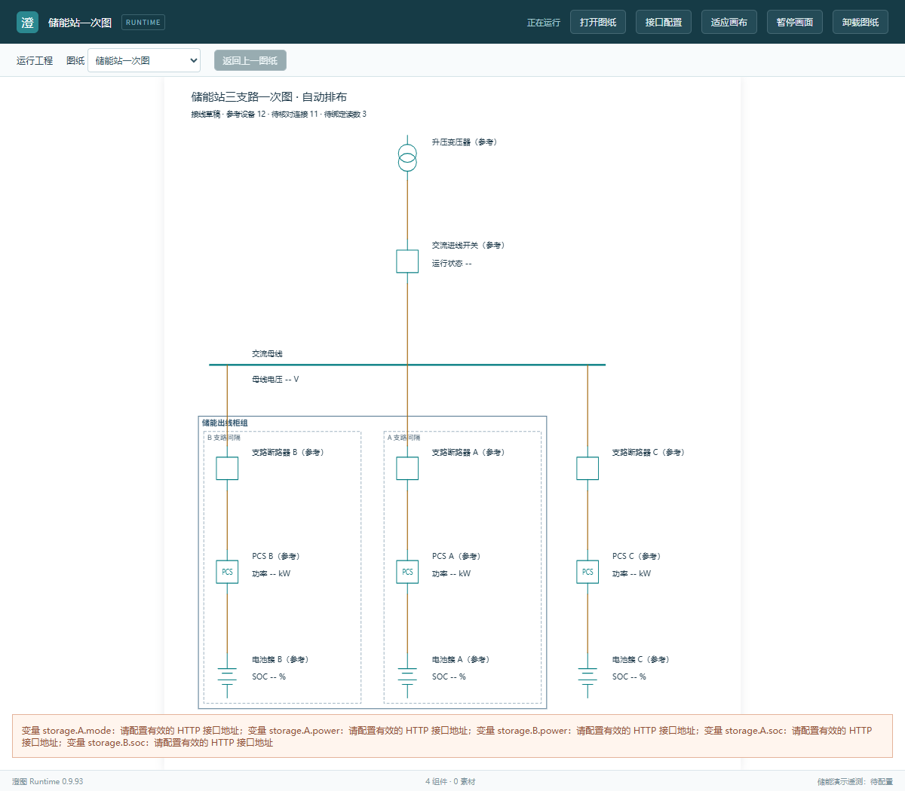

重排保留已有图元和端口 ID，设备、名称、读数一同平移，关联连线按原端点重新路由。方案作用于整张图纸，使用前取消选区。涉及绑定位置、手工折点、未登记连线、锁定对象、非水平母线、出界或新重叠时会拒绝，先按提示在编辑器中核对。
