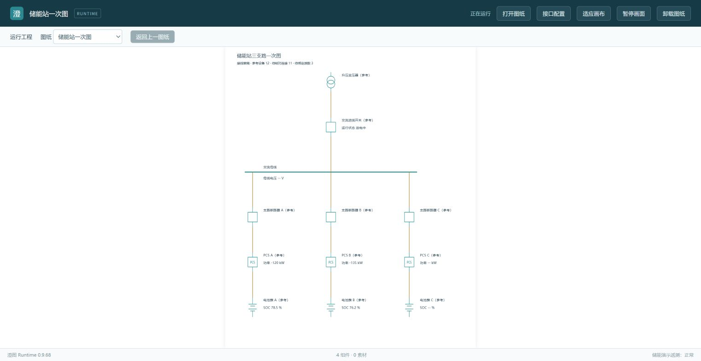
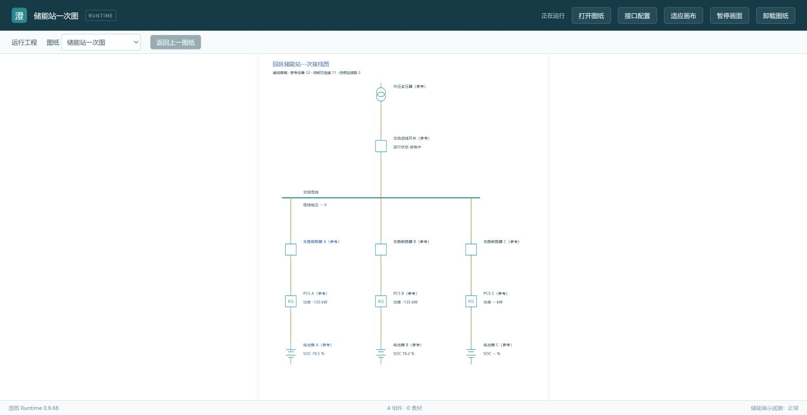
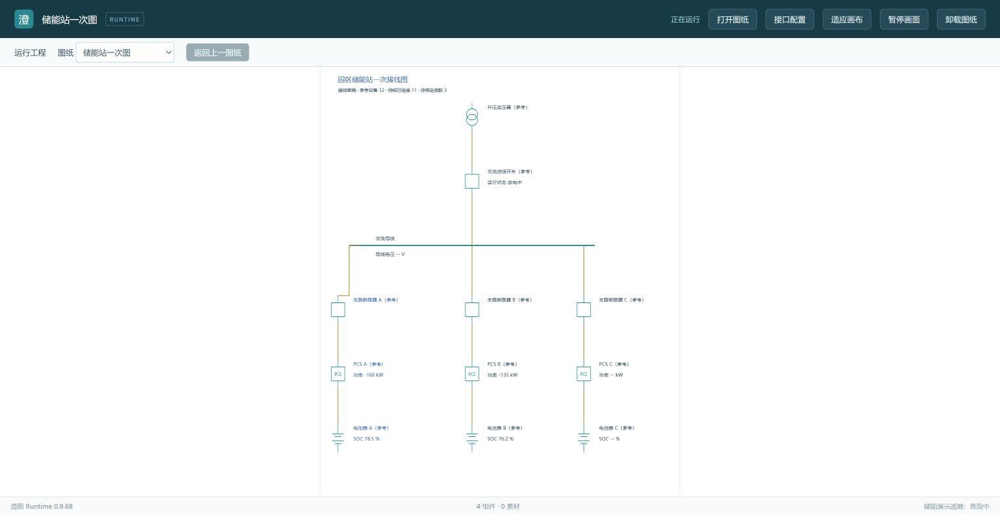

# 13.3 跟着 AI 绘制储能一次接线图

[返回 AI 绘图](13-AI绘图.md) · [一次图功能说明](13.2-AI电力一次图与设备测点.md)

本章从一个空白示例工程开始，带你完成「安装技能 → 告诉 AI 需求 → 查看初稿 → 连续修改 → 核对并保存」。完成后，你会得到一张包含交流母线、三个储能支路、功率和 SOC 的可编辑一次接线图。

本章使用澄图 Windows x64 0.9.68、一个能读取本机文件和执行命令的 AI 工具，以及随包提供的合成设备资料。图片来自本章样例工程的实际运行画面。不同模型生成的排版可能不同，请按每步的检查项核对；本章的提示词不是固定图片生成指令。

> 这里使用的是外部 AI 工具，不是澄图编辑器内的 AI 助手。AI 需要在你的电脑上调用 `chengtu-cli.exe`。只有聊天功能、不能读取文件或执行命令的工具，不能独立完成这些步骤。

## 先看这一轮要做什么

| 步骤 | 你告诉 AI 的事情 | 应得到的结果 |
| --- | --- | --- |
| 准备 | 告诉 AI 技能、CLI 和工作目录在哪里 | AI 读到当前能力与示例文件 |
| 第一轮 | 画一张储能站三支路一次图 | 母线、A/B/C 三支路及独立读数 |
| 第二轮 | 改标题，用蓝色强调 A 回路文字 | 原图保留，只改变指定文字 |
| 第三轮 | 把 A 回路整体左移 80 | A 的设备和读数一起移动，B/C 保持 |
| 取数验证 | 只改 A 的模拟功率 | A 显示 -160，B 仍为 -135，C 仍为 -- |
| 交付检查 | 核对映射、连接、数据质量及保存文件 | 得到可继续编辑的工程和核对清单 |

需要对照时，可下载本章[示例资料包](examples/draw/electrical-walkthrough.zip)，其中包含三轮参考方案、每轮工程、模拟响应和复现脚本。正常跟做时先使用本机导出的技能包即可，不必先下载资料包。

## 第 1 步：准备独立练习目录

先安装澄图。在安装目录找到 `chengtu-cli.exe`，记录它的完整路径。在 PowerShell 中执行下面的命令；把第一行改成你的实际安装路径。这里将练习目录放在「文档」中，避免在程序安装目录保存工程。

```powershell
$cli = 'D:\Program Files\Doenergy\澄图2D\chengtu-cli.exe'
Test-Path -LiteralPath $cli
$demo = Join-Path ([Environment]::GetFolderPath('MyDocuments')) 'Chengtu-AI-一次图练习'
New-Item -ItemType Directory -Path $demo -ErrorAction Stop
Set-Location -LiteralPath $demo
```

`Test-Path` 应显示 `True`。若是 `False`，先修正 CLI 路径。若练习目录已存在，换一个新名称，例如 `Chengtu-AI-一次图练习2`，不要覆盖旧练习。

后文中「练习目录」都指这里的 `$demo`。在外部 AI 工具中打开这个目录作为项目或工作目录。

## 第 2 步：导出完整 Skills 文件夹

仍在刚才的 PowerShell 中执行：

```powershell
& $cli skills --out (Join-Path $demo 'chengtu-draw')
Test-Path .\chengtu-draw\SKILL.md
Get-ChildItem .\chengtu-draw\assets
```

CLI 返回 `status: exported`，第二条命令返回 `True`。关键文件应如下：

```text
Chengtu-AI-一次图练习/
└─ chengtu-draw/
   ├─ SKILL.md
   ├─ references/
   │  ├─ electrical.md
   │  └─ device-catalog.md
   └─ assets/
      ├─ storage-electrical.ctproj          空白工程
      ├─ storage-topology-plan.json         三支路设备与连接
      ├─ storage-electrical-data.json       变量和取数字段
      ├─ storage-device-catalog.json        设备测点对应关系
      ├─ storage-electrical-config.json     本机模拟接口配置
      └─ storage-electrical-response.json   本机模拟响应
```

必须保留整个文件夹。只复制 `SKILL.md` 会缺少操作说明与样例。导出目录已存在时，换一个新目录；CLI 不覆盖已有文件。

## 第 3 步：安装技能并让 AI 确认能调用工具

### 使用 Codex

把技能安装到本练习项目的 `.agents/skills` 目录：

```powershell
New-Item -ItemType Directory -Path .\.agents\skills -Force
Copy-Item -LiteralPath .\chengtu-draw -Destination .\.agents\skills\chengtu-draw -Recurse
Test-Path .\.agents\skills\chengtu-draw\SKILL.md
```

最后应返回 `True`，目录应是 `.agents/skills/chengtu-draw/SKILL.md`，不要多套一层同名文件夹。在 Codex 中打开本练习目录；如果当前会话未发现新技能，重新打开此项目的会话，再发送下面的提示词。Codex 的项目级技能目录可参考[官方安装说明](https://developers.openai.com/api/reference/cli#use-the-cli-from-a-coding-agent)。

### 使用其他能运行本机命令的 AI 工具

若工具提供本地技能导入，导入整个 `chengtu-draw` 文件夹，具体目录按该工具的说明选择。若不支持技能目录，可以不做复制，直接让 AI 读取练习目录下 `chengtu-draw/SKILL.md` 及其引用文件，再执行本章任务。两种方法选一种即可。

### 发给 AI 的准备提示词

复制下面的内容，补上两处完整路径。Codex 可以保留第一行的 `$chengtu-draw`；其他工具删掉该行，用实际技能路径唤起。

```text
$chengtu-draw
请用澄图 CLI 帮我绘制并修改一张储能站一次图。
CLI 完整路径：D:\Program Files\Doenergy\澄图2D\chengtu-cli.exe
练习目录：这里填写刚才创建的完整目录路径

先阅读 chengtu-draw/SKILL.md、chengtu-draw/references/electrical.md 和
chengtu-draw/references/device-catalog.md，再执行 CLI 的 schema 和 inspect，确认能力。
本次只使用练习目录中的合成资料，不连接真实设备。
不要修改安装目录和技能包原文件，不要覆盖已有工程。
每轮先生成预览和检查清单，等我看完后再另存为新工程。
现在只检查环境，告诉我 CLI 是否可用、空白工程是否可读、准备使用哪些样例文件。
```

检查 AI 是否确实执行了命令，而不只是说「可以」。它应识别 `storage-electrical.ctproj`、`storage-topology-plan.json`、数据契约和设备目录，并列出当前支持的一次图模型。找不到命令时，先核对路径和该 AI 工具的本机命令权限。

## 第 4 步：第一轮——生成三支路一次图

继续给同一个 AI 会话发送：

```text
开始第一轮。使用 chengtu-draw/assets/storage-electrical.ctproj 作为空白工程。
根据 assets/storage-topology-plan.json 的真实内容生成三支路储能一次图，
标题为“储能站三支路一次图”，按连接关系自动排布，不手工猜坐标。

使用 assets/storage-electrical-data.json 声明变量，
使用 assets/storage-device-catalog.json 匹配每台设备的测点。
应有交流进线、交流母线和 A/B/C 三个储能支路，
各支路包含断路器、PCS 和电池簇。
A/B 分别绑定自己的功率和 SOC，C 的功率、SOC 以及母线电压保持未绑定，显示 --。
参考设备和待确认接线按样例保留，不能为了消除提示把 verified 改成 true。

把方案保存为 01-generate.json；先 preview，浏览器预览目录为 preview-01。
将随包的本机模拟配置和响应复制到预览目录，启动 serve，
给我包含 config 参数的完整预览地址，以及设备、连接、绑定和未匹配清单。
此时不要 apply。
```

打开 AI 给出的地址，例如 `http://127.0.0.1:4181/project.html?config=./storage-electrical-config.json`。端口以实际输出为准；必须保留 `config` 参数，浏览器才会读取示例模拟数据。



你应看到 12 个设备和 11 条连接，A/B/C 三列支路；A 功率 `-120 kW`、SOC `78.5 %`，B 功率 `-135 kW`、SOC `76.2 %`。C 的两个读数和母线电压为 `--`。负功率在本示例中约定表示放电。

本图简化图符表达接线草稿，不包含设备实际分合状态；棕色连线表示连接待核对。对照支路名称和读数确认后，发送：

```text
第一轮预览符合要求。沿用这一轮相同的输入工程、方案、数据契约和设备目录，
使用 preview 返回的 baseSha256 作为 --expect-base，
apply 并另存为 01-初稿.ctproj，然后 inspect 这个新文件。
列出保存后的三条回路及未绑定项，不要覆盖空白工程。
```

确认练习目录中出现 `01-初稿.ctproj`。后续每轮都从最新保存的工程继续，不再从空白工程重建整张图。

## 第 5 步：第二轮——改标题并强调 A 回路文字

```text
继续修改 01-初稿.ctproj，不重新生成整张一次图。
标题改成“园区储能站一次接线图”，文字颜色改为 #2458a6。
把 A 回路的断路器、PCS、电池簇名称及功率、SOC文字也改为 #2458a6。
这只是文字排版强调，不表示带电或设备状态。

先 inspect 定位稳定对象 ID。只修改指定文字内容和文字颜色，
保留 A/B/C 设备 ID、位置、尺寸、连接、变量、取数路径、单位和表达式。
不要把功率或 SOC 的表达式替换成固定文字。
方案保存为 02-emphasize.json，预览目录为 preview-02。
给我新预览地址、具体变化项和保存前的映射/连接检查结果，先不 apply。
```



对比第一轮：顶部标题和 A 回路文字改变，B/C 和全部几何位置保持。A/B 读数仍独立更新。确认后发：

```text
第二轮预览符合要求。使用本轮 preview 的基线哈希，
另存为 02-文字调整.ctproj，再 inspect 保存文件。
确认 changedReadings 和 changedConnections 都为空。
```

这两个列表为空表示没有检测到已声明读数映射或连线端点变化，不代表完整电气业务已正确。

## 第 6 步：第三轮——整体移动 A 回路

```text
基于 02-文字调整.ctproj，把 branchA（储能支路A）整体向左移动80个画布单位，
纵向不变。使用当前 schema 支持的 circuit-move 方案，不重新生成整图。
设备、设备标签和读数一起移动；交流母线、B/C回路保持原位，
连接端子身份、变量绑定和蓝色文字保持。

方案保存为 03-move.json，预览目录为 preview-03。
先检查几何提示、changedReadings、changedConnections，给我预览后再保存。
如果遇到锁定、位置绑定、成员缺失或连接变化，停止并说明，不能删除保护信息。
```


「80」指画布坐标，不是屏幕像素，缩放后实际屏幕位移会不同。本例左移后 A 的三台设备、名称及读数一起靠左，连接仍指向原端子。看完再发送：

```text
第三轮预览符合要求。另存为 03-回路左移.ctproj，再 inspect。
请比较第二轮和第三轮：只有 A 回路成员的 X 坐标减80，
其他对象和所有变量配置保持，列出核对结果。
```

本章参考方案中的第三轮内容如下。AI 应先读取当前 schema，而不是猜测接口：

```json
{"format":"chengtu.electrical.circuit-move","version":1,"circuitId":"branchA","dx":-80,"dy":0}
```

## 第 7 步：用一次取数变化检查有没有绑错设备

保持第三轮预览运行，发送：

```text
只修改 preview-03 目录里的 storage-electrical-response.json，
把 data.meterA.power 从 -120 改为 -160，其他字段不变。
不要修改技能包原响应，不要修改工程、变量绑定或 B/C 测点。
告诉我如何观察 A/B/C 的变化，修改完等待我检查。
```



等候一次轮询后，应只有 A 的功率变为 `-160 kW`，A 的 SOC 仍为 `78.5 %`，B 仍为 `-135 kW / 76.2 %`，C 仍为 `--`。这能发现「多个回路误用同一个变量」的常见问题。若没有变化，检查预览 URL 的配置参数和 AI 修改的响应文件是否位于当前预览目录。

本步的响应变化不会写回 `.ctproj`。工程保存了取数规则；模拟接口地址通过运行配置提供。

## 第 8 步：检查并交付最终工程

给 AI 最后一条检查提示词：

```text
检查 03-回路左移.ctproj，输出一份最终核对清单，暂时不要再改图。
1. 三个回路各自的设备、读数、内部及边界连接。
2. A/B功率和SOC分别对应哪个设备ID、变量ID、JSON路径和单位。
3. changedReadings、changedConnections，以及未绑定项。
4. 未确认连接、referenceOnly设备和仍需人工确认的事项。
5. 本轮预览几何检查提示，不能把提示清零当作业务验收。
6. 本次实际生成的工程文件、方案文件和可用预览地址。
若没有当前运行质量快照，只报告静态绑定检查，不能编造实时 good 或更新时间。
```

按下表核对。参考样例的预期结果如下：

| 检查项 | 预期 |
| --- | --- |
| 回路 / 设备 / 连接 | 3 / 12 / 11 |
| A 功率 | meterA / power → storage.A.power → /data/meterA/power，kW |
| A SOC | meterA / soc → storage.A.soc → /data/meterA/soc，% |
| B 功率 | meterB / power → storage.B.power → /data/meterB/power，kW |
| B SOC | meterB / soc → storage.B.soc → /data/meterB/soc，% |
| 未绑定 | voltage、powerC、socC，共 3 项 |
| 映射或连接已变化 | changedReadings、changedConnections 都为空 |
| 接线确认 | 11 条连接仍待确认；12 台设备仍标为参考，不替你自动确认 |
| 样例几何提示 | 本章三轮参考方案均为 0；AI 自行调整后以实际输出和画面为准 |

然后在澄图编辑器中「打开工程」，选择 `03-回路左移.ctproj`。检查标题、文字颜色与回路位置，再进入独立运行预览。在运行环境的接口配置中加载本练习的模拟配置；相对响应路径需以实际运行页面能访问到的位置配置，不要假定浏览器预览目录中的相对地址会自动适用于桌面运行环境。

完整运行环境可使用「质量清单」查看本次观测结果，操作见[逐回路运行数据质量](13.2-AI电力一次图与设备测点.md#查看逐回路运行数据质量)。只有拿到实际采集的快照时，才让 AI 执行 `inspect --data-snapshot`。静态绑定正确、数据质量正常、连接已经人工确认，是三个分别检查的事项。

重新打开保存工程后对象仍可选中和编辑，才完成「生成可编辑图纸」这一步。演示通过后停止不再使用的预览服务，回到启动它的终端按 Ctrl+C。

## 跟做不一致时怎么办

| 现象 | 处理方法 |
| --- | --- |
| AI 只回复图片或示意代码 | 说明要交付 `.ctproj`，要求读取 Skills 并实际执行 CLI；确认该工具能调用本机命令 |
| AI 找不到技能 | 核对 `SKILL.md` 的完整路径与目录层级，直接要求读取该文件及 references |
| CLI 不支持某个命令/字段 | 让 AI 重新读取本机 CLI 的 schema，按实际能力生成，不继续套用旧格式 |
| 输出目录或工程已存在 | 使用新的编号；不要删原文件或强行覆盖 |
| preview 返回 needs_input | 先补充问题，再 preview；不要直接 apply |
| apply 提示基线变化 | 重新 inspect 当前工程并 preview，使用新基线，不能复用其他轮次的哈希 |
| 只想改一点却生成整张新图 | 指明「以最新工程做增量修改」，保留对象 ID 与绑定 |
| 几个支路的数值一起变 | 对照设备目录和取数路径逐项检查，不只看变量显示名 |
| C 显示了 A 的数字 | 该示例 C 没有测点，应恢复未绑定，不复制 A/B 数据凑齐 |
| 移动被保护规则拒绝 | 让 AI 解释锁定、位置绑定、端点或折点变化；先核对原因，不删除保护 |

## 把这个方法用于自己的项目

把第一轮提示词中的样例资料换成你的设备清单、已确认连接和脱敏接口样例，并明确设备 ID、测点字段、单位及未提供的资料。后续继续用「改哪个对象 → 改成什么 → 哪些必须保持 → 如何检查 → 另存哪个文件」描述每轮任务。

例如：

```text
基于上一轮保存的工程，只把2号储能支路的标签改成“东区储能”，
其余设备、连接和绑定保持。先预览并列出修改对象，确认后另存新工程。
```

先从一个站点、少量回路开始，完成一轮「生成—查看—修改—取数核对」后再扩大。复杂环网、汇合、专业接线辅助和带电拓扑能力请按当前版本支持范围安排，不能让 AI 省略真实接线以通过排布。
