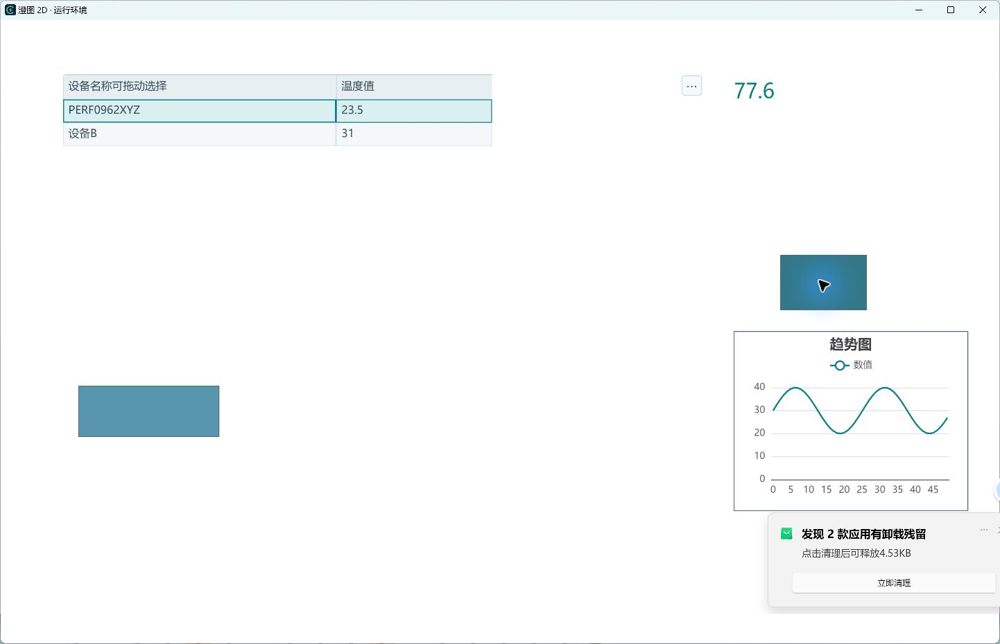
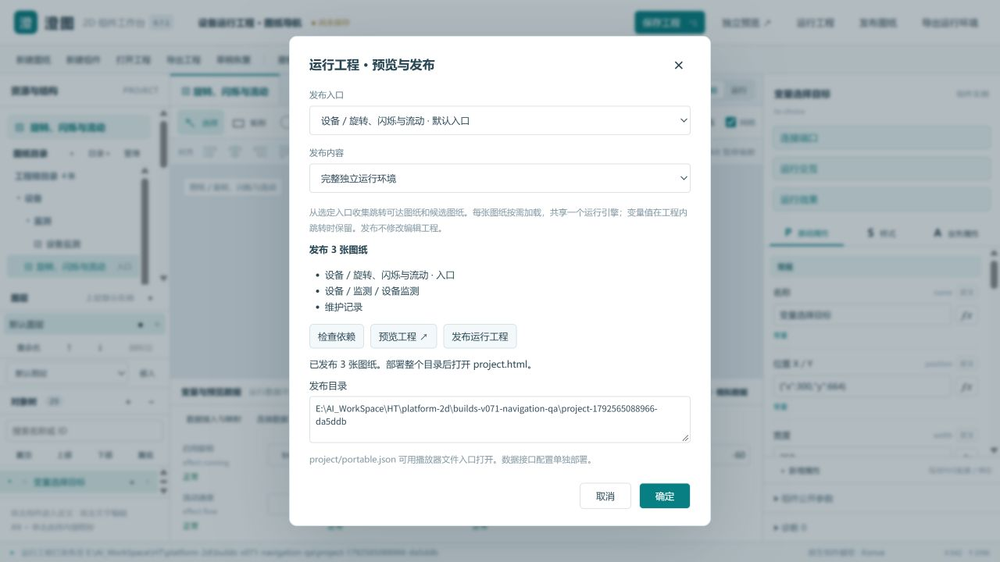

# 15 预览、独立运行与部署

[返回总目录](00-阅读指南与总目录.md)

编辑时可用画布右上角「运行」切到编辑器内的运行态，再用「编辑」返回。桌面版顶部「运行环境预览」会先保存工程，再启动或激活同目录的独立运行环境。用预览核对图纸打开、按钮交互、跳转和数据读取。

图 15-1。在独立运行窗口中，可以查看图纸并编辑已设为可编辑的表格。

| 「发布」菜单 | 用途 |
| --- | --- |
| 运行工程 | 从指定入口收集可跳转的图纸，检查依赖、预览或发布多图纸运行工程。 |
| 发布图纸 | 将当前图纸制作为可由播放器加载的运行包。 |
| 导出 Web 工程 | 获取浏览器部署所需的运行文件。按导出目录所附说明部署。 |
| 导出桌面运行程序与工程 | 生成适用于 Windows 的运行交付内容。保留导出目录中的程序、工程和附带资源。 |

在「发布 → 运行工程」中，按下表配置。

图 15-2。发布前先选入口图纸，再查看依赖检查结果。

| 项目 | 用途与填写方式 |
| --- | --- |
| 发布入口 | 从工程已有图纸中选启动画面，默认取当前图纸。切换后重新检查依赖。 |
| 发布内容 | 默认「完整独立运行环境」，包括运行引擎。已有兼容的部署引擎时可选「仅运行工程」。 |
| 检查依赖 | 显示本次纳入发布的图纸和入口。核对预期跳转的页面是否在列表中。 |
| 预览工程 | 按选定入口打开运行预览。 |
| 发布运行工程 | 生成运行文件并返回发布目录。发布目录为只读结果。 |

完整 Web 运行工程部署到 HTTP 静态文件服务后打开 `project.html`。仅发布运行工程时，将 `project` 目录放到兼容引擎旁，打开 `project.html?project=./project/project.json`。也可从播放器文件入口打开 `project/project.ctrun`。在目标环境单独配置数据地址与凭据，按第 08 章检查连通性和变量质量。
