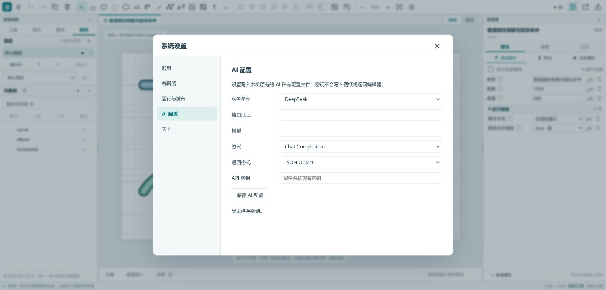

# 16 系统设置与故障排查

[返回总目录](00-阅读指南与总目录.md)

在编辑器选择「工程 → 系统设置…」，左侧选择配置页，右侧查看或修改对应设置。

图 16-1。左侧切换设置类别，右侧修改对应选项。

| 配置页 | 项目 | 用途与填写方式 |
| --- | --- | --- |
| 通用 | 默认工程目录 | 填入有访问权限的文件夹路径，或点击「选择…」选取目录。点击「保存工程目录」并重启编辑器后生效。既有工程仍存于原位置。 |
| 通用 | 恢复默认面板布局 | 将编辑器各面板恢复到默认布局。找不到关闭的面板时可使用。 |
| 编辑器 | 显示画布网格 | 控制画布参考网格是否可见。 |
| 编辑器 | 吸附参考线 | 控制拖放或编辑图元时是否吸附参考线。 |
| 编辑器 | 显示全部属性 | 展开完整属性列表，便于查看通常隐藏的属性。 |
| 运行与发布 | 打开独立预览、导出桌面运行程序与工程 | 快速打开第 15 章所述功能。入口图纸与运行属性在图纸检查器设置。 |
| AI 配置 | 服务类型 | 选择 DeepSeek 或兼容接口。 |
| AI 配置 | 接口地址 | 输入模型服务提供的接口 URL。 |
| AI 配置 | 模型 | 填写服务端提供的模型标识。 |
| AI 配置 | 协议 | 按服务支持的协议选择 Chat Completions 或 Responses。 |
| AI 配置 | 返回格式 | 选择 JSON Object 或 JSON Schema，按服务端支持情况设置。 |
| AI 配置 | API 密钥 | 填入服务密钥。留空保持已保存的密钥。保存后写入本机私有配置。 |
| 关于 | 系统版本 | 查看实际运行版本，用于核对手册与发布工程的适用范围。 |

| 现象 | 检查方法 |
| --- | --- |
| 面板找不到 | 先检查视图菜单与折叠状态，再用「恢复默认面板布局」。 |
| 预览不是预期图纸 | 检查保存状态、入口图纸和当前运行工程。 |
| 数据无值或质量异常 | 查看「数据接入」和「诊断」，核对地址、字段路径、变量类型和数据质量。 |
| AI 无法生成 | 核对地址、模型、协议、返回格式和密钥。若提示需要确认，补齐需求后再次生成。 |
| 同一工程在不同电脑效果不同 | 先核对引擎版本，再核对本机数据配置及组件、字体和素材是否齐全。 |

常用术语见第 00 章。工程保存使用 Ctrl+S，绘图操作与快捷键见第 04 章。
